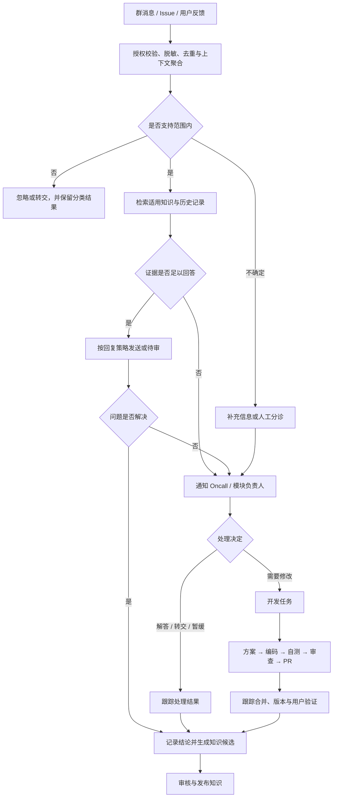

# AgentOwl 需求文档

版本：v0.1 · 评审草案  
日期：2026-10-27  
定位：面向 AgentOwl 的用户支持、Oncall 分流与受控开发机器人。

本文描述拟建设的产品能力和验收要求，尚不代表功能已经实现。技术栈及部署要求按项目约定确定；首期范围、默认策略和验收指标为本次评审建议。

## 1. 产品目标

AgentOwl 持续接收授权群聊、Issue 和用户反馈，识别支持范围内的问题，结合模块文档与历史处理记录解答；无法可靠解答时，将完整上下文交给对应处理人。开发者确认需要修改后，系统在审批或已配置策略的控制下完成分析、开发、自测和提 PR，并将处理结果沉淀为可追溯的知识。

产品需要达成四个结果：

1. **问题能被接住**：公开群、外部群及 Issue 中的支持问题进入统一处理队列，有状态、有负责人。
2. **回答有依据**：答复使用适用版本的有效知识，附可访问的依据；证据不足时补问或转人工。
3. **修改可控推进**：反馈、开发决定、执行步骤和审批分开记录，开发者可以逐步批准，也可以配置自动审批策略。
4. **处理经验可复用**：问答、排障、代码修改、测试和最终结果关联，经过确认的知识用于后续回答。

首期建议服务一个 Auth 维护团队，接入一个代码托管平台、一个主仓库和一个开发执行器，跑通完整闭环。

## 2. 用户与权限

| 角色 | 主要操作 | 权限边界 |
|---|---|---|
| 提问者／反馈者 | 在群内提问、补充信息、反馈是否解决 | 不要求登录 Web；不因发言或点击公开卡片获得开发权限 |
| Oncall／处理人 | 认领、回复、分类、合并问题、转交、确认解决 | 按被授权的团队、渠道和问题范围处理 |
| 模块负责人／开发者 | 确认修改、审批方案与执行步骤、接管开发任务 | 按负责模块、仓库与操作类型授权 |
| 知识维护者 | 审核问答、维护模块文档、发布或废弃知识 | 不能将无发布权限的内部材料提升为对外知识 |
| 管理员 | 管理接入、成员权限、负责人映射和审批策略 | 策略变更留痕；不隐式获得所有仓库操作凭据 |

一人可承担多个角色。Web 端建议使用团队身份登录；具体身份源待确认。卡片中的操作者必须映射到系统已授权身份，授权判断由后端执行。

## 3. 范围与接入边界

### 3.1 首期功能范围

| 能力 | 首期要求 |
|---|---|
| 群消息接入 | 支持官方应用机器人；按群配置采集、触发及回复策略，覆盖经验证可接入的公开群和外部群 |
| 个人账号接入 | 作为目标群的备选接入方式；选用时验证用户授权、消息可见范围、读取／回复能力后启用 |
| Issue 与反馈 | 同步指定代码平台的 Issue、评论和状态；支持 Web 手工登记与关联消息 |
| 支持范围识别 | 分类、提取环境信息、聚合重复反馈、判断是否需要补问或人工介入 |
| 自动答疑 | 基于授权知识回答，支持只生成草稿、人工发送、符合策略自动发送 |
| Oncall 分派 | 按模块与负责人映射通知，支持认领、转派、超时升级和人工接管 |
| 受控开发 | 确认修改、方案、代码、自测、审查、提 PR；逐步人工审批或按策略自动审批 |
| 知识维护 | 维护历史问答与模块文档，支持来源、版本、可见性、审核、过期和撤回 |
| Web 管理 | 问题工作台、审批中心、任务详情、知识库、接入与策略管理 |
| 运行保障 | 幂等、失败恢复、权限校验、审计、预算限制、暂停与停止 |

首期按选定的可行接入方式覆盖目标群，不要求同时实现应用机器人和个人账号两套连接器。开发流程交付到 PR，持续同步其审查与合并状态。自动合并、发布生产版本、生产环境修复不纳入首期。暂不建设通用工作流编排器、完整排班系统或多团队 SaaS 平台。

### 3.2 不同接入方式的能力

| 接入方式 | 产品要求 | 启用条件 |
|---|---|---|
| 内部公开群应用机器人 | 采集授权范围内消息，按原话题回复 | 加入群聊并获得实际所需权限；公开群不等于默认可采集 |
| 外部群应用机器人 | 收集反馈、回复、关联内部处理记录 | 目标飞书／Lark 区域、应用类型和租户实际支持，并完成外部群验证 |
| 用户身份／个人账号连接器 | 收集获准会话内容，按核实的能力回复或转人工 | 明确授权范围与凭据生命周期，验证实时、历史、回复三项能力 |
| 群自定义 Webhook 机器人 | 用于通知或链接到 Web 工作台 | 不承担群消息采集；审批可跳转到已登录的 Web 页面 |
| Issue 连接器 | 同步新建、评论、标签、状态与关联 PR | 配置仓库白名单和最小操作权限；首期实现一个代码平台 |
| Web 手工录入 | 登记无法自动采集的问题，保留来源与附件 | 由具备问题处理权限的人员录入 |

飞书官方文档描述了企业自建应用开启对外共享后接入外部群的能力；普通群消息接收与仅接收 @ 消息需要区分权限。此能力须在目标租户验收，不能直接推定所有 Lark 环境一致。[外部群机器人说明](https://open.feishu.cn/document/develop-robots/add-bot-to-external-group?lang=zh-CN)、[接收消息事件](https://open.feishu.cn/document/uAjLw4CM/ukTMukTMukTM/reference/im-v1/message/events/receive)

用户身份可调用的历史消息接口不等同于个人账号全部实时消息能力；其可见范围和应用类型另有约束，接入验证时应确定两类连接器是否需要独立应用配置。群自定义 Webhook 机器人也不能替代消息采集与应用机器人交互回调。[历史消息接口](https://open.feishu.cn/document/uAjLw4CM/ukTMukTMukTM/reference/im-v1/message/list)、[自定义机器人指南](https://open.feishu.cn/document/client-docs/bot-v3/add-custom-bot?lang=zh-CN)、[自定义机器人卡片](https://open.feishu.cn/document/feishu-cards/quick-start/send-message-cards-with-custom-bot)

每个连接器必须显示实际能力：实时 @ 消息、实时普通消息、历史补采、附件读取、回复和交互审批。没有权限、失去连接或历史缺失时，明确显示覆盖缺口。手工录入可保障处理连续性，但不能作为外部群或个人账号自动接入已完成的验收依据。

## 4. 核心流程



开发链路中的每个阶段由独立审批或有效策略放行。提 PR、合并、发布以及用户问题解决是不同状态，不自动互相代替。

例如，用户反馈“登录成功后访问接口仍提示无权限”：机器人先识别版本、环境、身份和错误码；有对应版本的已确认排查步骤时回复，否则交给负责人。负责人确认是回归缺陷后批准开发任务，系统准备修复、自测和 PR。只有确认修复已在适用版本生效，才向用户给出“已修复”的结论。

## 5. 功能需求

### 5.1 消息、Issue 与上下文采集

- **IN-01 授权配置**：按租户、身份、群、仓库配置允许采集的范围及开始时间；接入时提供权限检查与试运行结果。
- **IN-02 消息内容**：首期处理文本、富文本、引用和话题上下文；图片及日志附件默认保留来源引用，按授权需要读取，不统一归档原始附件。无法解析的附件明确标记，不假定已理解其内容。OCR 和复杂文件解析后续按需要增加。
- **IN-03 历史补采**：在权限与平台能力允许的范围内分页补采，记录时间区间、游标、失败和缺口；实时消息与历史数据按稳定身份合并，不宣称历史绝对完整。
- **IN-04 会话聚合**：优先按话题／回复关系归集；同群连续描述可形成一个问题，跨群同类反馈可关联为一个缺陷。保留来源，不把其他群的私有上下文公开转发。
- **IN-05 变更处理**：平台支持时同步编辑、撤回、删除和 Issue 关闭／重开；涉及已生成结论的内容变化触发重新评估。连接器不支持的事件类型显示在能力说明中。
- **IN-06 去重与防回环**：同一事件重复投递、历史重放、机器人自己发送的消息不重复创建问题或触发对话；外部写入失败或结果未知时先核对结果，再决定重试。
- **IN-07 降级**：权限被收回、账号失效、限流或连接中断时暂停对应动作、记录故障并通知管理员；恢复后从可用断点继续。
- **IN-08 上下文读取**：开发任务冻结请求人、会话、信息版本和资料索引，按需分页读取消息、参考信息和阶段结果。分页给出内容摘要及续读位置，来源覆盖度明确可见；来源权限撤销后不能继续读取。
- **IN-09 飞书身份绑定**：已有成员可在个人中心通过飞书授权绑定账号，绑定后可用飞书登录；消息、任务和卡片审批识别同一成员。绑定不改变角色和资源范围，解绑或停用后相关登录与操作权限失效。

### 5.2 支持范围识别与问题归档

- **TR-01 分类范围**：按当前团队配置的产品、模块、仓库与接入渠道判断是否属于支持范围；最终类别与负责人以目标模块清单为准。
- **TR-02 分类结果**：输出“范围内／范围外／不确定”、问题类型、简要依据和涉及模块；模型判断允许人工纠正，纠正进入评估样本。
- **TR-03 问题类型**：使用咨询、配置或权限问题、疑似缺陷、功能建议、安全事件。邻接问题可标记为“影响支持范围，归属待定”，避免直接误派到开发。
- **TR-04 环境信息**：按需要收集产品版本、系统与架构、飞书／Lark、生产／测试环境、认证方式、相关命令、错误码、脱敏日志、复现步骤、预期与实际结果。缺失字段不阻止建单。
- **TR-05 优先级**：建议 P0 为大范围不可用或疑似凭据泄露，P1 为核心流程受阻，P2 为局部缺陷与一般咨询，P3 为建议；最终级别可人工调整。安全事件转受限渠道处理。
- **TR-06 重复问题**：关联已有问题、已知缺陷和 PR；自动合并仅在确定规则内执行，语义相似的候选由处理人确认，并允许拆分。

### 5.3 自动答疑

- **QA-01 检索范围**：从已授权且适合当前受众的模块文档、已发布 FAQ、已确认历史问答、已知问题和版本说明检索。
- **QA-02 回答依据**：回复包含直接结论、必要操作步骤、适用版本／环境和可访问来源。无法确认的判断标为待验证，不编造命令、接口、版本行为或处理进展。
- **QA-03 自动发送门槛**：问题属于支持范围，必要环境已知，来源有效且无关键冲突，接收者有权获得回答内容，并符合渠道回复策略。模型自报的置信度不能单独决定发送。
- **QA-04 补问**：优先一次性收集最少必要信息；连续补问仍无法定位、用户明确要求人工、证据冲突或超过处理时限时转人工。
- **QA-05 触发策略**：每个群可选仅 @／回复机器人、主动识别后回复、只采集并生成草稿；采集权限与回复策略分别设置。首期建议先观察，再按群启用主动回复。
- **QA-06 输出保护**：不索取完整 Token、Cookie、私钥或 App Secret；指导用户提供脱敏信息。内部文档内容、带访问凭据的链接和其他用户身份信息不得进入对外回复。
- **QA-07 人工接管**：处理人可随时暂停机器人回复、编辑草稿或直接接管；恢复自动回复需要明确操作。对方机器人的连续回应不构成新的回复授权。
- **QA-08 效果反馈**：提供“已解决／未解决／转人工”等反馈入口。发送成功不自动记为问题已解决；未反馈按“待用户反馈”统计。

### 5.4 Oncall 与开发者协作

- **OC-01 路由**：按模块负责人映射到主处理人、备用处理人和通知渠道；无匹配进入默认 Oncall 队列。首期支持人工维护当前值班人，无需完整排班系统。
- **OC-02 通知内容**：包含问题摘要、优先级、脱敏环境、已尝试步骤、分类依据、来源链接及建议下一步；接收者须有权查看这些信息。
- **OC-03 操作入口**：应用机器人卡片或 Web 支持认领、转交、补问信息、回复、标记重复、暂缓、确认修改、拒绝修改和关闭；不能交互的渠道跳转 Web。
- **OC-04 处理决定**：“需要修改”应明确目标仓库、负责人、目标行为与验收条件；关闭或拒绝修改记录原因，并按权限给提问者可理解的进展。
- **OC-05 升级**：按优先级配置认领／处理时限、提醒间隔和备用负责人；同类爆发问题聚合通知。通知失败可重试并显示，不将未送达视为已处理。
- **OC-06 双向同步**：同步 Issue 和 PR 状态、关联后续评论；对外同步仅发布允许公开的摘要。关闭、重开及人工回复均反映到统一问题时间线。

### 5.5 自动开发流程

| 阶段 | 需要完成的工作 | 提供给下一阶段的产物 |
|---|---|---|
| 确认修改 | 明确问题、范围、仓库、负责人和验收条件 | 版本化开发任务与批准依据 |
| 准备方案 | 读取授权仓库与开发约定，分析复现条件与影响范围 | 方案、目标基线、拟修改范围、测试与风险说明 |
| 编码 | 在隔离分支／工作区实现批准范围内的变更 | 代码 diff、变更摘要、执行记录 |
| 自测 | 运行批准的构建、静态检查、测试与必要回归 | 命令、环境、退出状态和结果报告 |
| 变更审查 | 对照需求核查 diff、测试结果与范围；检查敏感信息和危险行为 | 可审批的最终变更、测试证据与限制 |
| 提 PR | 推送授权分支，创建或更新对应 PR | PR 链接、提交版本、描述、测试结果与审查人 |
| 跟踪结果 | 同步 CI、审查、合并、关闭和适用版本 | 问题进展、待处理项和知识候选 |

- **DEV-01 独立执行**：每次开发执行使用独立容器、隔离工作区和唯一任务标识；不直接修改主分支、不覆盖开发者未提交工作、不复用其他任务的临时状态。
- **DEV-02 约定继承**：遵守仓库开发约定、契约生成要求和相关检查；仓库内容与用户反馈均不能自行扩大执行器权限。
- **DEV-03 可恢复**：展示当前步骤、产物、预算和阻塞原因；支持暂停、停止、接管及从明确检查点恢复。停止后阻止新步骤和外部写入，已发生动作完整留痕。
- **DEV-04 失败处理**：复现失败、测试失败、冲突、超出范围、无权限或超预算时进入待处理；受预算限制的修复重试可由策略允许，超过次数转人工。
- **DEV-05 扩大变更**：新增依赖、修改额外模块、调整数据库、改变权限／凭据行为等超出批准范围的动作需重新评估与审批；不能靠重试绕过。
- **DEV-06 测试表述**：区分本地单测／Mock、测试环境集成和真实租户／真实平台验证；未执行的测试明确列出。通过单测不能自动宣称端到端或跨平台验证成功。
- **DEV-07 PR 质量**：描述问题、行为变化、验证结果和限制，关联原 Issue／反馈；未通过必要检查时阻止普通 PR，策略允许时可经审批创建明确标注的 Draft PR。
- **DEV-08 后续修改**：审查意见、CI 失败或基线改变引发的新修改必须重新进入受控步骤；已有 PR 更新绑定新的代码版本，不沿用已失效审批。
- **DEV-09 用户闭环**：PR 创建不标记“已修复”，PR 合并不标记“用户已升级”；按“PR 已提交／已合并／版本可用／待用户验证／已解决”表达进展。

## 6. 审批与自动审批策略

### 6.1 首期建议默认值

开发任务由授权开发者直接确认，或按任务创建策略提出建议后经统一审批创建。创建、回复、知识发布和开发步骤共用审批策略与记录。生成方案、修改代码、运行测试、审查变更和提交 PR 分别按各自策略审批，未匹配策略时人工审批。禁止优先于人工，人工优先于自动；每条策略可独立配置通知。自动审批须记录配置／策略版本和输入证据，执行前重新核对权限和来源。

| 控制点 | 建议默认 | 人工或策略需要检查的内容 |
|---|---|---|
| 对用户发送回复 | 已验证 FAQ 可按群自动发送，其余待审 | 答复正文、来源、适用版本、目标受众 |
| 确认需要修改 | 必须由授权开发者确认 | 问题、目标行为、仓库、负责人、验收条件 |
| 开始方案分析 | 确认修改后，限只读范围自动执行 | 可读仓库、基线、分析预算 |
| 开始编码 | 人工批准方案 | 方案版本、允许路径与操作、测试范围 |
| 执行自测 | 人工；可信测试集可单独配置自动 | 待测代码版本、命令、环境、网络与凭据权限 |
| 开始变更审查 | 批准范围内的只读审查可自动 | 代码版本、审查范围与预算 |
| 接受最终变更并推送／提 PR | 人工 | 最终 diff、测试报告、目标分支与 PR 内容 |
| 发布知识或对外同步结论 | 人工；已有模板可配置自动 | 知识／消息内容、可见性、来源与解决状态 |

“确认修改”是独立决定，不能从普通回复策略或问题优先级推导。任何阶段需要执行复现命令或测试代码时，均须经过“执行自测”控制点的授权。

### 6.2 策略与审批有效性

1. 策略按动作、渠道、仓库、模块、变更范围、测试结果、风险条件及预算匹配；缺少必要条件时转人工，禁止规则优先。首期采用固定字段规则表，无需流程编排语言。
2. 审批绑定问题与方案版本、仓库基线、代码 diff／提交摘要、测试产物以及目标操作；不同阶段只绑定执行该阶段所必需的证据。
3. 批准编码不能视为批准尚未生成的最终 diff；开始测试前批准待测代码与命令，提 PR 前批准最终提交和对外内容。
4. 批准后内容变化、权限撤回、策略失效或审批过期时，执行前重新核验；结果不符则失效并重新申请。
5. 卡片与 Web 使用同一授权逻辑；校验操作者、任务、动作与版本。旧卡片、转发卡片和重复点击不能产生越权或重复执行。
6. 拒绝、撤销、超时、修改后重提均有明确状态；超时不能自动视为同意。人工或自动批准均可追溯到责任主体。
7. 审批服务不可用时停止推进需要批准的动作；群消息中的“同意”、表情或模型推测不作为首期正式审批凭据。
8. 管理员可按渠道、仓库或全局暂停自动回复与开发；暂停任务恢复、已取消任务重新发起时均重新检查授权。

平台卡片回调只提供交互入口，业务审批、幂等和异步执行由 AgentOwl 负责。[回调概述](https://open.feishu.cn/document/event-subscription-guide/callback-subscription/callback-overview)

## 7. 知识与历史记录

### 7.1 知识来源和状态

| 类型 | 应保存的信息 | 用于自动回答的条件 |
|---|---|---|
| Auth 模块文档 | 模块、负责人、来源、修订版本、适用 CLI 版本与环境 | 已授权、有效且受众匹配 |
| 历史问答／排障 | 问题、环境、答复、结果、处理人、证据 | 结论经过确认；未经确认的机器人回答仅作为处理历史 |
| 已知问题／FAQ | 症状、影响范围、排查步骤、规避方案、状态 | 已审核发布，仍适用 |
| Issue／PR／版本记录 | 根因、变更、测试、合并与发布状态 | 所引用状态可核实，不把计划中的修改当作现有行为 |

知识条目采用“草稿 → 待审核 → 已发布 → 过期／已撤回”状态。每次回答保留所用知识版本与来源；知识内容更新形成新版本，既有回答保留历史依据。

### 7.2 维护要求

- **KN-01 完整处理历史**：保存授权采集范围内的问题、答复、人工修正、结果与关联开发记录；支持按问题、错误码、模块、版本和来源检索。历史消息的可获取范围由连接器能力决定。
- **KN-02 导入与同步**：首期支持仓库 Markdown、FAQ 和人工确认的问答；支持关联飞书文档。远端文档正文同步须验证读取权限与目标连接器，不能把只有链接的条目当作已读取的知识。
- **KN-03 版本适配**：同一问题在不同 CLI 版本、操作系统、认证模式或环境下可有不同答案；冲突时要求补充信息或人工处理。
- **KN-04 知识更新**：文档修订、PR 合并、发布及处理人纠错可生成知识更新候选，交由维护者确认；检测源变化后更新失效状态，记录最近同步成功时间。
- **KN-05 可见性隔离**：知识按公开、团队内部、指定渠道／对象授权管理。内部内容只有经过授权发布流程形成对外版本后，才能用于外部群；隐藏引用链接不等于内容可以公开。
- **KN-06 撤回与删除**：源权限撤销、知识废弃或数据删除后，相关检索索引同步失效；已发送内容不能假定可撤回，需要时向受影响问题发布更正。
- **KN-07 保留策略**：历史记录、原始消息、附件和审计分别配置保留期限；“维护历史”不表示无限保留全部原始聊天。期限、删除权限与备份清理规则由团队确认。
- **KN-08 可重建检索**：业务记录和来源版本为权威数据；摘要与搜索索引可重建，不将向量检索结果作为唯一事实来源。首期检索实现通过问答评测后再决定是否增加向量能力。

## 8. Web 工作台

| 页面 | 主要内容和操作 |
|---|---|
| 概览 | 待处理、待审批、未认领、超时、接入故障与正在运行的开发任务 |
| 问题收件箱 | 按渠道、模块、类型、状态、优先级和负责人筛选；搜索、认领、分派 |
| 问题详情 | 来源上下文、环境摘要、机器人依据、回复草稿、处理时间线、Issue／PR、知识关联 |
| 审批中心 | 待办、历史决定、方案／diff／测试证据、批准、拒绝、撤销与失效原因 |
| 开发任务详情 | 分阶段状态、当前动作、脱敏日志、测试产物、预算、暂停／停止／接管、PR 链接 |
| 知识库 | 文档和问答、版本、来源、可见性、审核、过期与同步状态 |
| 接入与团队设置 | 渠道能力、凭据状态、群／仓库范围、负责人、通知与成员权限 |
| 模型接口与任务执行设置 | 模型启用、地址、名称、密钥、每日 Token 预算；开发审批方式、网络、根文件系统与测试目录写入、资源模式、并发、时限和文件／工具额度，以及执行器能力和阻塞原因 |
| 策略与审计 | 阶段审批规则、回复策略、预算、操作审计与失败原因 |

关键交互要求：

- 全局可用命令面板快速查找问题、任务和知识；可搜索选择器用于群、负责人和仓库选择。
- 详情页显示“现在到哪一步、谁需要处理、下一步是什么”，失败与等待审批有明显区别。
- 高影响操作在确认界面展示具体对象、目标和影响；卡片与 Web 的审批结果保持一致。
- 主要操作支持键盘和明确的焦点状态；状态不能仅通过颜色区分。
- 用户可在飞书卡片完成常用处理；查看长 diff、复杂证据和策略配置转 Web 完成。
- 模型和执行设置允许已登录成员查看，仅管理员可修改；密钥只写不读，留空保留、显式清除，更换模型地址时需重新填写或清除密钥。配置版本冲突不得覆盖其他成员的更新。
- 保存后的模型与执行设置用于后续执行，无需重启服务；两个配置版本同时绑定开发审批。旧待执行审批失效，任务可恢复后重新审批；运行中的执行保留原模型、网络、文件系统权限和额度。页面区分已保存配置与执行器的实际能力，不能把未连接或待验证显示为可用。

## 9. 数据与状态要求

| 业务对象 | 职责与关联 |
|---|---|
| 渠道与来源事件 | 记录授权范围、连接状态、事件身份和源消息／Issue 版本 |
| 问题 Case | 聚合一次支持处理，关联来源、环境、分类、负责人和答复 |
| 开发任务与执行步骤 | 关联问题、仓库、方案、基线、产物、预算和执行状态 |
| 审批与策略版本 | 记录动作、证据、批准人／命中规则、有效期和执行结果 |
| 知识及知识版本 | 保存内容、来源、适用条件、可见性与发布状态 |
| 外部操作与审计 | 跟踪回复、通知、Issue／PR 写入及其重试／对账结果 |

问题建议状态：待分诊、待补充、处理中、待用户反馈、待修复、待版本／验证、已解决、已关闭；允许重开。重复、范围外、无法复现、无需修改作为处理结论保留。

开发任务建议状态：待确认、待审批、排队、执行中、阻塞、暂停、已取消、失败、PR 已提交、已完成。PR 已提交是开发产物状态，问题是否解决仍独立判断。

同一缺陷可关联多个问题；多个问题的公开回复与内部处理权限分别保留。每个审批、知识版本和外部操作必须能够追溯到原始问题或明确的管理动作。

## 10. 技术与部署约束

### 10.1 确定采用的技术栈

| 层级 | 选型与约束 |
|---|---|
| Web | React + Next.js + TypeScript |
| UI | Tailwind CSS 4 + shadcn-ui + Radix UI + Lucide + Geist |
| 交互增强 | Sonner 提示消息，cmdk 命令面板与可搜索选择器 |
| 状态与数据 | SWR 管服务端数据缓存，Zustand 管本地交互状态 |
| 输入校验 | Zod 校验前端表单与客户端数据边界；后端独立执行权限和输入验证 |
| 后端 | Golang；建议模块化单体 API + 独立 Worker，开发执行环境单独隔离 |
| 数据库 | PostgreSQL，保存业务状态、审批、审计和持久任务 |
| 缓存 | Redis，用于缓存、限流及临时协调；丢失缓存不能丢失审批或任务 |
| 数据与文件 | 问答、知识正文、处理记录和测试摘要保存在 PostgreSQL；必要的代码快照、较大日志与报告保存在 `./data/artifacts`，运行工作区位于 `./data/runner` |
| API 契约 | OpenAPI 3.1，权威文件为 `backend/api/openapi.yaml` |
| 客户端 | 默认 Kiota 生成 TypeScript 客户端；只有无法覆盖所需语言时才评估 OpenAPI Generator |
| 网关与部署 | 宿主机 Nginx + Docker Compose；Compose 不包含 Nginx |

Kiota 有官方 TypeScript 客户端生成流程；实施时须用本项目实际 OpenAPI 3.1 契约验证生成、序列化、鉴权、分页和错误处理，固定可用工具版本。[Kiota TypeScript 指南](https://learn.microsoft.com/en-us/openapi/kiota/quickstarts/typescript)

代码托管平台采用 GitHub；开发执行器为内置 Eino ReAct Agent 的 Runner Controller，任务在独立 Docker 沙箱中执行。模型使用 OpenAI 兼容接口，由管理员在网页选择服务与额度，配置存 PostgreSQL，密钥加密保存。Runner 宿主地址、服务令牌、镜像与磁盘边界由部署环境指定。

### 10.2 参考目录

```text
Frontend/
  app/
  components/
  lib/
    api/                 # Kiota 生成客户端与接入代码
  public/
backend/
  api/
    openapi.yaml
  cmd/
    api/
    worker/
  internal/
  migrations/
deploy/
  compose.yaml
  .env.example
  data/                  # 运行数据，不提交 Git
    postgres/
    redis/
    artifacts/
    runner/
script/
docs/
  requirements.md
```

以上为后续实现目录约定，本次仅交付需求文档。

### 10.3 工程和数据要求

1. API、Worker 与自动开发执行器通过明确业务接口变更问题、审批与知识状态；开发 Agent 不能直接写业务数据库或伪造审批记录。
2. 业务状态与待执行事件在 PostgreSQL 同一事务中提交，Worker 从持久任务恢复；必须支持幂等、重试、失败队列与执行结果对账。
3. OpenAPI 变更后生成客户端并检查生成物漂移；前端业务调用统一经生成客户端，禁止手改生成代码。
4. 运行数据全部挂载到 **Compose 文件所在目录的 `./data`**。本目录方案对应 `deploy/data`；不得将不可丢失数据仅存在容器可写层、未纳入迁移的 named volume 或宿主机其他散落目录。
5. Nginx 在宿主机负责 TLS 与入口代理；应用端口按实际入口绑定，数据库和 Redis 不公开暴露，本地文件通过业务 API 授权访问。
6. 迁移以停写的一致性备份或停机拷贝项目目录为验收方式，包含数据、部署配置及恢复所需密钥的受控备份；这些敏感材料不进入 Git。运行中直接复制数据库目录不算合格备份。
7. 恢复目标须具备兼容运行环境和镜像，校验数据库、本地文件引用、任务与审批状态，并重新验证外部连接权限。恢复后先暂停外部写入，防止重放已发送消息或已创建 PR。

## 11. 安全、质量与验收

### 11.1 必须满足的运行边界

- 群消息、Issue、附件、知识来源与仓库内容都是待处理输入，不能改变系统权限、审批规则或获取未授权凭据；提示注入不得直接触发工具执行。
- 外部回调按照平台机制校验来源与重放，业务操作继续校验操作者权限；凭据加密存储并支持撤销、轮换和失效提示。
- 普通日志、模型上下文、问题卡片和 PR 不包含 Token、Cookie、私钥、App Secret 或带访问凭据的链接；附件进入存储／模型前做必要脱敏与访问控制。
- 模型只能获取任务必要的已授权内容；模型服务的数据使用与留存设置须匹配团队要求，不能默认将所有群历史和私有代码提交给任意供应商。
- 开发与测试始终在独立容器中执行，使用专用 rootless 环境和非 root 用户；不得获得 Docker Socket、宿主 SSH 目录或其他任务凭据，模型密钥不注入容器。运行许可、撤销、暂停和停止在所有配置下有效。
- 网络默认关闭，可选择专用 Rootless Docker bridge，访问该网络可达的地址；不提供域名白名单，实际连通性由宿主路由决定。根文件系统默认只读，可允许当前用户有权限的目录写入，仍不能保证系统软件包安装可用。执行时限可设为 `1–3600` 秒，`0` 表示不设执行超时；暂停、审批失效或许可撤销仍会停止任务。
- 测试目录默认只读；允许写入时使用本次执行专属匿名 Docker 卷中的独立临时副本安装依赖和生成构建文件，新增文件不进入代码产物或后续 PR。测试修改、删除已有审批文件或改变其类型／执行权限时判定失败；相关源码或锁文件变更应在编码阶段完成并重新审批。代码快照、代码文件数、产物、工具调用次数和单次任务 Token 五项默认 0，表示不设任务额度，也支持正整数自定义；模型接口的每日 Token 总额度独立生效。设置正额度时，代码快照和文件数只约束代码输入与快照，测试新增文件不计入这两项额度；整个临时卷受专用运行盘总容量约束，执行结束后删除。
- 网页执行设置中的资源模式默认 `required`，要求实际生效的 CPU、内存和 PID 限制；未知值拒绝保存或执行。仅可信开发环境可显式选择 `disabled`，关闭这三项 cgroup 限制并强制单任务并发；必须明确告知任务可能耗尽宿主资源。资源模式不改变独立容器与运行许可边界，网络、文件系统、时限和额度由各自设置控制。
- 开发执行器与外部发布凭据分离；推送、发消息和创建 PR 由受控接口执行，且执行前再次核验审批与目标。
- 秘密泄露、审批绕过、跨渠道内容泄露和未授权外部写入属于发布阻断问题；出现时可立即停止相关自动化。

### 11.2 候选质量指标

以下为建议验收基线，需要结合试点规模和实际模型评测确认，不能作为已有性能承诺。

| 指标 | 建议目标与口径 |
|---|---|
| 支持范围识别 | 在至少 200 条脱敏、人工标注的独立样本上，精确率和召回率均达到 95%；含范围外、信息不全与相似故障 |
| 自动答复质量 | 至少 100 个独立支持问题中，获得人工认可的自动答复占已自动答复问题的 95% 以上；同时报告自动答复覆盖率，禁止靠全部转人工满足质量目标 |
| 首次响应 | 在约定负载与外部服务可用时，从本系统收到事件到首次有用答复或说明转人工，P95 不超过 90 秒；平台投递延迟单独记录 |
| 升级送达 | 从确定需要人工到首次通知成功，P95 不超过 2 分钟；无接收人、失败和重试均可见 |
| 审批与审计 | 所有受控动作都有有效审批／策略证据；测试中旧审批、重复请求和越权操作不能执行 |
| 恢复能力 | 在已持久化事件的阶段故障注入中不丢任务，不重复发消息、推送或创建 PR；结果未知进入对账 |
| 知识可信性 | 自动答复可追溯知识版本与适用范围；撤回、权限变化与跨版本冲突测试通过 |
| 运营效果 | 跟踪人工认领时间、平均解决时间、重复问题率、答复纠正率、PR 采用率及每个有效解决问题的模型成本 |

### 11.3 首期端到端验收清单

| 编号 | 验收场景 | 通过条件 |
|---|---|---|
| AC-01 | 授权内部群普通消息／@ 消息 | 按实际权限采集和识别，非授权群不采集，能力展示与实测一致 |
| AC-02 | 外部群及选定接入方式 | 在目标租户逐项验证 @、普通消息、群历史、话题回复、发送与身份失效；选用个人账号时单独验收其授权范围。记录实际覆盖，必需能力缺失则阻塞或由评审调整范围 |
| AC-03 | 已知 Auth 问题 | 自动回复正确步骤、适用条件和可访问来源，并记录所用知识版本 |
| AC-04 | 信息不足或无法回答 | 补问或通知正确负责人，保留上下文，不生成无依据结论 |
| AC-05 | Issue 与多来源重复反馈 | 关联同一缺陷，保留各来源状态与权限，不产生重复开发任务 |
| AC-06 | 开发者确认需要修改 | 形成有验收条件的任务；未获下一阶段授权前不执行对应动作 |
| AC-07 | 逐步人工审批闭环 | 方案、编码、自测、最终变更与提 PR 均按授权推进，PR 含真实测试证据 |
| AC-08 | 配置自动审批 | 符合规则的步骤自动推进；条件不足、禁止规则、范围变化或预算超限停止推进 |
| AC-09 | 旧卡片／重复回调／审批后改代码 | 旧版本不能执行，重复请求只产生一个结果，变更后重新审批 |
| AC-10 | 开发失败与人工接管 | 测试失败、冲突和停止操作均能保留产物、明确阻塞并安全恢复 |
| AC-11 | 受限知识与恶意输入 | 外部群不能获得内部答案／凭据，提示注入不能调用未授权工具 |
| AC-12 | 历史与知识沉淀 | 人工确认结论可发布为知识；错误、过期、撤回知识不再用于新答复 |
| AC-13 | PR 到用户解决 | 创建／合并 PR 不误报发布或已解决；可持续跟踪版本与用户验证 |
| AC-14 | 重启与迁移 | 从 `./data` 的一致性备份恢复业务、产物和审批，核对外部写入后恢复任务 |

## 12. 建议实施顺序与评审事项

### 12.1 实施顺序

1. **接入验证**：目标飞书／Lark 租户、公开群、外部群与选定接入方式；Issue 平台；Kiota 契约生成；执行器隔离与权限。形成能力矩阵和明确的阻塞项。
2. **支持闭环**：消息采集、支持范围分类、知识检索、回复草稿、人工接管、通知和问题工作台；先观察运行，再启用限定范围自动回复。
3. **开发闭环**：确认修改、逐步审批、隔离开发、自测和提 PR；同时具备最小规则式自动审批和全程审计。
4. **试点验收**：历史问答回收、知识更新、故障恢复、数据迁移和质量评测；达到对应验收条件后扩大渠道与自动审批范围。

前三步均属于首期完整目标；仅完成答疑不能视为完成本产品的开发闭环要求。

### 12.2 本轮需要确认的选择

| 事项 | 建议起点 | 对需求的影响 |
|---|---|---|
| 目标环境和首批群 | 明确飞书／Lark、应用归属、内部公开群与外部群清单 | 决定权限、接入验证与消息覆盖范围 |
| 是否采用个人账号接入 | 优先验证应用机器人；目标群需要个人账号时，明确已有方案与授权机制 | 决定是否实现个人账号连接器，不预设拥有全部账号消息 |
| 首期代码平台与仓库 | 一个平台、一个主仓库及 Auth 模块路径 | 决定 Issue／PR 接入、负责人和执行边界 |
| 模型与开发执行器 | 一个获准模型服务、一个可隔离的执行器 | 决定数据边界、执行能力、预算与部署方式 |
| 初始知识来源 | 指定 Auth 文档、仓库文档、FAQ 和可导入历史群记录 | 决定首期回答覆盖率与对外发布权限 |
| 审批默认值 | 修改决定由开发者确认；编码、自测、最终 diff 与 PR 默认人工，只读分析可自动 | 决定试点自动化程度；开发确认后的步骤可按规则放开 |
| Oncall 与时限 | 模块主负责人＋备用负责人，按优先级配置提醒 | 决定无人认领及紧急问题的升级路径 |
| 规模、预算和保留期限 | 确认群数、日消息量、并发开发数、模型预算和数据期限 | 决定性能验收与成本控制数值 |

## 13. 参考依据

- 用户指定的前后端技术栈、目录结构、宿主机 Nginx 与 Compose 同目录 `./data` 部署要求。
- 参考项目 [Anby-Wiki 工程约定](/Users/kirayuukiasuna/Desktop/Dev/Anby-Wiki/AGENTS.md)、[前端约定](/Users/kirayuukiasuna/Desktop/Dev/Anby-Wiki/apps/web/AGENTS.md)、[异步任务约定](/Users/kirayuukiasuna/Desktop/Dev/Anby-Wiki/Docs/adr/0003-async-tasks-outbox-queue.md)、[备份恢复规范](/Users/kirayuukiasuna/Desktop/Dev/Anby-Wiki/Docs/runbooks/backup-restore.md)：借鉴职责分工、契约、审批、持久任务与恢复原则。
- 飞书／Lark 接入能力以文中对应官方文档及目标租户验证为依据；海外区域可同时核对 [Lark 消息 FAQ](https://open.larksuite.com/document/server-docs/im-v1/faq)。平台能力、权限与审批策略在正式实施前重新确认。
