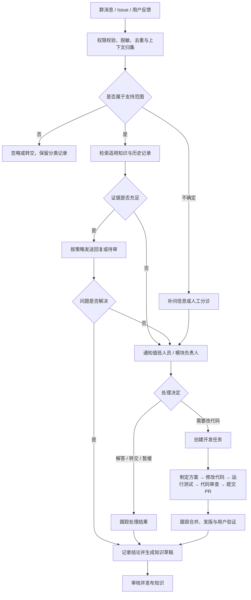

# AgentOwl 需求文档

版本：v0.1 · 需求基线  
日期：2026-10-27  
定位：面向研发团队的用户支持、值班分流与按审批推进的开发助手。

本文档描述产品目标、核心流程与验收标准（作为需求基线，实际实现状态和线上验收情况见 [运维手册](operations.md) 与 [验证记录](verification.md)）。

## 1. 产品目标

AgentOwl 负责持续承接授权群聊、GitHub Issue 和人工录入的用户反馈：先识别是否属于团队支持范围，再结合模块文档和已确认的历史排障记录给出答复；拿不准或缺少证据时，连同完整上下文转交对应负责人。遇到需要改代码的缺陷时，由开发者确认修改目标，系统在审批策略的约束下完成方案、编码、自测、审查并提交 PR，最终把解决经验整理进知识库。

这套工具希望解决四件具体的事：

1. **问题不遗漏**：内部群、外部群和 Issue 里的反馈统一归集到问题队列，有状态跟踪、有明确负责人。
2. **回答有依据**：基于适用版本的有效知识作答并附可访问来源；证据不够时主动补问或转人工，不瞎编。
3. **改代码可控**：用户反馈、开发者确认、具体步骤和审批记录各自分开，既能逐步人工把关，也能按明确规则自动放行。
4. **经验可复用**：问答、排障过程、代码改动和测试结果互相关联，经审核后沉淀到知识库，供后续排查直接复用。

首期聚焦服务一个 Auth 维护团队：接入一个代码平台、一个主仓库和一套开发执行环境，把从提问到提 PR 的完整流程跑通。

## 2. 角色与权限

| 角色 | 主要操作 | 权限约束 |
|---|---|---|
| 提问者 / 反馈者 | 在群里提问、补充信息、点击解决反馈 | 无需登录 Web；发言或点卡片不会附带开发与审批权限 |
| 值班人员（Oncall） | 认领、回复、分类、合并重复问题、转派、标记解决 | 仅限被授权的团队、渠道和问题范围 |
| 开发者 / 模块负责人 | 确认代码修改、审批各阶段产物、接管开发任务 | 按负责模块、仓库和操作类型分别授权 |
| 知识库维护者 | 审核问答草稿、维护文档、发布或撤回知识 | 不能把无权对外公开的内部资料直接发到外部群 |
| 管理员 | 配置平台接入、成员权限、值班安排与审批策略 | 所有策略变更留痕；不自动享有所有仓库的写凭据 |

一名成员可以同时拥有多个角色。Web 端支持团队统一身份源登录，飞书卡片里的操作人必须映射到系统内已授权的成员，所有权限判断一律在后端完成。

## 3. 范围与接入方式

### 3.1 首期功能范围

| 模块 | 首期要求 |
|---|---|
| 群消息接入 | 支持官方应用机器人；按群分别配置采集、触发和回复方式，覆盖实测可用的内部群与外部群 |
| 个人账号接入 | 仅作备选方案；确需使用时先单独验证授权范围、可见性以及读写能力 |
| Issue 与反馈 | 同步指定仓库的 Issue、评论和状态；支持在 Web 手动建单并关联原始消息 |
| 范围识别 | 识别是否属于支持范围、提取环境信息、发现重复问题、判断是否需要补问或转人工 |
| 自动答疑 | 基于授权知识生成答复，支持仅出草稿、人工审核发送，或命中策略自动发送 |
| 值班分派 | 按模块映射通知负责人，支持认领、转派、超时提醒与随时接管 |
| 开发执行 | 确认修改后按 `制定方案 → 修改代码 → 运行测试 → 代码审查 → 提交 PR → 跟踪 PR` 推进 |
| 知识库 | 管理历史问答与模块文档，支持来源同步、版本管理、可见范围、审核、过期与撤回 |
| Web 工作台 | 概览、问题列表与详情、审批中心、开发任务详情、知识库、接入与策略设置 |
| 稳定性与安全 | 幂等、失败重试与对账、权限隔离、操作审计、用量预算、随时暂停与停止 |

首期只需按验证通过的接入方式覆盖目标群，不必同时维护应用机器人和个人账号两套连接器。开发流程交付到 PR 并持续同步 CI/Review/合并状态；自动合并 PR、自动发版和线上故障自动修复不在首期范围内，也不做通用工作流引擎、排班系统或多租户 SaaS。

### 3.2 各类接入方式的能力差异

| 接入方式 | 预期用途 | 启用前提 |
|---|---|---|
| 内部群应用机器人 | 采集授权群消息，在原话题下回复 | 机器人进群并获得所需权限（公开群不等于自动可采集） |
| 外部群应用机器人 | 收集外部反馈、回复并关联内部处理记录 | 对应飞书/Lark 区域、应用类型与租户实测支持外部群 |
| 个人账号连接器 | 仅作特殊群的备选采集方式 | 明确授权范围与令牌生命周期，逐项验证实时、历史与回复能力 |
| 自定义 Webhook 机器人 | 单向发通知或带跳转链接到 Web | 无法采集群消息，也不能直接替代应用机器人的交互回调 |
| Issue 连接器 | 同步新建、评论、标签、状态与关联 PR | 配置仓库白名单和最小权限；首期接入一个代码平台 |
| Web 手动录入 | 补录无法自动采集的问题，保留来源与附件 | 具备问题处理权限的成员操作 |

飞书官方文档说明了企业自建应用开启对外共享后加入外部群的方式，且普通群消息与仅 `@` 消息权限分开，必须在目标租户实际测试，不能想当然认为飞书与海外 Lark 行为完全一致（参考 [外部群机器人说明](https://open.feishu.cn/document/develop-robots/add-bot-to-external-group?lang=zh-CN)、[接收消息事件](https://open.feishu.cn/document/uAjLw4CM/ukTMukTMukTM/reference/im-v1/message/events/receive)）。

同样地，用户身份调用历史消息接口不等于具备个人账号全量实时监听能力，自定义 Webhook 机器人也无法替代应用机器人回调（参考 [历史消息接口](https://open.feishu.cn/document/uAjLw4CM/ukTMukTMukTM/reference/im-v1/message/list)、[自定义机器人指南](https://open.feishu.cn/document/client-docs/bot-v3/add-custom-bot?lang=zh-CN)、[自定义机器人卡片](https://open.feishu.cn/document/feishu-cards/quick-start/send-message-cards-with-custom-bot)）。

每个平台账号都应在界面清晰展示各项能力的真实状态（实时 `@`、普通群消息、历史补采、附件读取、发消息、卡片回调）；缺权限、断连或历史存在缺口时直接标出来。手动建单可以保证日常运转，但不能拿来代替自动接入验收。

## 4. 核心业务流程

开发链路的每个阶段都由对应审批策略放行。“提交 PR”、“PR 合并”、“版本发布”和“用户问题已解决”是四个互相独立的状态，不能自动画等号。

举个典型场景：用户在群里反馈“登录成功后调用接口仍提示无权限”。机器人先提取版本、环境、认证方式和错误码，查到对应版本的排查步骤就直接答复；查不到则连同上下文转给负责人。负责人确认是回归缺陷后批准创建开发任务，系统依次完成方案、修复、自测和提 PR。直到确认修复已经在用户使用的版本里上线，才向用户同步“已修复”。

## 5. 功能需求

### 5.1 消息、Issue 与上下文采集

- **IN-01 授权范围**：按租户、应用身份、群和仓库配置采集白名单与起始时间，接入时提供权限探测和检查结果展示。
- **IN-02 消息与附件**：首期支持文本、富文本、引用回复与话题上下文；图片和日志附件默认只存来源引用，按授权按需读取，不统一落盘归档。无法解析的附件直接提示，不假装已读懂内容。
- **IN-03 历史补采**：在权限允许范围内分页补采，记录时间窗口、游标、失败原因与缺口；实时推送与历史拉取按消息唯一 ID 合并，存在缺口时如实提示。
- **IN-04 会话归集**：优先按话题/回复关系归入同一问题；同群连续发言可合并，跨群同类缺陷可关联到同一主问题，但绝不把其他群的私密上下文转发到外部群。
- **IN-05 编辑与撤回**：在平台支持的前提下同步消息编辑、撤回、删除和 Issue 开关状态；涉及已生成答复或开发输入的内容变化时触发重新评估。
- **IN-06 去重与防回环**：忽略重复投递、历史重放和机器人自己发出的消息；外部写入超时或结果不明时先核对远端状态，再决定是否重试。
- **IN-07 异常降级**：遇到撤权、令牌失效、限流或断连时暂停对应动作、记录错误并通知管理员，恢复后从断点续跑。
- **IN-08 按需上下文**：开发任务锁定请求人、会话、消息版本和资料索引，执行时分页读取消息、参考资料和前序阶段报告，每页返回摘要和游标；一旦来源撤权，立即停止读取。
- **IN-09 飞书身份绑定**：已有成员可在个人中心通过飞书授权绑定账号，绑定后可直接用飞书登录，并在消息、任务和卡片审批中识别为同一人。绑定不改变角色和资源范围，解绑或停用后对应会话立即失效。

### 5.2 范围识别与问题归档

- **TR-01 范围判定**：结合当前团队配置的产品、模块、仓库和渠道判断相关性，以维护的模块清单为准。
- **TR-02 分类输出**：给出“范围内 / 范围外 / 待判断”、问题类型、简要依据和疑似模块；允许人工纠偏，纠偏记录可用于后续评估。
- **TR-03 问题类型**：分为使用咨询、配置/权限问题、疑似 Bug、功能建议和安全事件。边界模糊的问题标为待判断，避免直接误建开发任务。
- **TR-04 环境提取**：尽量抽取 CLI/产品版本、操作系统与架构、飞书/Lark 环境、部署环境、认证方式、报错命令、错误码、脱敏日志与复现步骤；信息不全时依然正常建单。
- **TR-05 优先级**：P0 对应大面积不可用或疑似凭据泄露，P1 为核心流程受阻，P2 为局部缺陷或常规咨询，P3 为优化建议，支持人工调整；安全事件走受限渠道。
- **TR-06 重复问题**：支持关联已有问题、缺陷和 PR。自动归并只基于确定规则，语义相似项由人工确认，也允许随时拆分。

### 5.3 自动答疑

- **QA-01 检索范围**：仅检索当前渠道有权查看、已发布且版本匹配的模块文档、FAQ、已确认历史问答和版本说明。
- **QA-02 回答规范**：给出直接结论、必要步骤、适用版本/环境和可访问引用；拿不准的地方标明待确认，绝不编造命令、接口或发版进展。
- **QA-03 自动发送门槛**：必须同时满足“在支持范围内、关键环境已知、来源有效无冲突、受众有权查看、符合渠道策略”，不能单靠模型自己打的置信度就发出去。
- **QA-04 补问与转人工**：缺信息时尽量一次问齐最少必要项；连续补问仍无解、用户主动要人工、知识冲突或超时，立即转交值班人员。
- **QA-05 渠道触发方式**：每个群可独立设为仅 `@`/回复触发、主动识别回复、仅生成草稿或纯人工处理。新群建议先跑草稿观察，再放开自动回复。
- **QA-06 脱敏与防泄密**：不向用户索要完整 Token、Cookie、私钥或 App Secret；内部文档、带鉴权参数的链接和其他用户隐私不得出现在对外回复中。
- **QA-07 人工接管**：处理人可随时暂停自动回复、修改草稿或直接接管，恢复自动回复需手动点击。其他机器人的回复不会自动触发新授权。
- **QA-08 反馈收集**：提供“已解决 / 未解决 / 转人工”入口。消息发送成功只记为“待用户反馈”，不自动算作已解决。

### 5.4 值班与研发协作

- **OC-01 负责人路由**：按模块匹配主负责人、备用负责人和通知渠道，未命中则进默认队列；首期手动维护值班人，不做复杂排班表。
- **OC-02 通知信息**：包含问题摘要、优先级、脱敏环境、已尝试步骤、分类依据、原文链接和建议下一步（且通知接收人须有权查看）。
- **OC-03 交互入口**：支持通过应用机器人卡片或 Web 完成认领、转派、补问、回复、标记重复、暂缓、创建开发任务和关闭；不支持交互的渠道直接附 Web 链接。
- **OC-04 开发确认**：“需要改代码”的决定必须写明目标仓库、负责人、预期目标与验收条件；拒绝修改或直接关闭时写清原因并同步给提问者。
- **OC-05 超时提醒**：按优先级配置认领和处理时限及备用提醒人，同缺陷爆发时聚合通知；通知发送失败可重试并在界面可见。
- **OC-06 双向同步**：同步外部 Issue / PR 的状态和后续评论，对外只发布允许公开的进展，人工操作和外部变化统一沉淀在问题时间线。

### 5.5 开发任务流程

| 阶段 | 主要工作 | 传给下一阶段的产出 |
|---|---|---|
| 确认修改 | 明确目标仓库、修改目标、负责人和验收条件 | 版本化开发任务与授权依据 |
| 制定方案 | 读取授权仓库和规范，定位原因与影响范围 | 修改方案、基线提交、拟改路径、测试与风险说明 |
| 修改代码 | 在隔离工作区实现批准范围内的改动 | 代码 diff、变更摘要、操作记录 |
| 运行测试 | 执行管理员配置的构建、静态检查与测试命令 | 实际命令、退出码与测试日志报告 |
| 代码审查 | 对照需求核查 diff、测试报告、路径范围及敏感信息 | 可供审批的最终改动、测试证据与已知限制 |
| 提交 PR | 推送任务分支，创建或更新对应 PR | PR 链接、提交哈希、描述、测试摘要与审查人 |
| 跟踪 PR | 同步 CI、Review、合并、关闭与上线版本 | 问题进展、待跟进项与知识草稿候选 |

- **DEV-01 独立沙箱**：每次执行使用一次性容器、独立工作区和唯一运行 ID，不碰主分支，不共享其他任务的临时文件。
- **DEV-02 遵守仓库约定**：遵循仓库代码规范与接口生成检查；仓库源码和用户消息都无法用来放大执行器权限。
- **DEV-03 随时可停可恢复**：详情页清晰呈现当前阶段、产物、预算和阻塞原因，支持暂停、恢复、人工接管、取消及修订目标。
- **DEV-04 失败收口**：复现失败、测试挂掉、代码冲突、越界修改或超预算时自动进入阻塞待人处理；策略允许的重试受次数上限约束。
- **DEV-05 变更扩面需重审**：凡涉及新增依赖、改动批准路径以外的模块、改库表或调整鉴权逻辑，都必须重新审批，不能靠重试绕过。
- **DEV-06 测试如实汇报**：严格区分本地单测/Mock、集成测试与真实环境验证，未跑的测试项必须标出。
- **DEV-07 PR 规范**：写清背景、改动点、测试结果和限制并关联原 Issue；未通过必选检查阻止普通 PR，策略允许时可经审批提 Draft PR。
- **DEV-08 后续修订**：收到 Review 意见、CI 失败或主干变更引发的二次修改，重新进入版本化审批与测试，更新同一 PR，绝不复用过期审批。
- **DEV-09 准确反馈进展**：按“PR 已提交 / PR 已合并 / 版本可用 / 待用户验证 / 已解决”逐级表达状态，不把提 PR 或合并误报成“线上已修好”。

## 6. 审批与策略规则

### 6.1 默认审批方式

开发任务既可由有权限的开发者手动创建，也可由「创建开发任务」策略生成建议后经统一审批创建。创建任务、发送回复、发布知识和五个开发阶段共用同一套审批策略与记录；未命中任何策略时一律走人工审批。优先级遵循 **禁止 > 人工 > 自动**，每条策略可独立开关通知。自动批准必须留存命中的策略版本和输入证据，真正执行前还会重新核对权限与来源。

| 控制点 | 建议默认 | 审核重点 |
|---|---|---|
| 发送回复 | 已验证 FAQ 可按群自动发，其余人工审 | 正文内容、引用来源、适用版本、目标渠道可见性 |
| 创建开发任务 | 开发者手动确认（或按策略审） | 问题描述、目标仓库、预期行为、验收条件与负责人 |
| 制定方案 | 可按策略对只读分析自动放行 | 仓库基线、可读范围、分析预算 |
| 修改代码 | 人工审批 | 方案版本、允许修改路径、工具限制与预算 |
| 运行测试 | 人工（白名单稳定测试集可配自动） | 待测代码快照、测试命令、网络与写入选项 |
| 代码审查 | 只读审查可按策略自动放行 | 改动快照、测试结果、审查预算 |
| 提交 PR | 人工审批 | 最终 diff、测试报告、目标分支与 PR 正文 |
| 发布知识 | 人工审批 | 正文内容、可见范围、来源有效性与适用条件 |

> “确认改代码”是独立决策，不会根据普通回复策略或问题优先级自动推导。任何需要跑复现或测试命令的步骤，都必须经过「运行测试」控制点授权。

### 6.2 审批有效性约束

1. 策略只基于固定结构字段匹配（操作类型、渠道、仓库、路径、文件数/Token/时长上限、有效期），不做脚本式规则引擎；条件不足默认回退人工，禁止规则永远优先。
2. 审批严格绑定当前版本的对象和必要证据（如问题版本、方案、基线提交、代码摘要、测试报告与目标分支）。
3. 批准编码不等于批准最终 diff；测前审待测代码与命令，提 PR 前审最终提交与对外说明。
4. 批准后若内容变更、权限被收回、策略失效或审批过期，执行前二次校验会直接拦截并要求重审。
5. 飞书卡片与 Web 走同一套后端校验逻辑，校验操作人身份、对象版本与权限；旧卡片、转发卡片和重复点击均无效。
6. 拒绝、撤销、过期、修订重提都有独立状态，过期绝不自动视为同意；所有人工或自动决定都可追溯到具体负责人或规则。
7. 审批服务不可用时暂停推进动作；群里的“同意”、表情回应或模型猜测不算正式审批。
8. 管理员可按渠道、仓库或全局暂停自动化；任务恢复或重开时全部重新校验权限。

卡片回调只负责传递交互动作，权限校验、幂等和异步调度全由 AgentOwl 后端完成（参考 [飞书回调概述](https://open.feishu.cn/document/event-subscription-guide/callback-subscription/callback-overview)）。

## 7. 知识库与历史记录

### 7.1 知识类型与生效条件

| 类型 | 核心字段 | 参与自动答疑的条件 |
|---|---|---|
| 模块文档 | 所属模块、负责人、来源、修订号、适用版本与环境 | 来源有效、已审核发布、渠道可见 |
| 历史排障与问答 | 问题现象、环境、有效答复、解决结果、处理人、依据 | 经人工确认并整理发布（未确认的机器人回复仅作历史） |
| 已知问题 / FAQ | 症状、影响范围、排查步骤、临时规避方案、状态 | 已发布且仍在有效期内 |
| Issue / PR 记录 | 根因、改动说明、测试与合并/发版状态 | 状态可核实，不把未上线改动当现有行为 |

知识条目按 `草稿 → 待审批 → 已发布 → 已过期 / 已撤回` 流转。每次答复都记录引用了哪个版本的知识；知识更新生成新版本，历史答复仍保留当时引用的旧版依据。

### 7.2 维护要求

- **KN-01 完整排障档案**：保存授权范围内的问题、回复、人工修改和关联开发记录，支持按关键字、错误码、模块、版本和来源检索。
- **KN-02 来源导入与同步**：首期支持仓库 Markdown、飞书 docx / Wiki 文档与人工录入。远端文档必须校验实际读取权限，仅有链接但读不到正文时不视为有效知识。
- **KN-03 版本与环境匹配**：同一问题在不同 CLI 版本、系统或认证方式下答案可能不同；条件缺失或候选冲突时补问或转人工。
- **KN-04 持续更新**：文档修改、PR 合并或人工纠错可生成知识更新草稿；源文档变动后自动标记失效并记录最近同步时间。
- **KN-05 内外隔离**：按公开、团队内部、指定渠道分级授权。内部资料必须经脱敏整理并审批通过后才能对外发布，光隐藏链接不算脱敏。
- **KN-06 撤回机制**：来源撤权或知识撤回后立即从检索中剔除；已发出的历史消息若需勘误，通知处理人跟进更正。
- **KN-07 留存周期**：问题记录、原始消息、附件和审计分别设定保留期限，并非无限期保存全量聊天原文。
- **KN-08 可重建检索**：以 PostgreSQL 中的业务记录和来源版本为准，搜索切片和索引可随时重建；首期先用数据库检索并通过问答评测，再评估是否需要向量检索。

## 8. Web 工作台

| 页面 | 核心内容与操作 |
|---|---|
| 概览 | 待处理问题、待审批数、进行中开发任务、已发布知识、失败提醒与最近动态 |
| 问题列表 | 按状态筛选、按标题/正文/错误码搜索、手动新建问题 |
| 问题详情 | 问题描述、环境信息、附件下载、来源消息、回复草稿与生成、用户反馈、时间线、分派与开发确认 |
| 审批中心 | 待审批与历史审批列表，详情展示锁定方案、改动路径、测试证据与批准/拒绝/撤销操作 |
| 开发任务 | 分阶段进度条、补充信息与关联会话、阶段产物、增量运行日志、暂停/恢复/接管/取消与目标修订 |
| 知识库 | 检索、新建与版本编辑、提交审批、撤回、版本历史与可见范围 |
| 接入与团队设置 | 平台账号（含能力检查结果）、消息渠道、代码仓库、运行机器、知识来源、团队成员、身份绑定、值班安排与审批策略 |
| 模型与执行设置 | 模型接口（地址、名称、加密密钥、每日上限与兼容选项）与任务执行（机器池状态、网络、只读/可写选项、资源模式、并发、超时、用量上限与重试策略） |
| 操作记录与后台任务 | 操作审计、外部平台操作核对、失败后台任务查看/忽略/重试 |

关键交互约定：
- 支持 `⌘K` 全局命令面板快速跳转；群、负责人、仓库等下拉均支持关键字搜索。
- 详情页突出展示“当前状态、阻塞原因、负责人和下一步”，把“等待审批”和“执行出错”区分清楚。
- 取消任务、撤销审批、删除配置等高影响操作必须弹出确认框，写清影响范围。
- 模型与任务执行配置全员只读可见、仅管理员可改；密钥只写不读，留空保留，换地址强制重填或显式清除；多人同时编辑通过乐观锁防止覆盖。
- 保存模型与执行设置后立即对后续任务生效（无需重启），未执行的旧审批自动失效，运行中的任务保持原快照；界面如实展示运行机器的真实检查结果。

## 9. 核心数据与状态

| 对象 | 职责与关联 |
|---|---|
| 平台账号与消息渠道 | 保存授权范围、连通状态、能力矩阵、事件标识与同步游标 |
| 问题（Case） | 归集一次完整支持处理，关联来源消息、环境、分类、负责人、回复与反馈 |
| 开发任务与步骤 | 关联规范问题、仓库、目标修订、基线、产物、预算和每次执行记录 |
| 审批与策略 | 记录操作类型、锁定证据、审批决定/命中策略、有效期与执行结果 |
| 知识与版本 | 保存正文、来源修订、适用条件、可见范围和发布状态 |
| 外部操作与审计 | 跟踪消息发送、通知、推送与 PR 写入状态及其对账结果 |

- **问题状态**：待分类、待处理、待补充、处理中、待用户反馈、待修复、待发布、已解决、已关闭（可重开）。
- **开发任务状态**：排队中、待审批、运行中、已阻塞、已暂停、PR 待合并、已完成、失败、已取消。
- 多个用户反馈可归并到同一个主问题共享一个开发任务，同时保留各自渠道的回复权限与上下文隔离。

## 10. 技术栈与工程约束

### 10.1 技术选型

| 层级 | 选型 |
|---|---|
| 前端 | React + Next.js App Router + TypeScript |
| UI 与交互 | Tailwind CSS 4 + shadcn-ui + Radix UI + Lucide + Geist；Sonner 提示，cmdk 命令面板与搜索下拉 |
| 状态与校验 | SWR 管理服务端数据，Zustand 管理本地 UI 状态；Zod 校验前端表单，后端独立校验权限与参数 |
| 后端 | Go 模块化单体（API + 独立 Worker + 独立 Runner Controller） |
| 数据库 | PostgreSQL 17（业务主数据、审批、审计与 `jobs` 队列） |
| 缓存 | Redis（登录限流与可丢失的临时协调） |
| 文件存储 | 问答、知识正文和测试摘要入库；代码快照与大日志落盘 `./data/artifacts`，执行工作区位于 `./data/runner` |
| API 与客户端 | OpenAPI 3.1（`backend/api/openapi.yaml`）+ 固定版本 Kiota 生成 TypeScript 客户端（参考 [Kiota 指南](https://learn.microsoft.com/en-us/openapi/kiota/quickstarts/typescript)） |
| 开发执行器 | Runner Controller 内置 Eino ReAct Agent + 专用 Rootless Docker 沙箱；对接 GitHub 与 OpenAI 兼容模型接口 |
| 部署方式 | 宿主机 Nginx（TLS 与入口代理）+ Docker Compose（Compose 内不含 Nginx） |

### 10.2 工程与运维底线

1. API、Worker 与 Runner 均通过明确接口读写状态，开发 Agent 不能直连数据库或篡改审批记录。
2. 业务状态与异步任务在同一个 PostgreSQL 事务中提交，支持幂等、重试、失败队列与外部结果核对。
3. 修改 OpenAPI 后必须重新生成 Kiota 客户端并通过漂移校验，前端业务请求统一走生成客户端，不手改生成物。
4. 所有持久化数据统一挂载到 Compose 同级的 `./data`（即 `deploy/data`），不使用散落的宿主机路径或未纳入迁移的匿名卷。
5. 数据库和 Redis 仅在内部网络可达，本地产物通过 API 鉴权后流式下载，不由 Nginx 直接暴露目录。
6. 迁移采用停写冷备份（含数据库、产物、配置与加密主密钥），严禁在 PostgreSQL 运行时直接拷贝数据目录；恢复后先保持暂停外部写入，核对完在途操作再恢复接入。

## 11. 安全边界与验收基线

### 11.1 安全运行边界

- 群消息、Issue、附件、知识原文和仓库代码均视为不可信输入，绝不能改写系统权限、审批规则或触发未授权工具调用。
- 外部回调严格验签与防重放，业务操作继续按操作人权限校验；所有凭据加密存储并支持撤销与轮换。
- 普通日志、模型上下文、飞书卡片与 PR 不得泄露 Token、Cookie、私钥、App Secret 或带凭据的链接。
- 模型仅接收当前任务必需且已授权的上下文；数据留存策略需符合团队合规要求。
- 开发与测试始终跑在独立非 root 容器与专用 Rootless Docker 中，不挂载 Docker Socket、宿主机 SSH 目录或模型密钥；运行许可、暂停和停止在所有配置下持续生效。
- 默认断网、根文件系统只读、测试目录只读；开启可写测试时仅在本次执行的独立匿名卷副本中运行，改动已有源码或锁文件即判测试失败，临时卷用完销毁且不进 PR。
- 资源限制默认 `required`（要求 cgroup v2 及 CPU/内存/PID 限额）；仅内部开发环境可手动切至 `disabled`（并发强制为 1，并明确提示可能耗尽宿主机资源）。
- 发布凭据与执行沙箱彻底隔离，推送与建 PR 仅由 Worker 在二次核验审批与代码摘要后执行。
- 凭据泄露、绕过审批、跨渠道内容泄露和未授权外部写入属于发布阻断级缺陷。

### 11.2 建议质量指标（试点校准参考）

| 指标 | 建议目标 |
|---|---|
| 支持范围识别 | ≥ 200 条脱敏人工标注样本（含范围外、信息不全与相似问题），精确率和召回率均 ≥ 95% |
| 自动答复质量 | ≥ 100 个独立问题中，人工认可率 ≥ 95%，同时汇报自动答复覆盖率（不能靠全转人工刷高准确率） |
| 首次响应 | 正常负载下从收到事件到首次有效回复或转人工通知，P95 ≤ 90 秒（不含平台投递延迟） |
| 人工升级送达 | 从判定转人工到首次通知送达，P95 ≤ 2 分钟，失败与重试全部可见 |
| 审批与审计 | 所有受控动作均具备有效审批或策略证据；旧审批、重放和越权操作 100% 拦截 |
| 故障恢复 | 已持久化阶段注入故障后不丢任务，不重复发消息、推送或建 PR，不确定结果进入核对 |
| 知识可信度 | 自动答复可追溯知识版本与适用范围；撤回、撤权与跨版本冲突测试全部通过 |
| 运营跟踪 | 持续统计认领时长、平均解决时间、重复问题率、回复纠正率、PR 采纳率与单问题模型成本 |

### 11.3 首期端到端验收清单

| 编号 | 场景 | 通过标准 |
|---|---|---|
| AC-01 | 授权内部群消息 | 按实测权限采集和识别，未授权群不采集，能力面板与实测一致 |
| AC-02 | 外部群及备选接入 | 在目标租户逐项验证 `@`、普通消息、历史、话题、回复与失效处理，缺项明确标出 |
| AC-03 | 已知模块问题 | 自动回复正确排查步骤、适用版本和可访问来源，并记录引用的知识版本 |
| AC-04 | 信息不足或无依据 | 补问或转交正确负责人，保留上下文，不编造结论 |
| AC-05 | Issue 与多端重复反馈 | 关联到同一缺陷，各自保留来源状态与权限，不重复建开发任务 |
| AC-06 | 开发者确认改代码 | 创建带验收条件的任务，未经下一步授权绝不提前执行 |
| AC-07 | 逐步人工审批 | 方案、编码、测试、审查与提 PR 依次按批准推进，PR 附带真实测试报告 |
| AC-08 | 自动审批策略 | 命中规则自动放行；条件不足、命中禁止规则、范围扩面或超额时停止推进 |
| AC-09 | 防重放与防篡改 | 旧卡片与旧审批无法执行，重复回调幂等，代码变更后强制重审 |
| AC-10 | 失败与人工接管 | 测试失败、冲突或手动停止均保留产物、标清阻塞原因并支持安全恢复 |
| AC-11 | 权限隔离与防注入 | 外部群拿不到内部文档和凭据，恶意提示注入无法调用未授权工具 |
| AC-12 | 知识生命周期 | 已确认问答可发布为知识；错误、过期或撤回的知识不再被检索 |
| AC-13 | PR 到用户解决 | 提 PR 和合并都不误报已解决，可持续跟踪发版与用户验证 |
| AC-14 | 重启与迁移 | 从 `./data` 一致性备份恢复业务与产物，核对外部写入后顺利恢复服务 |

## 12. 实施节奏与关键决策项

### 12.1 推进顺序

1. **接入预研**：跑通目标飞书/Lark 租户（内外部群）、GitHub、Kiota 客户端生成与 Linux 沙箱隔离，列出真实能力矩阵。
2. **支持工作流**：落地消息采集、范围识别、知识检索、草稿/人工接管、值班通知和工作台；先观察再按群放开自动回复。
3. **开发工作流**：落地开发确认、分阶段审批、隔离沙箱编码/测试、提交 PR 与基础自动审批策略。
4. **试点与验收**：补齐问答转知识、故障恢复、冷备迁移与质量评测，达标后再扩大接入群与自动化范围。

### 12.2 落地前需确认的输入

| 事项 | 建议起点 | 影响范围 |
|---|---|---|
| 目标租户与首批群 | 明确飞书/Lark 区域、应用归属及首批内外部群清单 | 决定权限申请与采集范围 |
| 是否需要个人账号接入 | 优先用应用机器人，确有需求再单独立项评估 | 决定是否引入额外连接器 |
| 首批代码平台与仓库 | 锁定一个平台、一个主仓库和 Auth 模块路径 | 决定 Issue/PR 接入与路径白名单 |
| 模型与运行机器 | 确定获准模型服务和一台 Linux 宿主机 | 决定合规边界、成本与执行隔离 |
| 初始知识来源 | 梳理 Auth 文档、仓库文档、FAQ 与可导入历史 | 决定上线初期的答复覆盖率 |
| 审批策略起点 | 确认修改、编码、测试与提 PR 默认人工，只读分析可配自动 | 决定试点阶段自动化程度 |
| 值班人与时限 | 配置模块主备负责人与分优先级超时时间 | 决定无人认领与紧急问题升级路径 |
| 容量与留存策略 | 估算日消息量、并发数、模型月预算与日志保留期 | 决定资源配额与清理规则 |

## 13. 参考资料

- 飞书 / Lark 平台能力以对应官方文档及目标租户实测为准；海外租户同时参考 [Lark 消息 FAQ](https://open.larksuite.com/document/server-docs/im-v1/faq)。
- 异步任务 Outbox、事务一致性与冷备恢复遵循团队通用的 PostgreSQL 事务队列与单机数据目录规范。
