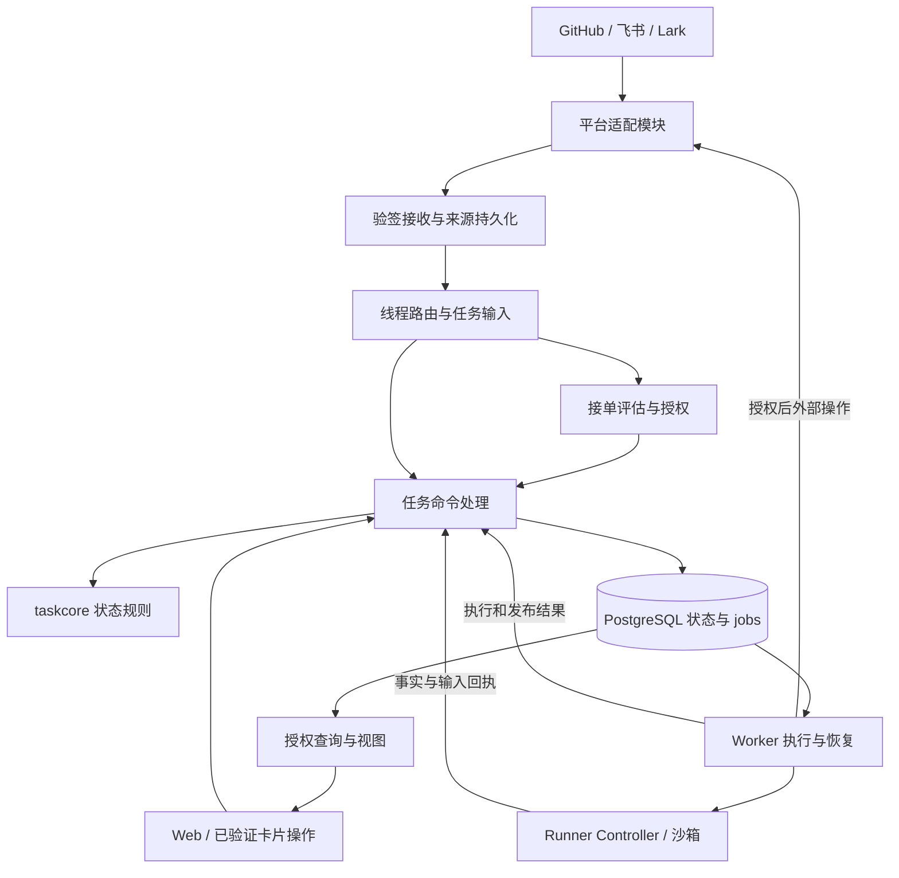

# AgentOwl 持续任务与接入模块技术方案

日期：2026-11-10  
状态：已完成本地实现；尚未部署。实际接口、验证结果及发布步骤见 [实现与验收记录](task-runtime-implementation.md)。  
范围：任务状态管理、持续输入、接单授权、平台适配四项完整改造，包含数据库、后端、Runner、接口、前端、迁移和验收。

## 1. 目标与实施原则

任务从创建到结束，应有明确的状态规则、授权依据和输入记录。用户补充信息后，系统能够回答：消息归属哪个任务、是否影响任务范围、纳入哪一版任务、哪次执行接收了哪些内容、为什么允许继续执行。

实施沿用 PostgreSQL、`jobs`、API/Worker 进程、Eino、Runner Controller、Runtime Machine、现有审批与外部操作核对机制。新增模块使用 Go 标准库和项目已有依赖。完整交付包括四项能力的实际调用链与管理入口，不以空接口、占位配置或仅有数据表作为完成。

本期确定的行为：

- 任务状态通过统一命令处理；任务、步骤、执行尝试与相关队列操作在同一数据库事务中提交。
- 支持一个任务接收多个线程的输入；自动路由要求唯一归属，歧义由人处理。
- 补充信息先进入任务收件箱，再形成有版本的任务输入。已批准的执行快照保持不可变。
- 任务创建融入审批策略，支持 `manual / auto / deny`；没有启用的创建策略时只允许开发者手动确认。
- GitHub、飞书、Lark 完成适配接口接入，现有 webhook、长连接、轮询、回复和结果核对能力保持可用。
- 任务详情可查看待处理输入、接单依据和执行消费记录；普通用户操作不要求填写内部 ID 或 JSON。

本期不新增微服务、消息中间件、通用工作流 DSL、动态插件加载或任意 shell 工具。开发阶段仍为 `plan → edit → test → review → publish_pr → track`。

## 2. 已核实的实现基线

本节列出复用的既有能力；第 3 节起描述本期模块与契约。既有技术文档作为背景，接口和身份行为以当前源码为准。

| 当前能力 | 源码依据 | 本期处理 |
|---|---|---|
| `dev_tasks / task_steps / run_attempts` 分层，任务包含 `revision / epoch / version` | [初始表结构](../backend/migrations/000001_initial.up.sql) | 保留，增加授权及输入关联 |
| 人工确认、修订、暂停、恢复与审批校验 | [workflow.go](../backend/internal/service/workflow.go) | 状态规则集中，保留现有外部入口 |
| 后续消息复用 Case，重建描述并使旧回复失效 | [support_worker.go](../backend/internal/service/support_worker.go) | 保留问答处理，增加任务路由和输入账本 |
| 持久队列、租约、重试及事务内入队 | [jobs.go](../backend/internal/service/jobs.go) | 复用，不新增队列服务 |
| 运行许可校验 attempt、epoch、摘要和审批；运行宿主冻结到 attempt | [execution.go](../backend/internal/service/execution.go)、[runtime_machine_runner.go](../backend/internal/service/runtime_machine_runner.go) | 扩展授权与输入摘要校验 |
| 外部写入通过 `external_operations` 领取，未知结果只查询核对 | [publish.go](../backend/internal/service/publish.go) | 保留，增加新消息与授权撤销检查 |
| 平台客户端和统一 `integration.Event` 已存在 | [types.go](../backend/internal/integration/types.go)、[适配约束](../backend/internal/integration/README.md) | 在已有客户端之上集中平台差异 |
| 身份绑定按 `provider + app_id + subject_id` 查询，必须唯一、启用且成员有效 | [ingest.go](../backend/internal/service/ingest.go) | 复用；不按姓名或邮箱猜测身份，不恢复已移除的 tenant 绑定条件 |
| Runner 有只读 context manifest/ref 工具，当前内容存在截断 | [runtime_context.go](../backend/internal/service/runtime_context.go)、[agent.go](../backend/internal/runner/agent.go) | 增加版本化输入引用、分页读取和消费回执 |
| OpenAPI 是业务契约，Kiota 生成前端客户端 | [接口契约](../backend/api/openapi.yaml)、[检查脚本](../script/check.sh) | 同步更新契约、生成物和调用端 |

需要纳入状态改造的现有写入路径包括 `workflow.go`、`execution.go`、`publish.go`、`jobs.go`、`execution_settings.go`、`support.go`。只改人工操作入口不能完成状态集中。

## 3. 目标结构

以下图示为实现的模块关系。



| 模块 | 负责 | 不持有的职责 |
|---|---|---|
| `internal/taskcore` | 类型化任务状态、命令前置条件和转换结果 | SQL、HTTP、模型调用、凭据 |
| `service/task_runtime.go`、`workflow.go` 等 | 调用者授权、锁、读取当前事实、调用规则、原子保存、入队 | 平台协议细节 |
| `service/task_routing.go`、`task_runtime.go` 等 | 线程关联、输入归属、输入版本、修订应用和消费查询 | 直接改变已批准 RunSpec |
| `service/admission.go` 等 | 接单门控、结构化评估、决策记录、授权生成与复核 | 代替步骤审批 |
| `integration/source*.go` | 平台接收、上下文、发送、结果核对和能力描述 | 业务授权、数据库事务、自动重试外部写入 |
| `runner` | 接收冻结输入、受限执行、持久化回执和产物 | 决定任务授权、扩大资源范围、直接发布 |

采用同一进程内的模块拆分。`Data map[string]any` 可继续用于既有 HTTP/SQL 转换，但进入任务规则后必须转换为明确类型；本期不重写所有业务资源的数据访问。

## 4. 任务状态与命令

### 4.1 三个版本的含义

| 字段 | 含义 | 变化时机 |
|---|---|---|
| `version` | 乐观并发版本 | 当前任务状态或可操作事实变化 |
| `revision` | 目标、验收条件、任务输入集及授权快照的版本 | 接受新输入、修改目标或重新授权 |
| `epoch` | 当前执行代次，用于拒绝旧执行继续推进 | 暂停、取消、撤权、输入失效及修订生效 |

普通消息到达先改变收件箱水位，不自动改变任务目标。形成新修订时，旧步骤的待执行审批失效，新的开发流程从 `plan` 开始。阶段重试沿用该修订的冻结输入，使用新的 attempt；不能在重试中偷偷带入新消息。

### 4.2 命令接口与事务

核心规则接口如下：

```go
// Command 是封闭的类型集合，各命令携带自己的必要字段。
func Decide(state State, command Command, facts Facts) (State, error)
```

`Facts` 由宿主从当前数据库、已核验 Runner 结果或平台结果构造，包括当前权限、策略版本、未结束执行和外部操作、输入水位、时间及证据摘要。模型和客户端不能直接提交这些可信事实。

实现中 `Decide` 返回 `State`。`transitionTask` 是任务状态的唯一更新入口；步骤、attempt、审批和队列沿用现有编排函数，在调用者事务内显式写入。纯规则层不生成 SQL、函数回调或通用效果列表。

现有 HTTP 和 Worker 事务内调用同一个命令处理入口：

1. 校验请求角色、资源范围、幂等键和期望版本。
2. 获取需要的锁，重读当前状态和授权事实。
3. 调用 `taskcore.Decide`。
4. 保存状态、输入/授权关联、领域事件、审批失效与 `jobs`。
5. 提交后才调用模型、Runner 或平台；调用结果通过事实命令回来。

命令处理入口接受现有 `pgx.Tx`，避免嵌套事务。内部 Worker 不使用伪造管理员身份，按命令类型提供系统来源、job 租约和执行证据。单纯的 lease 续租、运行心跳只更新对应运行记录，不承担业务状态推进。

### 4.3 命令与转换

| 命令组 | 命令 | 关键约束 |
|---|---|---|
| 创建与修订 | `ConfirmTask`、`ApplyInputs`、`ReviseTask` | 唯一活动任务约束；修订前确认没有未核定的执行和发布 |
| 生命周期 | `PauseTask`、`ResumeTask`、`CancelTask`、`RevokeMandate` | 撤销旧 epoch；恢复复核当前权限及待处理输入 |
| 阶段准备 | `StepPrepared`、`ApprovalResolved` | 当前 revision/epoch；证据、输入和授权摘要匹配 |
| 执行事实 | `RunAdmitted`、`RunFinished`、`RunLost` | attempt、宿主、spec 摘要绑定；重复回调幂等 |
| 发布事实 | `PublicationClaimed`、`PublicationSettled`、`PRUpdated` | 当前授权和来源水位；未知结果不重发 |
| 外围变更 | `ExecutionSettingsChanged`、`CaseRebound`、`JobExhausted`、`RetryRequested` | 配置失效、问题合并和失败重试也经过统一规则 |

主要转换保留既有任务状态：

| 触发 | 条件 | 结果 |
|---|---|---|
| 确认 / 修订生效 | 授权有效且执行已核定 | `queued / plan`，准备审批 |
| 准备阶段 | 输入与配置快照完整 | `pending_approval` 或按现有审批模式安排执行 |
| 运行被接受 | 审批与运行许可有效 | `running` |
| 阶段完成 | 当前 attempt 成功、无待应用输入 | `queued / 下一阶段` |
| 阶段完成 | 有待评估或待应用输入 | 暂停阶段推进，处理输入后决定新修订或继续 |
| 暂停 / 取消 / 撤权 | 授权操作或策略失效 | `paused / cancelled / blocked`，增加 epoch、撤销待执行效果并停止执行 |
| 发布完成 | 远端结果确认匹配 | `pr_open / track` |
| PR 合并 | 匹配本任务追踪的 PR | `completed` |
| 运行或发布结果未知 | 尚不能证明确已结束 | 保留待核对事实，禁止新修订、新 attempt 或重复发布 |

使用类型化 `hold_reason` 表达 `pending_inputs / input_review / execution_unsettled / authorization_changed`，不通过中文错误文本推导状态。任务 `status` 保持现有枚举可读，详情额外返回等待原因及可用操作。

### 4.4 并发与锁

保留 `execution_locks.go` 的设置锁与运行行锁规则。任务变更先取得已有设置协调锁；需要读取来源水位时，再按线程 ID 排序锁定线程，然后执行既有 run → step → approval → task 锁顺序。多任务变更按任务 ID 排序。

发布领取有独立的 operation → approval 锁路径，仍必须先取得同一设置协调锁；不能把发布 SQL 机械搬入另一种锁序。处理回调、设置保存、Case 合并及 job 重试时逐条核对锁序，并通过真实 PostgreSQL 并发测试验证。

接收入口只锁来源线程并保存事件，不持有线程锁再调用任务命令。消息消费完成后通过持久 job 路由任务，避免 Case 锁、线程锁与执行锁反向等待。

旧 attempt 迟到结果可以登记、收集产物和结算预算，但不能修改当前阶段、恢复被取消的任务或触发后续发布。

## 5. 数据模型

新增迁移从当前最大文件序号之后分配，不改写已部署迁移；本地现有迁移已到 `000009`，最终编号以实施时目录为准。

| 表 / 扩展 | 核心字段 | 约束与用途 |
|---|---|---|
| `source_threads` | `id, connector_id, channel_key, external_thread_id, generation, processed_generation` | `(connector_id, channel_key, external_thread_id)` 唯一；私聊使用现有稳定虚拟渠道身份，不依赖可空的 `cases.channel_id` |
| `task_threads` | `task_id, thread_id, repository_id, relation, routing_active, routed_generation, resolved_generation, attached_by` | `(task_id, thread_id)` 唯一；relation 为 `owner/context/execution`；同一线程同一仓库最多一个活动 owner；水位表示连续完成的范围 |
| `task_inputs` | `id, task_id, seq, kind, source_message_id, source_version, actor_ref, body, digest, disposition, reason_code, created_at` | `(task_id, seq)` 唯一；来源消息按 `(task_id, source_message_id, source_version, kind)` 去重；Web 输入按请求幂等键去重 |
| `task_revision_inputs` | `task_id, revision, input_id, content_digest, source_version` | `(task_id, revision, input_id)` 主键；明确冻结成员集合，不能仅靠最大 seq 表示消费完成 |
| `run_input_receipts` | `run_id, input_id, phase, content_digest, part_id, receipt_key, created_at` | phase 为 `delivered/included`；每个 attempt 分开记录；唯一 receipt_key 防重放 |
| `task_input_evaluations` | `id, task_id, input_ids, input_digest, task_revision, policy_version, model_version, state, result, started_at, deadline` | 每任务最多一个活动评估；成员集合和评估结果持久化，正在处理的批次不会被新消息覆盖 |
| `admission_evaluations` | `id, thread_id, generation, input_digest, policy_version, model_version, snapshot, state, deadline` | 接单按 Case 串行；去重键包含 Case 版本、策略及模型版本、显式重评请求标识 |
| `admission_decisions` | `id, evaluation_id, outcome, reason_code, evidence, authority_basis, task_id, created_at` | 追加式决策记录；人工确认也记录决策；结构化证据可追溯到来源版本 |
| `task_mandates` | `id, task_id, revision, decision_id, issuer, sponsor_principal_id, scope, scope_digest, policy_ref, status, revoked_at` | 每修订一个明确授权；授权内容不可覆盖，撤销单独记录状态及原因 |
| `task_events` | `id, task_id, sequence, type, actor, metadata, created_at` | `(task_id, sequence)` 唯一；用于审计和查询，不引入事件溯源作为权威状态 |
| 既有表扩展 | `dev_tasks.mandate_id/hold_reason/next_input_seq`；`task_revisions` 输入集及授权摘要；`task_steps.input` 冻结字段 | 原字段、版本和外部标识保留；旧记录按迁移规则读取 |
| 来源事件扩展 | `ingest_events.thread_id/thread_generation` | 接收时分配水位；消费完成后推进连续 processed_generation |

`task_inputs.disposition` 为 `pending / context / apply / review / unrelated / withdrawn / superseded`。该字段表示当前处理结论，变化产生 task_event；执行是否消费由 revision 关联和 receipt 推导，不能用一个“已处理”布尔值同时表示这三件事。

输入正文先做现有脱敏和权限处理。正文保存为受限文本；单条最多 64000 字节，一个修订最多采用 128 条。超限明确拒绝，可将旧输入改为参考信息；附件仍使用现有 artifact/附件机制；来源链接、消息版本和 digest 保留。查询摘要、下载、模型读取均验证当前 Case、渠道和仓库权限，禁止通过任务关联绕过源数据权限。

建立 `(task_id, disposition, seq)`、待评估线程、未结算回执、活动授权和待处理决策的部分索引。批量查询与输入列表均分页。历史正文与 artifacts 沿用现有保留政策；撤回后停止新的模型读取，审计仅展示有权查看的信息及失效标记。

## 6. 消息路由与持续输入

### 6.1 接收与归属

1. 平台 Adapter 验签、解析，产生 `integration.Event` 及稳定线程引用。Webhook、长连接和轮询最终走同一个持久化入口。
2. 在同一事务中，按既有事件幂等键保存事件、增加线程 `generation`、记录事件水位并安排消费；重复事件不增加水位。
3. 既有消费流程更新来源消息、消息版本和 Case。新增路由 job 在该事务中提交，绑定明确消息版本；消费按线程串行推进连续水位，失败的消息不能被后续水位越过。
4. 查找有权读取该消息的活动任务关联。唯一 owner 接收输入；context 关联只获得上下文，不能产生执行指令。多个仓库均有 owner 且消息未明确目标时，记录归属歧义，等待选择。
5. 无 owner 时进入接单评估；已经由任务处理的输入不同时自动创建第二个任务。

`task_threads` 保存显式关联。Issue/PR/飞书话题中的引用仅提供关联建议，不能仅凭正文中的 URL 自动绑定任务。PR 关联由已确认发布结果创建；人工关联需同时拥有任务及来源访问权限。

创建任务时，将确认时实际采用的来源消息版本、手工补充和目标依据建立为初始输入，写入第一版 task_revision_inputs；不能只保存可变的 Case.description 作为上下文。新关联线程以当前水位为起点，历史内容只有在显式选择或规则明确允许时作为 context 导入，不触发追溯接单。一个任务的自动输入流水号在锁定任务后分配，人工操作、路由和重试共享同一幂等规则。

Case 合并使用现有 canonical Case，重新检查活动任务唯一约束和消息可见性；保留原 task/input ID。发生同仓库多个活动任务或权限冲突时返回可操作冲突，不自动合并执行或授权。私聊用户、平台账号之间不能按显示名关联。

### 6.2 输入评估

持久任务输入由确定性规则和结构化模型评估处理。模型可建议 `context / clarification / scope_change / unrelated / stop_request`，提供引用和原因；规则层决定 disposition 和可执行操作。

- 感谢、重复消息、运行通知等作为 context，不创建新修订。
- 范围内的复现信息、日志或问题回答可建议 apply；自动应用还要求当前授权允许对应来源、任务范围和跟进规则，否则进入 review。
- 目标、验收条件、仓库、路径、工具或权限变化必须重新授权和创建修订。
- 模型建议停止不直接撤销任务；停止请求须来自有权操作任务的已验证成员，或明确适用的管理策略。
- 无法判断、缺少证据或模型不可用进入 review，显示原因。不得将失败当作“无影响”。

评估期间到达的消息合并为下一批。评估结果绑定输入集合、消息版本、策略/模型版本和任务版本；落库前重新检查，过时结果不生效。使用现有模型预算与重试限制；所有耗时在事务外发生。

接单评估按归一化后的 Case 串行，已有任务的输入评估按任务串行，将多个关联线程的输入合并为一个冻结批次。后者存入 `task_input_evaluations`。模型执行期限从实际开始请求时计算；队列等待不计模型超时，排队超时另行显示。重试沿用同一评估记录，显式重新评估生成新记录并关联前一次结果。

### 6.3 生效时机

| 到达时机 | 行为 |
|---|---|
| 尚未执行 | 评估后合并 apply 输入，创建新修订，重新准备审批 |
| 已有 pending/approved 步骤 | 暂停该步骤的领取；评估为 context 则继续，评估为 apply 则使旧审批失效并创建新修订 |
| Runner 正在执行 | 冻结的当前执行继续；禁止自动推进下一阶段，待结果核定后应用输入。用户可选择“暂停并应用”，沿用停止与核对流程 |
| 当前执行结果未知 | 保存输入，等待核对，不能启动替代执行 |
| PR 待发布 | 尚有未消费来源事件、pending/review/apply 输入时，不领取发布 |
| PR 已创建且任务在 track | context 输入继续记录；有效变更通过新修订、审批及现有同 PR 更新流程执行 |
| 已完成 | 只记录到来源/Case；由有权成员确认修订恢复或建立关联新任务，普通聊天不自动复活任务 |
| 已取消 | 不自动恢复；重新确认创建任务，并保留关联关系 |

新修订基于当前任务目标、验收条件和明确选中的输入 ID 集合。调用者必须提供期望任务版本；规则层验证输入归属、来源版本、权限和未核定执行。范围外输入必须由有权成员给出新的目标及授权，不能直接沿用旧 mandate。

### 6.4 冻结、送达与消费

步骤快照增加 `mandate_id, mandate_digest, input_set_digest, input_refs, source_watermarks`。摘要使用版本化的确定性序列化，输入按稳定 ID 排序，明确空值处理；由固定测试向量验证。审批 action_hash、RunSpec/spec_digest 和发布证据均包含这些字段。

Runner 接收匹配的 RunSpec 并持久化后记录 `delivered`。`included` 表示某段内容已放入一次获得模型响应的请求，不代表模型理解或采纳；test 等无模型阶段只显示送达。对于摘要、分段正文分别标记，不能把仅发送摘要称为全文已读。

长输入通过版本化只读引用分页读取。v2 context ref 响应包含 `content_digest, part_id, text, next_cursor`，游标只用于该冻结内容，单页受已有上下文预算限制；Runner 工具新增可选 cursor，v1 引用维持原契约。不得通过尾部截断后仍报告全文消费。

回执由 Runner 的模型适配层产生，模型文本不能伪造。回执先写 Runner 本地运行目录，通过现有 Inspect 轮询同步，收集归档时补齐；相同 attempt 的两条途径按 receipt_key 合并。复用现有传输和恢复链，不新增重复的回调端点。Run 不因回执上报暂时失败而重复执行模型。拿不到可靠回执时显示“消费情况未确认”。

内部接口验证 Runtime Machine 身份、run/attempt、spec digest、输入成员及分段 digest。迟到回执只补历史，不触发状态转换。已撤回或失去访问权的内容禁止新的引用读取；历史已发送给模型的内容不能被声称已撤回。

### 6.5 发布竞争、编辑与撤回

发布领取和每次外部写入前的 checkpoint 检查三层连续水位：来源 `processed_generation == generation`，任务关联 `routed_generation == generation` 且 `resolved_generation == generation`，同时任务没有未应用的有效变更。来源事件已入库但消费或路由尚未完成时，必须等待；路由 job 的延迟不能成为发布旧结果的窗口。

步骤中的 `source_watermarks` 记录冻结时的来源位置，用于审计；它不要求永远等于实时水位。新消息评估为 context/unrelated 后，记录该代的无变更结论并推进 resolved_generation，批准的 input_set_digest 保持原值；评估为 apply 时必须通过新修订改变输入集。跳过不相关事件也需要明确结论，水位不能越过未决缺口。

影响当前修订的来源被编辑、撤回或撤销访问权时：记录替代/失效输入，增加 epoch，停止运行、失效审批并取消未领取发布；在重新选择有效输入后建立修订。保留迟到结果的核对与预算结算，不能继续推进。

接收时已能确定是当前冻结消息的编辑/撤回事件，须在来源持久化事务中登记待核验失效标记。许可续租和引用读取检查该标记，在消费完成前也不能继续使用旧内容；普通追加消息按上一节安全点规则处理。

发布请求已发出后才到达的新消息无法撤销远端请求。此时先核对该操作；确认 PR 已创建后记录需要跟进的输入，再通过新修订更新。未知结果维持 `outcome_unknown`，不自动重发或删除远端内容。

## 7. 接单评估与任务授权

### 7.1 两层授权

任务 mandate 说明由谁、根据什么规则、为哪些资源和目标开展工作；步骤 approval 批准本次冻结的具体操作。运行仍需同时满足当前成员/策略权限、mandate、步骤审批、revision/epoch 和 Runner 许可。

`scope` 是类型化对象：`repository_id, permitted_source_refs, allowed_paths, goal, acceptance_criteria, permitted_stages, followup_mode`。目标文字帮助解释意图；仓库、路径和执行能力必须由宿主校验。模型不能填写有效的授权主体或扩大范围。

`followup_mode` 为 `manual / within_scope`，默认 manual。within_scope 由有权成员在确认任务时选择，或来自明确的自动接单规则；它允许宿主结合结构化评估，将指定来源的范围内补充应用为新修订，步骤审批仍然执行。任务级跟进设置独立于是否自动接新任务，关闭自动接单不改变已有人工任务的跟进选择。新修订按当前权限复核后生成新 mandate，记录继承的授权依据，不能仅因为上一修订存在就继续授权。

人工确认沿用现有 developer 及资源授权，记录 `human_confirmation` 决策。自动接单由管理员配置的规则授权，包含明确的 `sponsor_principal_id`；担保成员必须仍然有效且拥有目标渠道和仓库开发权限。外部提问者可以是请求来源，但不会因此成为内部成员或审批人。

### 7.2 配置与决策流程

任务创建使用 `configs.kind=policies, data.kind=create_task`，与后续操作共用策略 CRUD。字段包括名称、模式、有效期、启用状态、来源渠道、目标仓库、授权负责人、来源类别、路径、followup_mode 和创建条件。负责人必须仍拥有渠道和仓库开发权限。

| 模式 | 行为 |
|---|---|
| `manual` | 形成待审批建议，批准后创建同一种开发任务 |
| `auto` | 满足规则及证据检查后自动批准，由统一审批执行器创建任务 |
| `deny` | 禁止该渠道与仓库范围内的任务创建，包括直接人工确认 |

同一渠道、仓库的禁止和人工策略优先；模型选择的规则及版本绑定到审批内容。多个候选规则由模型提出候选，后端仍独立检查同范围内更严格的策略。模型不可决定批准权限。缺失目标、验收标准、有效来源、负责人权限时只记录阻塞结果。

审批保存 case 版本、规则版本、消息快照、来源证据、目标、验收标准、路径和跟进模式。批准与执行分别重查权限、配置和来源；异步执行按原有确认开发事务创建任务、授权、输入及首阶段队列，重复执行不会重复创建。创建批准不替代后续步骤审批。

旧独立设置和规则 API 已退役（410）；历史判断查询与重新生成入口保留，确认动作必须通过统一审批。迁移 `000012` 保留规则 ID/版本，将原 auto 映射为 auto、observe 映射为 manual、off 映射为停用。历史决定作为已执行或已失效记录展示，不补发执行。

### 7.3 授权变更和撤销

策略停用、删除、到期或版本变化后，依赖其授权的任务不能继续执行。成员、渠道、仓库或来源权限变化同样需要重新确认。已经开始的执行仍定期核对运行许可；旧审批与旧模型结果不能恢复被撤销的授权。

## 8. 平台适配接口

接口位于现有 `integration` 包，GitHub 与 Lark/飞书为实际实现。按能力拆成小接口，注册表只做静态查找；不要求每个平台实现空方法。

| 接口 | 典型操作 | 输出契约 |
|---|---|---|
| 接收 | `ParseWebhook`、事件标准化 | 统一 Event、CardAction、Challenge、Ignored；无业务 SQL |
| 上下文 | `ReadThread`、`ReadMessage`、`ReadAttachment` | 稳定来源 ID、版本、分页游标、删除状态；有界内容 |
| 消息写入 | `SendMessage`、`MarkReceived` | 明确确认成功、永久目标失效、明确失败或结果未知 |
| 消息核对 | `ReconcileMessage` | `confirmed / absent / unknown`；absent 本身不能证明此前请求未成功 |
| 描述与探测 | `DescribeCapabilities`、只读探测 | 静态能力与当前账号实际探测结果分开 |

以下职责继续由宿主拥有：连接器秘密解密和配置版本、身份绑定、资源授权、历史导入模式、审批、限流、预算、幂等键、outbox、失败重试和操作审计。

适配器接收已授权的类型化发送请求，内部负责飞书卡片/线程回复/GitHub 评论格式。业务通知意图由宿主构造；卡片的 operation_id、nonce、服务端动作绑定保持原校验，不把动作授权交给适配器。

统一错误保留现有 `integration.APIError` 信息，并明确 `retryable / target_gone / unauthorized / outcome_unknown` 分类。结果不确定时交回现有 external_operations 核对；不能在 Adapter 内重试写入。消息 idempotency 的实际平台差异必须保留。

调用链覆盖 `IngestWebhook`、卡片解析、Lark socket/poll、GitHub poll、同步历史上下文、附件、`DispatchMessage` 和 `ReconcileMessage`。GitHub Git 对象与 PR 发布继续使用现有专用发布接口，不能被降为普通消息发送；PR 的会话读取及线程绑定使用来源接口。

契约测试使用已有模拟 HTTP 服务，对两个 Adapter 跑同一组公共能力用例，再保留各平台验签、解密、卡片、分页和未知结果专属测试。

## 9. 接口与产品闭环

全部业务接口进入 `backend/api/openapi.yaml`，生成 Kiota 客户端；禁止手改 generated 文件。复用现有会话、CSRF、Idempotency-Key、版本冲突和资源权限契约。

| 接口 | 行为 |
|---|---|
| `GET /api/v1/development-tasks/{id}` | 增加授权摘要、待处理输入数、hold_reason、可用操作；保留原字段 |
| `GET/POST /api/v1/development-tasks/{id}/inputs` | 分页查看 / 添加任务补充；POST 使用幂等键和期望版本 |
| `POST /api/v1/development-tasks/{id}/inputs/{input_id}/actions` | 明确标为 context、unrelated、申请应用或交回判断；验证任务归属和权限 |
| 既有 `POST .../{id}/revisions` | 增加选择的 input_ids；统一完成目标修改、授权和输入快照，不新增第二种修订入口 |
| `GET/POST /api/v1/development-tasks/{id}/threads` | 查看 / 关联线程；关联校验双方资源权限 |
| `DELETE /api/v1/development-tasks/{id}/threads/{thread_id}` | 解除主动路由；历史输入和审计保留 |
| `GET /api/v1/development-tasks/{id}/authorization` | 当前 mandate、接单依据与撤销信息 |
| 既有 `POST .../{id}/actions` | 增加明确的撤销授权动作，复用暂停/停止处理 |
| `GET /api/v1/admission-decisions`、`GET /api/v1/admission-decisions/{id}` | 按有权查看的来源/仓库分页查询和读取详情 |
| `POST /api/v1/admission-decisions/{id}/actions` | 重新评估或人工确认；确认复用 ConfirmTask，重新检查权限和证据 |
| `GET/POST /api/v1/policies`、`GET/PATCH/DELETE /api/v1/policies/{id}` | 统一操作策略；任务创建使用 `kind=create_task` |
| 旧 `settings/admission`、`admission-rules` | 已退役，返回 410；历史数据保留 |
| 现有 Runner Inspect / Collect | 在已验证 run/spec/宿主身份后同步冻结输入回执，运行中轮询和最终归档均可补齐 |
| `GET /internal/runner/context/{run_id}/refs/{id}?protocol=2&cursor=...` | v2 分页响应；省略 protocol 的 v1 响应形状不变，未知版本拒绝 |

新冲突码包含 `input_changed / input_scope_conflict / routing_ambiguous / mandate_invalid / source_pending / execution_unsettled`，使用现有错误封装。不存在或无权查看的对象继续保持一致的隐藏行为。

前端交付四处实际流程：

1. 任务详情：补充信息列表、简洁处理按钮、输入应用到哪版任务及送达/消费状态；复杂诊断收在详情中。
2. 确认与修订表单：勾选待应用输入，编辑目标和验收条件，并选择是否允许自动应用范围内补充；运行中提供“暂停并应用”的连续操作，停止未确认时显示等待原因。
3. 审批策略：在现有“设置 → 审批策略”中集中配置任务创建方式、创建规则与操作审批；成员、仓库、渠道、角色采用选择控件。配置缺项在对应字段提示，不新增独立接单页面。
4. 审批：增加“任务创建”分类，展示观察结果、待人工处理事项、来源证据和确认入口；沿用现有权限和版本校验。旧接单页面链接跳转至审批策略。

上述列表、详情、导出及日志均执行资源权限过滤；统计数也不得泄露无权访问的任务或来源。

## 10. 持久效果与故障恢复

复用 jobs 表增加路由输入、评估接单、评估任务输入及应用输入等明确 kind。job payload 携带实体 ID、版本、水位和摘要，不携带可变授权断言。

| 中断位置 | 恢复行为 |
|---|---|
| 来源事件入库后消费失败 | 同一事件重试；processed_generation 不跨过失败事件；发布等待 |
| 输入已保存但评估未完成 | 从持久状态重建 job；按评估 ID 去重，过时输出丢弃但预算照常结算 |
| 决策提交前进程退出 | 无任务创建；同一评估可重新提交 |
| 决策、任务与 job 已提交 | 唯一约束返回已有结果，不再建第二个任务 |
| Runner Start 超时 | 使用已有 run ID 查询已冻结宿主，不创建替代 attempt |
| 消费回执同步失败 | 重放本地回执或由产物收集补齐，不重跑模型 |
| 新修订生效后旧 job 到达 | revision/epoch 不匹配，结束旧 job，不改变任务 |
| 外部请求后失联 | outcome_unknown，按已有标记与摘要查询核对 |
| 模型和平台持续失败 | 按已有预算/重试策略收敛到人工处理，保留可操作原因 |

维护扫描仅补齐确实缺失的工作，不重放外部写入。所有有“当前事实”要求的检查在执行时重做。日志记录 task/revision/epoch/attempt/input/evaluation/operation ID 和结构化原因，正文及密钥不进入普通运行日志。

来源消费永久失败时，管理员可通过既有 job 处理入口重试或作出有原因的忽略决定。忽略后只有已确认不影响当前输入的事件才能推进水位；涉及撤回、权限或内容版本不明的事件仍使任务保持 blocked，须补采核实或由有权成员重新选择有效输入。不能以“忽略失败 job”绕过输入有效性检查。

查询至少提供待路由时长、评估失败数、待处理输入数、mandate 拒绝原因、回执滞后和未知外部结果数。先复用当前日志与状态查询，不引入新的监控部署依赖。

## 11. 数据迁移、兼容与发布

### 11.1 数据迁移

采用追加表和可空扩展列。来源线程按现有消息 connector/channel/thread 标识去重回填；私聊沿用当前虚拟渠道规则。跨来源或同名线程不合并。现存活动任务按来源证据建立关联，无法唯一判断的记录标记待确认，不推测订阅关系。

历史任务的 mandate 记录为 `legacy_confirmation`，只保存能够从 confirmed_by、task_revisions 和审批中证明的事实，缺失证据明确标记；不伪造历史输入的送达/消费记录。终态任务保持只读，活动任务的下一次恢复/修订必须通过当前权限复核。

回填使用唯一键和确定性键保证可重跑。按 ID 分批执行，记录数量、冲突和进度；不覆盖既有目标、产物、审批、配置和凭据。业务关联验证完成后再加非空约束；不在首个 schema 迁移内执行不可控的全表模型评估。

### 11.2 协议与服务兼容

新增 Runner capability `task_input_receipts_v1` 与 `context_ref_pages_v2`。含新输入快照的 attempt 只选择支持能力的宿主；无可用宿主时等待，不能静默删去输入或降级为旧格式。已被接受的 attempt 仍固定原宿主。

既有已冻结 RunSpec 和摘要保持原编码，按缺少协议版本识别为 legacy；新 RunSpec 明确携带输入协议与引用协议版本，新摘要字段仅在新协议中计算。旧记录可以查询和核对，新修订使用新协议。原业务接口字段和错误封装保持可读。

业务层与旧 Worker 同时写入会绕过新的输入和授权约束，因此部署采用受控停写切换，不宣称支持任意混合版本运行：停止新接单/新开发领取，排空或核定执行与发布，暂存或暂停接收入口，再更新 schema、API、Worker、Runner 和 Web，验收后恢复入口。停收期间依赖的平台重投/轮询补采能力必须按实际配置核实；不具备补采的长连接不能未经安排直接停机。

### 11.3 回滚

发布前备份数据库、artifacts、配置和镜像，记录正在运行的 attempt 与未知外部操作。保持实际 Compose project、卷路径、账号、加密密钥和 Runtime Machine 身份。

关闭自动接单仅能回退业务开关，不能代替二进制兼容回滚。已产生新协议数据后，优先回滚到仍理解这些数据的兼容构建；回退到改造前构建需要先停止写入并确认不会绕过 mandate/input 校验。恢复旧数据库备份会丢失切换后的数据，不能作为普通回滚步骤自动执行。

上线批次先验证人工任务完整链路，再启用 observe；auto 是已实现且可验收的能力，由管理员在指定规则上显式启用。试运行使用测试渠道和仓库，真实写入操作的范围单独明确。

## 12. 实施顺序与文件范围

全部阶段属于本期交付。分阶段用于控制回归面，每阶段应形成可验证的完整调用链。

| 阶段 | 交付 | 主要文件与验收出口 |
|---|---|---|
| 1. 状态规则集中 | taskcore、事务命令入口、事件与状态迁移 | workflow/execution/publish/jobs/execution_settings/support 全部任务写入接入；既有行为回归通过 |
| 2. 平台适配 | 小接口、静态注册、GitHub 与 Lark 实现 | ingest、socket/poll、上下文/附件、DispatchMessage/ReconcileMessage；公共契约及平台特有测试通过 |
| 3. 来源和输入 | 线程水位、关联、输入、路由、编辑撤回 | 迁移、task_inputs、support_worker、ingest、query；重复/乱序/多来源/跨权限测试通过 |
| 4. 授权与接单 | mandate、决策、off/observe/auto、规则管理 | admission、admin/identity、workflow、execution permit、发布 checkpoint；自动接单闭环及撤权测试通过 |
| 5. Runner 与持续执行 | 输入快照、版本化引用、回执、修订应用 | runner types/controller/eino/agent、runtime_context、execution；断线恢复和旧协议测试通过 |
| 6. 产品与发布验收 | OpenAPI、生成客户端、四处前端流程、迁移/运维说明 | Frontend、api、script、docs；全链路、真实 PostgreSQL 与 Linux Runner 验收通过 |

需求中的架构模式全部落到实际场景：飞书补充信息 → 当前任务收件箱 → 评估 → 新修订 → 审批 → Runner 消费 → 原 PR 更新；GitHub 新问题 → observe/auto 决策 → 授权任务 → 既有分阶段流程。

## 13. 验收与完成定义

### 13.1 必测场景

| 类别 | 用例与通过条件 |
|---|---|
| 状态规则 | 当前状态 × 命令 × 权限/证据表驱动测试；非法转换无部分写入，终态不被迟到结果复活 |
| 状态覆盖 | 人工操作、审批拒绝/撤销、模型设置变化、job 耗尽/重试、Case 合并、PR 回传均走命令接口 |
| 原子性 | 在任务/授权/输入/事件/jobs 写入点注入故障，事务全部回滚；重试只产生一份有效结果 |
| 并发 | Pause 与 RunFinished、ApplyInputs 与发布领取、设置变更与 RunAdmitted、两个自动接单同时发生；无死锁、无越代推进 |
| 路由 | 同线程跟进、私聊、一个任务多个线程、多个仓库归属歧义、context-only、重复投递、乱序与历史补采 |
| 关联与授权 | 跨账号同名 ID、无权线程、Case 合并冲突、解除关联、撤回/编辑、未绑定外部提问者不获开发权限 |
| 输入生效 | 运行中补充不会改变当前 spec；新修订精确记录输入集合；重试不能夹带新输入；取消后普通消息不重启任务 |
| 发布竞争 | 事件已入库但路由未运行时发布等待；无影响消息处理后正常继续；请求已发出后的新输入走核对和后续修订 |
| 自动接单 | off 无评估执行；observe 无任务/授权/开发 job；auto 仍受步骤审批；多规则冲突、重复评估、缺预算、无模型及 stale 结果可恢复 |
| 授权撤销 | 担保成员停用、身份/仓库/渠道/规则变更和 mandate 撤销阻断新许可与发布；已有外部结果可核对 |
| 输入消费 | 摘要与全文区分，分页完整性与 digest 校验；回执重复、迟到、断线、本地重放、归档补齐；回执缺失不伪报已读 |
| 适配器 | 验签/解密/Challenge、卡片 nonce、私聊/群线程、分页、限流、目标不存在、401/403、明确失败与未知写入结果 |
| 兼容迁移 | 空库、现存任务与审批、私聊、无历史证据、迁移重跑、旧 attempt 核对、新协议宿主选择、受控回滚演练 |
| 前端 | 角色与资源隔离、选择控件、版本冲突保留草稿、暂停等待、输入应用、observe 确认、无权限列表和计数 |

### 13.2 执行检查

优先复用现有测试入口与 fixtures，补充有行为区分力的测试，不以调用次数或重复实现作为主要断言。

- `taskcore` 纯规则测试无需外部依赖。
- 配置 `AGENTOWL_TEST_DATABASE_URL` 后运行真实 PostgreSQL 服务测试；测试被跳过不算通过。
- 使用项目 `make ci` / `script/check.sh --ci` 验证格式、Go vet/race/build、OpenAPI、Kiota 漂移、前端 lint/typecheck/test/build 和 Compose。
- Runner 协议、许可、模型输入与回执使用现有模型/HTTP 替身测试；Linux 环境补做真实容器暂停、撤权、恢复及产物验收。
- 测试平台完成 webhook/长连接/轮询与回复核对；真实模型验证结构化评估和跟进输入处理，供应商质量与本地模拟结论分开记录。
- 浏览器验证任务输入、修订、接单规则和权限，记录登录态验收；HTTP 200 不能代替交互验收。

完成时须提供迁移结果、全部检查结果、实际运行范围与未验证项，并更新运行/验证文档。不存在绕过命令处理的任务业务状态写入，不存在未接入调用链的适配器，不存在只显示“已读”而没有可核验回执的数据。

## 14. 设计依据与限制

本方案采用当前 AgentOwl 的审批、持久队列和执行隔离，吸收参考原型的集中状态规则、线程订阅、输入回执和接单授权建模。参考路径为 `dsh-superagent-prototype/src/core/{engine,intake,ports,model}.ts` 与 `src/sources/kind.ts`；不迁移其单进程存储或 shell 权限模型。

普通新输入在执行安全点形成新修订，本期不向已经批准的模型回合热插入可变上下文。这是审批证据保持一致的执行契约，任务仍可持续接收、处理和应用跟进信息。

发布与外部消息发送跨越网络，无法与数据库事务形成原子操作；已发出的请求不能保证被后来的暂停或新消息撤回。实现必须保持结果核对和禁止盲目重发的现有语义。

本地数据库、模型和平台替身、Runner 协议及前端构建已验证；Linux 容器、真实平台、视觉交互和生产升级仍需在目标环境验收。具体范围见实现与验收记录。
