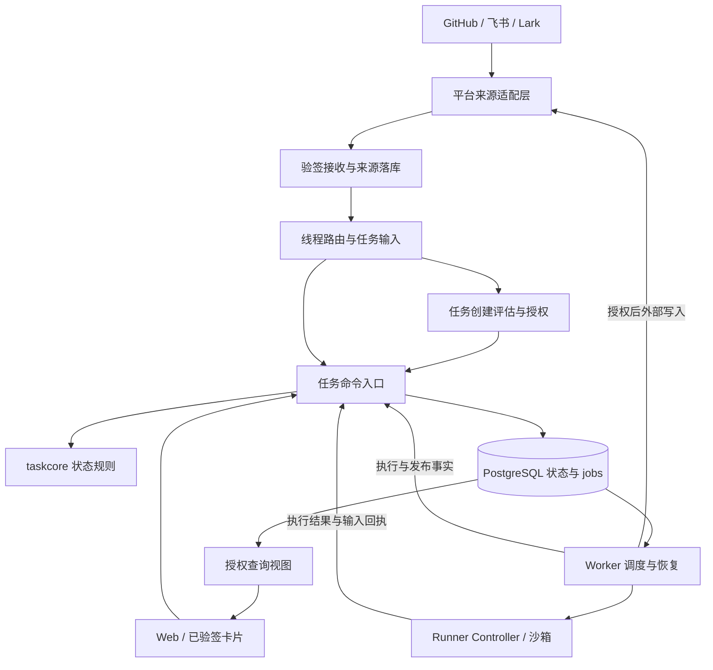

# AgentOwl 持续任务与接入模块技术方案

日期：2026-11-10  
状态：已完成核心实现并部署至测试开发机，详细发布与验收记录见 [实现与发布记录](task-runtime-implementation.md)。  
范围：集中任务状态机、持续输入与会话路由、任务授权与统一创建策略、平台来源适配层。

## 1. 设计目标与约束

一个开发任务从创建到合并往往会持续收到用户的补充信息。这套改造的目标是让系统在任何时刻都能说清五件事：**这条新消息归属哪个任务、是否影响任务范围、被纳入了哪一版任务、哪次执行真正用到了它、以及这次继续执行的授权依据是什么**。

实现继续沿用现有的 PostgreSQL、`jobs` 队列、API/Worker、Eino、Runner Controller、运行机器和外部操作核对机制，不引入新的微服务、消息中间件、通用工作流 DSL、动态插件或任意 Shell 工具，开发阶段保持 `plan → edit → test → review → publish_pr → track`。

核心行为约定：
- 所有任务状态变更收敛到统一的命令处理入口，状态、步骤、执行记录与异步任务在同一个数据库事务内提交。
- 单个开发任务可关联多个会话线程；自动路由要求归属唯一，出现歧义交由人工处理。
- 补充信息先进入任务收件箱，再按版本纳入新修订；已批准的执行快照保持不可变。
- 任务创建统一并入审批策略（支持 `manual / auto / deny`）；未配置启用策略时仅允许开发者手动确认。
- GitHub、飞书和 Lark 统一接入来源适配接口，既有 Webhook、长连接、轮询、回复和核对能力全部兼容。
- Web 任务详情直接提供补充信息管理、授权依据和消费状态查看，普通操作无需手填内部 ID 或 JSON。

## 2. 既有能力基线

| 既有模块 | 代码位置 | 本次演进方式 |
|---|---|---|
| 任务/步骤/执行分层（含 `revision / epoch / version`） | [000001_initial.up.sql](../backend/migrations/000001_initial.up.sql) | 保留主结构，追加授权与输入关联表 |
| 确认、修订、暂停、恢复与审批校验 | [workflow.go](../backend/internal/service/workflow.go) | 收敛到统一状态规则，对外入口不变 |
| 后续消息复用 Case 并作废旧回复 | [support_worker.go](../backend/internal/service/support_worker.go) | 保留答疑流程，增加任务路由与输入台账 |
| 事务 Outbox 与租约队列 | [jobs.go](../backend/internal/service/jobs.go) | 直接复用 |
| 运行许可与选机绑定 | [execution.go](../backend/internal/service/execution.go)、[runtime_machine_runner.go](../backend/internal/service/runtime_machine_runner.go) | 补充授权摘要和输入集摘要校验 |
| 外部写入领取与 `outcome_unknown` 核对 | [publish.go](../backend/internal/service/publish.go) | 保留对账逻辑，增加新消息水位与撤权检查 |
| 平台客户端与 `integration.Event` | [types.go](../backend/internal/integration/types.go)、[适配说明](../backend/internal/integration/README.md) | 抽象公共来源接口，收敛平台差异 |
| 身份绑定按 `(provider, app_id, subject_id)` 查询 | [ingest.go](../backend/internal/service/ingest.go) | 原样复用，不按姓名/邮箱猜测身份 |
| Runner 只读上下文工具 | [runtime_context.go](../backend/internal/service/runtime_context.go)、[agent.go](../backend/internal/runner/agent.go) | 升级为版本化分页引用与真实消费回执 |
| OpenAPI 契约与 Kiota 客户端 | [openapi.yaml](../backend/api/openapi.yaml)、[check.sh](../script/check.sh) | 同步扩展接口并校验生成无漂移 |

所有修改任务状态的写入路径（`workflow.go`、`execution.go`、`publish.go`、`jobs.go`、`execution_settings.go`、`support.go`）全部纳入统一状态规则管理。

## 3. 模块结构



| 模块 | 职责 | 边界 |
|---|---|---|
| `internal/taskcore` | 纯类型化任务状态、前置条件与状态转换 | 不碰 SQL、HTTP、模型或凭据 |
| `service/task_runtime.go`、`workflow.go` | 鉴权、加锁、收集实时事实、调 `Decide`、原子写库与入队 | 不包含具体平台协议 |
| `service/task_routing.go` | 线程关联、输入归属、输入版本、修订应用与消费查询 | 不修改已批准的 RunSpec |
| `service/admission.go` | 任务创建评估、审批建议生成与授权复核 | 不替代后续阶段审批 |
| `integration/source*.go` | 平台入站解析、上下文/附件读取、发送、核对与能力探测 | 不做业务授权、事务或写入重试 |
| `runner` | 接收锁定输入、分页读取、受限执行与回执持久化 | 不做授权决策、不扩权、不直接发布 |

## 4. 任务状态机与命令处理

### 4.1 三个版本号的职责

| 字段 | 含义 | 递增时机 |
|---|---|---|
| `version` | 乐观锁并发版本 | 任何状态或可操作字段更新 |
| `revision` | 任务目标、验收条件、输入集合与授权快照版本 | 采纳新输入、修订目标或重新授权 |
| `epoch` | 执行轮次（用来拦截过期的旧执行继续推进） | 暂停、取消、撤权、来源失效或新修订生效 |

新消息到达先推进收件箱水位，不会直接篡改进行中的任务目标。生成新修订时，旧步骤的待执行审批作废，新修订从 `plan` 重新开始；而普通阶段重试沿用当前修订的锁定输入，绝不偷偷夹带新消息。

### 4.2 命令入口与事务模板

```go
// Command 为封闭命令集合，各类命令携带各自的必要参数。
func Decide(state State, command Command, facts Facts) (State, error)
```

`Facts` 由后端从数据库、已核验的 Runner 回报或平台响应构造（包含权限、策略版本、未收口执行/发布、输入水位与证据摘要），客户端和模型不能伪造。`transitionTask` 是唯一的任务状态写入口，步骤、attempt、审批和队列操作在调用方事务内显式落库：

1. 校验调用者角色、资源范围、幂等键和 `expected_version`。
2. 按固定锁序加锁，重读最新状态与授权事实。
3. 执行 `taskcore.Decide` 计算新状态。
4. 在同一事务内保存状态、输入/授权关联、任务事件、失效旧审批并写入 `jobs`。
5. 事务提交后再发起模型调用、Runner 请求或外部发送，结果通过事实命令回流。

内部 Worker 使用系统来源、job 租约和执行证据驱动事实命令，不伪造管理员身份；纯租约续期和心跳只更新运行记录，不触发业务状态推进。

### 4.3 命令清单与关键转换

| 类别 | 命令 | 关键约束 |
|---|---|---|
| 创建与修订 | `ConfirmTask`、`ApplyInputs`、`ReviseTask` | 同问题同仓库唯一活跃任务；修订前须确认无未收口执行/发布 |
| 生命周期 | `PauseTask`、`ResumeTask`、`CancelTask`、`RevokeMandate` | 递增 `epoch` 截断旧执行；恢复时重检权限和待处理输入 |
| 阶段准备 | `StepPrepared`、`ApprovalResolved` | 核验当前 `revision / epoch` 与输入、授权摘要匹配 |
| 执行事实 | `RunAdmitted`、`RunFinished`、`RunLost` | 绑定 attempt、运行机器与 spec 摘要，重复回调幂等 |
| 发布事实 | `PublicationClaimed`、`PublicationSettled`、`PRUpdated` | 检查当前授权与来源水位，不确定结果不重发 |
| 外围联动 | `ExecutionSettingsChanged`、`CaseRebound`、`JobExhausted`、`RetryRequested` | 配置变更、问题合并与失败重试统一经由状态规则 |

主要流转规律：
- 确认或修订生效 → 进入 `queued / plan` 并准备审批；审批和许可通过后运行机器接单进入 `running`。
- 阶段完成且无待处理输入 → 自动推进到下一阶段；若有待评估或待应用输入，则停在安全点等待处理。
- 暂停、取消或撤权 → 转入 `paused / cancelled / blocked`，递增 `epoch` 并中止执行。
- 推送与 PR 核实完成 → 转入 `pr_open / track`；PR 合并后进入 `completed`。
- 存在未确认结果的执行或发布 → 保留待核对状态，禁止发起新修订、新 attempt 或重复发布。

暂停/等待原因通过结构化 `hold_reason`（`pending_inputs`、`input_review`、`execution_unsettled`、`authorization_changed`）表达，不再依赖解析中文错误字符串。

### 4.4 并发与锁序

沿用 `execution_locks.go` 的协调锁规范：任务写入先拿设置协调锁，涉及来源水位时按线程 ID 排序锁线程，随后依次锁定 `run → step → approval → task`（多任务按任务 ID 排序）。发布领取同样先取设置协调锁再按 `operation → approval` 加锁。事件接收入口仅锁来源线程落库，后续通过持久 job 路由任务，避免线程锁与任务锁交叉死锁。过期 attempt 的迟到回报只补录产物和结算预算，不会推动当前阶段或复活已取消任务。

## 5. 数据表扩展

迁移文件顺延已有编号追加，不修改历史迁移。

| 表 / 扩展 | 核心字段 | 用途与约束 |
|---|---|---|
| `source_threads` | `id, connector_id, channel_key, external_thread_id, generation, processed_generation` | `(connector_id, channel_key, external_thread_id)` 唯一；私聊采用稳定虚拟渠道标识 |
| `task_threads` | `task_id, thread_id, repository_id, relation, routing_active, routed_generation, resolved_generation, attached_by` | `(task_id, thread_id)` 唯一；`relation` 分 `owner / context / execution`，同线程同仓库最多一个活跃 `owner` |
| `task_inputs` | `id, task_id, seq, kind, source_message_id, source_version, actor_ref, body, digest, disposition, reason_code, created_at` | `(task_id, seq)` 唯一；来源按消息版本去重，Web 补充按幂等键去重 |
| `task_revision_inputs` | `task_id, revision, input_id, content_digest, source_version` | `(task_id, revision, input_id)` 主键，精确记录每版采用的输入成员集合 |
| `run_input_receipts` | `run_id, input_id, phase, content_digest, part_id, receipt_key, created_at` | `phase` 区分 `delivered / included`，按 `receipt_key` 防重放 |
| `task_input_evaluations` | `id, task_id, input_ids, input_digest, task_revision, policy_version, model_version, state, result, started_at, deadline` | 每任务最多一个进行中的批次评估，不被新到达消息覆盖 |
| `admission_evaluations` | `id, thread_id, generation, input_digest, policy_version, model_version, snapshot, state, deadline` | 按 Case 串行评估任务创建建议 |
| `admission_decisions` | `id, evaluation_id, outcome, reason_code, evidence, authority_basis, task_id, created_at` | 追加式决策记录（含人工确认与策略评估） |
| `task_mandates` | `id, task_id, revision, decision_id, issuer, sponsor_principal_id, scope, scope_digest, policy_ref, status, revoked_at` | 每版修订一条不可变授权记录，撤销单独记录状态和原因 |
| `task_events` | `id, task_id, sequence, type, actor, metadata, created_at` | `(task_id, sequence)` 唯一，用于审计与时间线展示 |
| 既有表扩展 | `dev_tasks.mandate_id / hold_reason / next_input_seq`；`task_revisions` 输入与授权摘要；`task_steps.input` 锁定字段；`ingest_events.thread_id / thread_generation` | 保持原字段向后兼容 |

`task_inputs.disposition` 支持 `pending / context / apply / review / unrelated / withdrawn / superseded`，与“纳入哪版修订”及“执行回执状态”分开建模，不用单一布尔位混淆语义。

输入正文经脱敏入库，单条上限 64,000 字节，单版修订最多采用 128 条（超限明确拒绝，可把较早输入改为仅供参考）。所有查询、下载与模型读取均校验当前 Case、渠道与仓库权限。

## 6. 消息路由与持续输入

### 6.1 归属与关联

1. Webhook、长连接和轮询均经平台适配层生成统一 `integration.Event` 和稳定线程标识，进入同一落库入口。
2. 同事务写事件、递增线程 `generation` 并入队消费（重复事件不递增水位）。
3. 消费线程按顺序更新来源消息和 Case，推进连续 `processed_generation`（失败事件不会跳过），并投递路由 job。
4. 路由时查找有权读取该消息的活跃任务关联：唯一 `owner` 接收为任务输入，`context` 仅提供参考上下文；若多个仓库同时有活跃 `owner` 且消息未指明归属，则标记歧义待人工指定。
5. 无现有 `owner` 时进入任务创建评估；已归属某任务的输入不会重复触发创建第二个任务。

`task_threads` 记录显式绑定关系——正文里提到某个 PR 或话题链接仅可作参考提示，不会自动绑定任务；人工关联会话需同时具备任务和来源渠道的访问权限。新建任务时把确认瞬间实际采用的消息版本与说明固化为第一版 `task_revision_inputs`，不依赖可变的 `Case.description`。

### 6.2 补充信息评估

采用“确定性规则 + 模型结构化建议”协同评估：模型给出 `context / clarification / scope_change / unrelated / stop_request` 建议及理由，最终处置与权限边界由规则层敲定：

- 致谢、重复提醒、系统通知记为 `context`，不触发新修订。
- 范围内的复现步骤、日志或澄清可建议 `apply`；仅当当前任务允许自动应用范围内补充且来源合规时自动应用，否则进入 `review` 待人工确认。
- 涉及目标、验收条件、仓库、路径或权限变更，必须经人工重新授权生成新修订。
- 模型识别到“停止请求”时不会直接停任务，需核实请求人具备任务操作权或命中管理策略。
- 无法判断或模型不可用一律转 `review` 并说明原因，绝不默认当成“无影响”。

评估期间新到的消息归入下一批；结果落库前重检任务、策略与模型版本，过时结果直接丢弃（已耗模型预算仍正常结算）。

### 6.3 不同到达时机的处理

| 消息到达时机 | 系统行为 |
|---|---|
| 任务尚未执行 | 评估为 `apply` 后合并创建新修订，重新准备审批 |
| 有待审批或已批准步骤 | 暂缓领取执行；评估为 `context` 则继续，评估为 `apply` 则作废旧审批并创建新修订 |
| Runner 正在执行 | 当前锁定运行照常完成，但禁止自动进入下一阶段，待核定后应用输入（用户也可主动点击暂停并应用） |
| 当前执行结果不明 | 保存输入，等待核对结束，不另起替代运行 |
| PR 待发布 | 只要有未消费来源事件或待处理的 `pending / review / apply` 输入，暂不领取发布 |
| PR 已提交（`track`） | `context` 照常记录，实质性改动生成新修订、重新审批并更新同一 PR |
| 已完成 / 已取消 | 仅记录到原 Case，普通聊天不会自动复活任务，需有权限的成员手动修订或新建 |

### 6.4 锁定摘要、分页与消费回执

步骤快照增加 `mandate_id`、`mandate_digest`、`input_set_digest`、`input_refs`、`source_watermarks`，按确定性序列化算摘要并纳入审批 `action_hash`、`RunSpec` 和发布证据。

- **区分送达与入模**：Runner 持久化匹配 RunSpec 后记录 `delivered`；仅当某分段内容实际放入一次成功返回的模型请求时才记录 `included`（`test` 等无模型阶段只记送达），且绝不把“送入请求”夸大成“模型已理解”，也不把仅发摘要说成全文已读。
- **分页读取**：v2 引用接口返回 `content_digest`、`part_id`、`text` 与 `next_cursor`，按字符安全分页，不做无提示截断。
- **回执同步**：回执由 Runner 模型适配层生成（模型文本无法伪造），先写本地运行目录，再通过既有 Inspect 轮询与 Collect 归档幂等合并；拿不到回执时如实标明未确认，不因回执上报短暂失败而重跑模型。

### 6.5 发布前水位核查与编辑/撤回处理

领取发布及每次外部写入前检查三层连续水位：`processed_generation == generation`、`routed_generation == generation`、`resolved_generation == generation`，且不存在待应用的有效变更。只要来源事件还在队列里没路由完，发布就会等待，防止抢发旧结果。

若当前修订引用的来源消息被编辑、撤回或撤销访问权：在来源入库事务里立即挂上待核验失效标记，阻断新的许可续租和引用读取，随后递增 `epoch`、停跑并失效旧审批，等人工重新确认有效输入后再起新修订。对于已经发往远端的发布请求，按既有 `outcome_unknown` 核对流程处理，再通过后续修订跟进。

## 7. 任务授权与统一创建策略

### 7.1 任务授权（Mandate）与步骤审批

任务授权回答“谁根据什么规则允许在哪些范围里干这件事”，步骤审批回答“是否批准当下这份锁定快照执行具体一步”。实际运行需同时满足成员/策略权限、有效 mandate、步骤审批、当前 `revision / epoch` 与运行许可。

授权 `scope` 明确限定 `repository_id`、`permitted_source_refs`、`allowed_paths`、`goal`、`acceptance_criteria`、`permitted_stages` 与 `followup_mode`（`manual` 或 `within_scope`）。`within_scope` 允许按结构化评估把范围内补充自动应用为新修订（后续各开发步骤仍按审批策略把关）；人工任务的跟进设置独立于是否自动创建新任务。

人工确认由具备渠道与仓库开发权的成员签发 `human_confirmation`；策略自动创建任务时需指定一位有效的授权负责人（`sponsor_principal_id`），该负责人必须持续保有目标渠道和仓库的开发权限。外部提问者不会因为提问获得内部成员或审批权。

### 7.2 统一策略配置

任务创建纳入 `configs.kind=policies`（`data.kind=create_task`），与回复、知识发布和开发步骤共用策略管理界面与接口：

| 模式 | 行为 |
|---|---|
| `manual` | 生成待审批的任务创建建议，人工批准后创建开发任务 |
| `auto` | 满足条件与证据校验后自动批准，由统一审批执行器创建任务 |
| `deny` | 禁止该渠道与仓库范围内创建任务（同时拦截直接人工确认） |

同渠道、仓库下遵循“禁止 > 人工 > 自动”；模型只能从候选规则中提出建议，后端独立复查所有更严格策略和必要字段（缺目标、验收标准、有效来源或负责人权限时仅记阻塞记录）。旧的独立接单设置与规则接口已退役返回 `410`，迁移 `000012` 保留了历史规则与记录。

### 7.3 权限变更与撤销

策略停用、删除、过期或修改，或者授权负责人停用、失去渠道/仓库权限时，依赖该授权的活跃任务会立刻进入待重审状态，进行中的运行在下次许可续期时中止，旧审批无法绕过撤权。

## 8. 平台来源适配层

在 `internal/integration` 下按能力拆分为小接口，通过静态注册表查找（GitHub 与飞书/Lark 为当前实现），不强求各平台实现空方法：

| 能力接口 | 核心方法 | 契约约定 |
|---|---|---|
| 入站接收 | `ParseWebhook`、标准化 | 输出统一 Event / CardAction / Challenge / Ignored，无 SQL |
| 上下文读取 | `ReadThread`、`ReadMessage`、`ReadAttachment` | 返回稳定来源 ID、版本、分页游标、删除标记与有界内容 |
| 消息发送 | `SendMessage`、`MarkReceived` | 明确区分确认成功、目标永久失效、明确失败与结果不明 |
| 结果核对 | `ReconcileMessage` | 返回 `confirmed / absent / unknown`（查不到不等于之前一定没发成功） |
| 能力描述 | `DescribeCapabilities`、只读探测 | 区分平台静态能力与当前账号实测结果 |

凭据解密、身份绑定、权限检查、审批、限流、幂等键、队列重试和审计继续留在宿主 `service` 层。错误类型保留 `integration.APIError`，并归类为 `retryable / target_gone / unauthorized / outcome_unknown`；适配器内部绝不私自重试外部写入。Git 对象与 PR 操作继续沿用专用发布接口。

## 9. API 与前端流程

所有业务接口均定义在 `backend/api/openapi.yaml` 并生成 Kiota 客户端，沿用会话、CSRF、`Idempotency-Key`、乐观锁与资源鉴权：

| 接口 | 说明 |
|---|---|
| `GET /api/v1/development-tasks/{id}` | 补充授权摘要、待处理输入数、`hold_reason` 与可用操作 |
| `GET/POST /api/v1/development-tasks/{id}/inputs` | 分页查看与手动添加补充信息 |
| `POST /api/v1/development-tasks/{id}/inputs/{input_id}/actions` | 标记参考信息、无关或申请应用 |
| `POST /api/v1/development-tasks/{id}/revisions` | 携带勾选的 `input_ids`，统一完成目标修订与输入快照 |
| `GET/POST/DELETE /api/v1/development-tasks/{id}/threads` | 查看、关联或解除任务关联会话 |
| `GET /api/v1/development-tasks/{id}/authorization` | 查询当前任务授权、依据与撤销信息 |
| `POST /api/v1/development-tasks/{id}/actions` | 新增撤销任务授权动作 |
| `/api/v1/admission-decisions`、`/{id}`、`/{id}/actions` | 查询任务创建判断历史与重新生成建议 |
| `/api/v1/policies`、`/{id}` | 统一审批策略 CRUD（含 `create_task`） |
| `GET /internal/runner/context/{run_id}/refs/{id}?protocol=2&cursor=...` | v2 分页上下文读取（保留 v1 形状兼容） |

新增冲突错误码：`input_changed`、`input_scope_conflict`、`routing_ambiguous`、`mandate_invalid`、`source_pending`、`execution_unsettled`。前端在任务详情、创建/修订表单、审批策略和审批详情四处串联起完整操作体验，所有列表与统计数字均严格按资源权限过滤。

## 10. 故障恢复

复用的 `jobs` 表新增路由输入、任务创建评估、任务输入评估和应用输入等类型，payload 只带实体 ID、版本、水位和摘要，不缓存可变权限断言。

| 异常中断点 | 恢复机制 |
|---|---|
| 事件落库后消费失败 | 同事件重试，`processed_generation` 不越过失败点，发布自动等待 |
| 输入已存但评估中断 | 按持久状态重建评估任务，按评估 ID 去重，过时结果丢弃但正常结算预算 |
| 决策落库前崩溃 | 未建任务，重试可干净重来 |
| 任务已建但响应丢失 | 唯一约束返回已有任务，不重复建单 |
| Runner 启动超时 | 用既有 `run_id` 查询绑定宿主，不另起替代容器 |
| 回执同步短暂失败 | 依赖 Runner 本地回执，靠后续 Inspect 或归档收集补齐，不重跑模型 |
| 修订生效后旧 job 才到 | `revision / epoch` 不匹配直接丢弃，不污染新版本 |
| 外部写入发包后失联 | 记 `outcome_unknown`，凭标记与摘要核对远端状态 |

若某条来源消费永久失败，管理员重试或忽略时只能放行已确认不影响当前任务输入的事件；涉及消息撤回、权限或版本不明的事件仍会保持任务阻塞，不能靠“忽略失败任务”跳过有效性检查。

## 11. 数据迁移、兼容与回滚

- **增量迁移与回填**：通过追加表和可空列平滑演进，按消息来源回填 `source_threads`，历史任务授权记为 `legacy_confirmation`（仅记录可从历史记录查证的事实，缺失路径标明待重审，不补造消费回执）。
- **协议协商**：运行机器声明 `task_input_receipts_v1` 和 `context_ref_pages_v2` 后才会接手新协议任务，旧 RunSpec 保持原摘要可读。
- **停写切换与回滚**：大版本升级采用停写切换（先升 Runner，再升 API、Worker、Web），防止旧 Worker 绕过新约束并发写入。新协议数据落库后若需回滚，应回退到兼容新 schema 的构建版本，而非盲目起旧 Worker 或覆盖数据库。

## 12. 实施阶段

1. **状态规则收敛**：落地 `taskcore` 与统一事务命令入口，打通全部任务写入路径。
2. **平台来源适配**：抽象公共小接口并接入 GitHub 与飞书/Lark 全调用链。
3. **持续输入与路由**：落地线程水位、关联、收件箱、评估与编辑/撤回失效处理。
4. **授权与统一审批**：落地 `mandate`、统一创建策略、许可复核与撤权止损。
5. **Runner 分页与回执**：落地输入快照、Unicode 安全分页、本地回执持久化和同步。
6. **前端、契约与上线验收**：同步 OpenAPI/Kiota、四处前端流程、真实 PostgreSQL 与 Linux 容器验收。

## 13. 验收要求

核心必测维度涵盖：状态表驱动测试、全路径命令覆盖、事务故障回滚原子性、高并发锁序（暂停 vs 结束、应用输入 vs 发布、改配置 vs 接单）、多会话路由与歧义处理、编辑/撤回实时拦截、发布水位门控、自动创建与撤权止损、分页摘要与真实分段回执、双平台协议契约测试、旧数据回填兼容及前端权限隔离。

本地需配置 `AGENTOWL_TEST_DATABASE_URL` 跑通真实 PostgreSQL 测试（跳过不算通过），配合 `make ci`、`script/check.sh --ci`、Linux 容器实测及浏览器关键路径校验。

## 14. 设计取舍说明

本方案吸收了集中状态机、线程订阅、输入回执和任务授权的设计思路，并结合 AgentOwl 现有的审批体系、PostgreSQL 事务队列与 Rootless 容器隔离落地。

为了保证每次审批证据严格对应执行时的真实上下文，普通新输入都在阶段安全点生成新修订，不向正在跑的模型回合热插可变消息。此外，由于跨网发送消息和创建 PR 本质上无法与本地数据库做成分布式原子事务，系统始终坚持“不确定先核对、绝不盲目重发”的原则。
