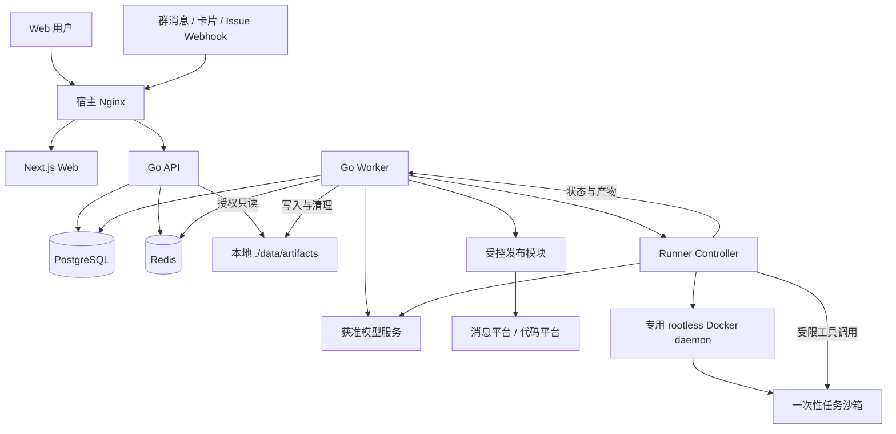
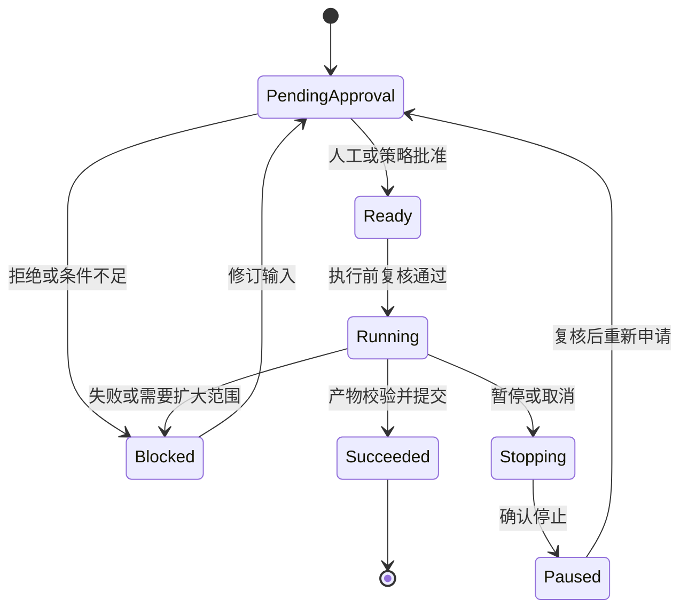
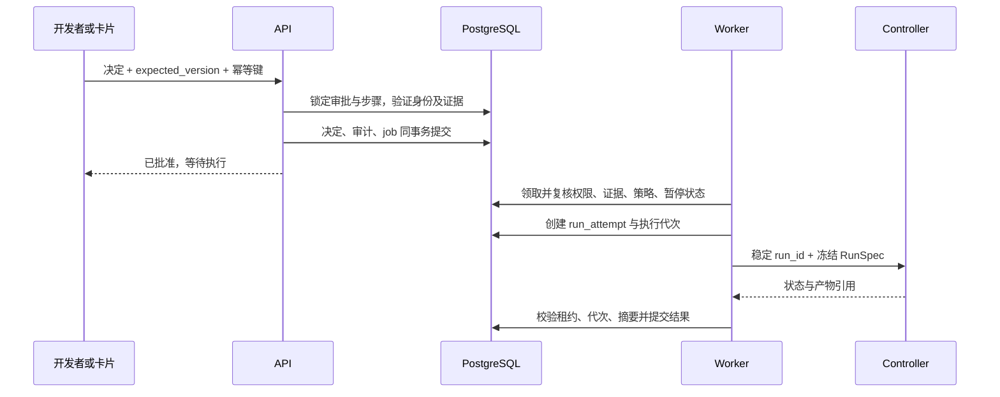

# AgentOwl 技术方案

版本：v0.1 · 技术设计基线  
日期：2026-10-27  
需求基线：[需求文档 v0.1](./requirements.md)  
范围：一个 Auth 维护团队、一个代码平台、一个主仓库、一个内置开发 Agent 执行器的首期完整闭环。

本方案定义系统结构、数据与执行协议。代码平台采用 GitHub，模型采用可配置的 OpenAI 兼容接口，开发 Agent 使用 Runner Controller 内集成的 Eino ReAct。身份源、目标群权限和部署宿主由环境配置。当前代码入口与操作方式见 [运行手册](./operations.md)，实际验证范围见 [验证记录](./verification.md)。

## 1. 核心设计

系统采用 **Next.js Web + Go API + Go Worker + Runner Controller + 独立任务沙箱**。API 与 Worker 使用同一个 Go Module 和领域服务，按进程职责部署。Runner Controller 负责受限执行，不接触业务数据库或外部发布凭据。执行宿主必须登记为 Runtime Machine；系统按能力选机并冻结到每个 attempt。

| 设计项 | 方案 |
|---|---|
| 权威状态 | PostgreSQL 保存问题、知识版本、审批、任务、执行记录和外部操作结果 |
| 异步处理 | PostgreSQL `jobs` 表兼任事务 Outbox；Worker 领取、续租、重试和恢复 |
| Redis | 仅用于缓存、限流和可丢失的临时协调；不保存唯一审批或任务状态 |
| 数据与文件 | 问答、知识正文、处理记录与测试摘要存 PostgreSQL；必要的代码快照、较大日志和报告存 `./data/artifacts`，数据库记录相对路径、摘要与访问范围 |
| API | OpenAPI 3.1 为唯一业务接口契约，Kiota 生成 TypeScript 客户端 |
| 消息接入 | 首期使用应用机器人 HTTP 事件与卡片回调；个人账号连接器在确有需要且验证通过时实现 |
| 自动开发 | 开发者先确认修改，后续阶段依据冻结证据进行人工或策略审批 |
| 开发 Agent | Eino v0.9.22 `flow/agent/react` 管理模型与工具循环；Controller 保留执行限制与证据校验 |
| 执行环境 | 可信 Controller 调用专用 rootless Docker daemon，每次执行使用独立沙箱；控制面可登记多台 Runtime Machine |
| 模型与执行设置 | 管理员通过 Web 保存版本化配置；PostgreSQL 为唯一配置来源，模型密钥加密保存；运行尝试使用审批绑定的配置快照 |
| 执行宿主选择 | `runtime-machines` 记录执行地址、回调地址、状态、调度权重和镜像白名单；系统从就绪机器中选择执行宿主，并把结果冻结到 `run_attempts.runtime_machine_id` |
| 上下文预算 | 开发执行上下文拆为短 header 与只读 context manifest/ref；Context Budget 使用固定离线 `o200k_base` tokenizer 估算，大 diff 与日志按需读取 |
| 发布 | 发消息、推送和创建 PR 由 Worker 内的受控发布模块完成，Agent 无直接发布权限 |
| Web 更新 | SWR 轮询问题、审批和任务状态；首期不增加独立实时消息服务 |
| 部署 | 宿主 Nginx 提供统一入口；应用服务使用 Compose，持久挂载统一位于同目录 `./data` |

首期不引入独立消息队列、工作流引擎、向量数据库、对象存储服务或通用插件框架。必要扩展先由实际接入或问答评测证明需求。

## 2. 系统结构与信任边界



图中发布模块是 Worker 内部模块。Runner Controller 是独立 Go 进程，Eino ReAct 作为 Go 库集成其中，通过模型适配器调用获准模型，再调用 Controller 提供的受限文件工具。Eino 无需额外服务；任何仓库命令都在沙箱内执行。多机模式下，Worker 先选择一台 Runtime Machine，再向该机器发起 Start/Inspect/Stop/Collect/Acknowledge；机器自身通过回调地址读取 settings、context manifest/ref 与运行许可。attempt 被某台机器接受后，后续只向该机器轮询和收集证据，不静默迁移。

| 边界 | 可拥有的能力 | 不允许拥有的能力 |
|---|---|---|
| 浏览器 | 当前登录会话、业务 API | 模型密钥、连接器 Token、数据库凭据 |
| API | 身份校验、业务事务、事件与回调接收、文件授权、Runtime Machine 回调 | 执行仓库代码、Docker 控制权限 |
| Worker | 任务调度、知识处理、受控外部读写、选机 | 在自身进程执行仓库脚本、Docker 控制权限 |
| Runner Controller / Runtime Machine | 受限运行协议、专用 runtime、必要模型调用 | 业务数据库、群消息发送和仓库写凭据 |
| 任务沙箱 | 本任务工作区、已批准工具、网络模式与测试环境 | runtime socket、其他任务目录、生产凭据 |

模型、群消息、Issue、知识内容与仓库文件均不能授予权限。权限来自后端授权配置、开发者决定和当前有效的审批记录。

## 3. 代码组织与模块职责

```text
Frontend/
  app/
    (workspace)/
  components/
  lib/
    api/
      generated/             # Kiota 生成，禁止手改
      client.ts              # Cookie、CSRF、错误转换
    hooks/
    stores/
    validation/
  public/
backend/
  api/
    openapi.yaml
  cmd/
    api/
    worker/
    runner-controller/
    migrate/
  internal/
    httpapi/
    service/                 # identity、ingest、support、knowledge、workflow 业务文件
    integration/
    runner/
    platform/
  migrations/
deploy/
  compose.yaml
  .env.example
  data/
script/
docs/
  requirements.md
  technical-design.md
```

| 模块 | 负责内容 | 主要写入对象 |
|---|---|---|
| `identity` | Web 登录、会话、平台身份映射、角色与资源授权 | 成员、身份绑定、会话、授权 |
| `ingest` | 入站事件、消息标准化、历史补采、能力与游标 | 接入配置、事件、来源消息 |
| `support` | 分类结果、Case、答复、Oncall、时间线 | 问题、关联、答复、负责人路由 |
| `knowledge` | 来源同步、版本、可见性、检索和发布 | 知识来源、版本、片段、引用 |
| `workflow` | 开发确认、步骤、审批、策略、预算与外部操作 | 开发任务、步骤、审批、策略、发布记录 |
| `integration` | 单个平台 SDK／HTTP 协议适配、模型结构化调用 | 不自行改变业务状态 |
| `runner` | Controller 客户端及服务端、Eino 模型／文件工具适配、沙箱生命周期与执行限制、context manifest/ref 读取协议 | 本地运行清单；业务状态通过内部 API 上报 |
| `platform` | PostgreSQL、Redis、本地文件访问、任务领取、配置、日志 | 通用基础设施，不依赖领域模块 |

Go HTTP 服务优先使用标准库 `net/http`，PostgreSQL 使用 `pgx`，SQL 以显式查询和事务为主。迁移采用带版本的 SQL 文件，由独立迁移入口显式执行；上线后的历史迁移不得改写。其他依赖随具体适配器引入，固定版本。

Handler 与 Worker 调用相同领域 Service；Service 是业务状态写入入口。跨模块操作由应用服务组合，在一个数据库事务内完成；不通过绕过服务的 SQL 修改审批或任务。

## 4. 身份、接入与入站处理

### 4.1 Web 与平台身份

Web 首期接入一个团队身份源，由 Go 后端完成登录回调并创建服务器会话。浏览器仅保存 `Secure`、`HttpOnly`、`SameSite=Lax` 的会话 Cookie；不在 LocalStorage 保存访问 Token。写接口验证 CSRF Token 与来源，退出时撤销服务端会话。

若身份源采用 OAuth/OIDC，使用授权码流程、交易绑定的 `state` 和 PKCE，并按实际协议校验身份；OIDC 还需验证发行者、受众、签名和 `nonce`。不把飞书授权接口默认当作 OIDC。[OAuth 安全最佳实践](https://www.rfc-editor.org/rfc/rfc9700.html)

内部成员与外部身份通过 `(provider, app_id, subject_id)` 显式绑定，飞书的 `subject_id` 为应用内 Open ID。平台账号可启用飞书登录与绑定；已有成员在登录态中发起绑定，授权码交换和 user_info 查询在服务端完成。登录交易绑定浏览器 state、S256 PKCE、应用配置版本；绑定交易还绑定发起人的现有会话。交易十分钟过期且只能消费一次。用户 Token 不持久化，模型和 Runner 无法获取。

飞书登录只查找已绑定且启用的成员。绑定写入与管理员维护共享互斥锁和唯一性校验，绑定过程不修改角色、资源范围或成员邮箱。飞书登录会话关联绑定记录，每次认证检查成员、绑定和应用登录状态；解绑立即撤销对应会话。消息请求人、任务上下文与审批卡片共用平台身份解析函数。卡片中的姓名、邮箱、任务参数及普通群成员身份不能直接赋予审批权，业务操作仍按当前成员权限校验。

首次管理员通过部署配置中的稳定身份显式指定，首次登录不自动成为管理员。卡片按固定 `action_type` 分派到问题反馈、认领／接管或审批服务；外部提问者依据已验证的平台身份和来源关系反馈自己的问题，无需成为内部成员，也不因此获得开发权限。

权限采用“角色 + 资源范围”：角色控制操作，资源范围限制渠道、模块和仓库。所有详情、列表、搜索、下载及后台任务均执行相同资源授权；首期单团队也不能绕过渠道可见性。

### 4.2 连接器配置与能力

每个连接器保存区域、应用／账号身份、凭据引用、授权范围、健康状态、验证时间与能力矩阵。能力分别表示：实时 @、实时普通消息、历史读取、话题读取、附件读取、发送、卡片回调。

连接器只封装实际需要的 `VerifyInbound`、`NormalizeEvent`、`FetchHistory`、`FetchResource`、`Send`、`LookupOperation` 等平台操作，不建立可加载任意代码的插件机制。未验证的能力标为 `unverified`，不能被调度器调用。

飞书外部群依赖应用类型与目标租户配置；用户身份历史读取与全账号实时订阅是独立能力。应用机器人和个人账号是否需要不同应用配置，纳入接入验证。[外部群机器人](https://open.feishu.cn/document/develop-robots/add-bot-to-external-group?lang=zh-CN)、[历史消息接口](https://open.feishu.cn/document/uAjLw4CM/ukTMukTMukTM/reference/im-v1/message/list)

### 4.3 HTTP 事件处理

1. Nginx 限制请求大小和速率；API 按连接器协议验证原始请求、解密并校验应用／租户身份。验证握手与业务事件分开处理。
2. 检查渠道白名单与采集起始范围；未经授权的内容不进入业务处理。
3. 在内存中识别并脱敏凭据，持久化所需的标准化字段；原始请求只用于协议校验，默认不落盘。
4. 一个事务内写入 `ingest_events` 和对应 `jobs`，唯一冲突返回已接收结果。事务提交后才 ACK；数据库失败返回可重试错误。
5. Worker 解析上下文、读取附件、分类、生成答复或升级。ACK 路径不调用模型，不等待开发任务。

平台事件存在重复投递与响应时限，接入成功以持久化完成为边界。[飞书事件概述](https://open.feishu.cn/document/uAjLw4CM/ukTMukTMukTM/event-subscription-guide/event-subscriptions)

标准化事件最小字段为：`connector_id`、`event_id`、`kind`、`channel_id`、`external_message_id`、`root_id`、`parent_id`、`thread_id`、`actor_ref`、`source_revision`、`occurred_at`、`received_at`、`sanitized_content`、`attachment_refs`。平台原始结构仅保留必要扩展字段，不能作为授权参数直接使用。

事件去重与消息去重分开：事件按平台投递身份去重；消息按平台对象身份合并。编辑产生新版本，删除／撤回产生失效标记。平台没有可靠版本号时，重新读取对象当前状态或标记待核对，不按到达顺序覆盖。

### 4.4 历史、Issue 与附件

- 历史补采保存范围、分页游标、最近成功点和缺口；实时与历史复用消息唯一键。群根消息与话题回复分别补采，能力不完整时显示具体缺口。
- Issue 首帖、评论与状态事件映射为来源记录，Case 与外部 Issue／PR 通过显式关联维护。Webhook 之外使用增量核对；无完整游标的平台使用有界时间窗重扫。
- 附件通过连接器按原始访问权限获取，限制类型、大小、展开体积与下载时长；不直接抓取消息里任意 URL。涉及远端抓取时限制目标主机、重定向与解析后的地址，阻止访问宿主和云元数据地址。
- 附件默认只保存来源引用，按需授权读取并脱敏，不统一归档原始文件。确需留存的脱敏诊断材料进入受限本地目录，临时文件处理后清理；源文件不可用时明确提示，不假定可永久读取。
- 已用于回答的必要脱敏摘录、来源版本与摘要保存在 PostgreSQL，保留当时的回答依据，不仅保存可能失效的附件链接；后续读取仍需重新校验权限。
- 卡片回调在平台规定时间内完成业务决策事务后反馈，长任务异步执行；超时或响应丢失时可在 Web 查询结果，不能假定平台一定重投回调。[卡片回调概述](https://open.feishu.cn/document/event-subscription-guide/callback-subscription/callback-overview)

## 5. 数据模型

### 5.1 表与核心字段

以下是逻辑表设计；正式字段类型、外键和索引在迁移与 OpenAPI 中冻结。业务 ID 使用 UUID，时间使用 UTC `timestamptz`，Web 按用户时区展示。可变聚合包含递增 `version`；不可变证据通过新版本追加。

| 表组 | 核心字段及职责 |
|---|---|
| `principals` / `identity_bindings` / `role_grants` | 内部成员、平台稳定身份、角色、资源范围、撤销状态与权限版本 |
| `sessions` | 随机会话 ID 的摘要、成员、CSRF Token、到期时间及可选的平台绑定 ID；不保存身份源 Token |
| `lark_login_transactions` | 一次性 state 摘要、PKCE verifier、应用配置版本、发起成员及会话摘要、到期时间 |
| `connectors` / `channels` | 平台身份、凭据引用、能力、白名单、回复模式、健康状态、同步游标 |
| `ingest_events` | 投递唯一键、消息引用、标准化事件、接收与处理状态 |
| `source_messages` / `source_message_versions` | 外部消息身份、话题关系、当前版本、脱敏内容、撤回标记与附件引用 |
| `cases` / `case_sources` / `case_events` | 分类、优先级、环境、负责人、状态、规范问题引用 `canonical_case_id`、回复模式 `reply_mode`、来源关联和追加式处理时间线 |
| `replies` / `answer_evidence` | 答复版本、目标渠道、审核状态、正文摘要、引用的知识／来源版本 |
| `owner_routes` | 模块主负责人、备用人、通知渠道、认领与处理时限 |
| `repositories` | 代码平台、仓库身份、允许分支／路径、凭据引用、测试配置与预算上限 |
| `dev_tasks` / `task_revisions` | 规范问题、确认人、目标仓库、当前阶段、执行代次；不可变目标与验收条件快照 |
| `task_steps` / `run_attempts` | 阶段、输入／输出摘要、状态、运行编号、沙箱身份、租约、执行代次、错误与用量 |
| `approvals` / `approval_decisions` | 冻结的动作与证据、生命周期；追加式人工／自动决定及撤销记录 |
| `policies` / `policy_versions` | 当前生效版本、启停状态；不可变规则、授权范围与预算 |
| `system_settings` | `model`、`execution` 两条配置记录；`data` 保存非秘密参数，`secret` 保存加密模型密钥，包含独立版本、修改时间与修改人 |
| `knowledge_sources` / `knowledge_versions` | 来源修订、权限有效期、版本适用范围、发布状态、受众与审核人 |
| `knowledge_chunks` / `knowledge_grants` | 可重建检索片段、来源位置、可见范围与权限版本 |
| `artifacts` | 本地相对路径、SHA-256、字节数、类型、所属任务／问题、可见范围、过期时间；只登记需要保留的文件 |
| `jobs` | 事务内产生的待办工作、业务幂等键、类型、状态、时间、尝试数、租约 |
| `external_operations` | 回复／通知／推送／PR 操作身份、审批引用、请求摘要、结果状态、远端 ID |
| `audit_events` | 操作者、动作、资源、前后版本、批准依据、结果、关联请求；不存秘密或整段 Prompt |

`JSONB` 用于环境信息、标准化扩展字段和冻结快照；状态、权限、关联与调度字段采用独立列和约束，不把整个系统状态塞进一个 JSON 文档。

### 5.2 必须成立的约束

- `ingest_events`：唯一 `(connector_id, event_id)`；平台没有稳定事件 ID 时，由连接器定义并验证可重放的去重键。
- `source_messages`：唯一 `(connector_id, channel_id, external_message_id)`；版本唯一 `(message_id, source_revision)`。
- Case 默认以自身为 `canonical_case_id`；确认同一缺陷后统一指向一个规范问题，保留各 Case 的来源、回复与权限。关联只允许扁平归组，禁止循环引用。
- 同一开发确认重放只创建一个 `dev_task`；通过部分唯一约束保证同一 `(canonical_case_id, repository_id)` 最多一个活动开发任务。多个 Case 共享该任务，不因重复反馈分别开发。
- 合并问题组时按固定顺序锁定规范问题并检查活动任务；双方已有任务时转人工决定保留或整合，不能静默创建第二个任务或取消执行。归组不扩大任何 Case 的可见权限。
- `task_steps`：同一任务修订下阶段编号唯一；`run_attempts` 的稳定运行 ID 唯一。过期 attempt 不能成为当前步骤的成功依据。
- `jobs`：逻辑工作键唯一，包含对象 ID、对象版本与工作类型；重试复用同一逻辑工作，人工重新执行产生新版本或新尝试。
- `external_operations`：唯一业务动作键，包含逻辑动作、目标与内容版本；不能通过生成新的随机请求 ID 绕过重复保护。
- 同一审批请求只允许一个有效决定；批准内容不可修改。撤销与重提保留原记录，不覆盖批准人或历史证据。
- 索引覆盖队列领取、未认领／超时问题、待审批、问题来源、知识适用范围与权限。对象外键保护关联完整性。

### 5.3 文件与事务一致性

结构化内容直接写 PostgreSQL，不为普通问答、知识正文或测试摘要生成文件。需要保留的较大产物由 Worker 写入 `./data/artifacts` 的临时目录，核验摘要并完成持久化后，在同一文件系统内原子改名，再通过事务登记 `artifacts`。只有文件就绪且数据库记录为 `ready` 时才能下载或参与审批；失败不推进步骤，未被引用的临时文件和孤立文件定期清理。

已用于审批的文件不可覆盖，修改产生新文件与版本；清理不得删除活动任务仍依赖的证据。因删除或撤权必须移除证据时，先使依赖的待执行动作与审批失效。Worker 核对本次执行的产物额度；产物额度为 `0` 时不设任务总量上限，文件系统空间不足时写入失败并记录错误。

首期按单宿主部署：Worker 读写、API 只读挂载同一个 `./data/artifacts` 目录；Controller 和任务沙箱不能挂载该归档目录。下载经 Go API 检查调用者及文件权限后流式返回，Nginx 不直接暴露文件目录。路径由服务端生成并限制在存储根目录内，拒绝路径穿越与逃逸符号链接，不接受客户端指定宿主路径。

删除先让元数据不可访问，再由 Worker 清理文件与索引。审计记录可保留脱敏摘要，正文删除策略同时覆盖副本与备份保留期。跨宿主副本不共享此本地目录，不能直接套用首期部署配置扩容。

## 6. 持久任务、并发与外部操作

### 6.1 Worker 队列

业务状态更新、审计记录及 `jobs` 在同一 PostgreSQL 事务内提交。`jobs` 本身承担 Outbox，首期不再把同一任务复制到 Redis Queue。

Worker 在短事务中通过 `FOR UPDATE SKIP LOCKED` 领取到期任务，设置唯一 `lease_token`、领取代次与 `lease_until`，提交后再执行耗时工作。该锁模式适合多个消费者领取队列表中的记录。[PostgreSQL 行锁说明](https://www.postgresql.org/docs/current/sql-select.html#SQL-FOR-UPDATE-SHARE)

续租、成功、失败和业务结果提交都必须匹配当前租约令牌及未过期条件。提交领域结果时同时验证对象版本、任务执行代次和暂停状态，防止旧 Worker 在新尝试之后提交结果。数据库事务内不等待模型或远端 API。

可重试错误按退避与抖动调度；鉴权失效、无效输入和不支持能力直接阻塞。超过尝试次数进入失败队列，由 Web 查看并重新发起。租约、超时、并发数及每日预算配置化；首期开发并发默认 1，消息处理与开发任务使用不同并发额度。

模型调用与执行任务启动前按配置的预算原子预留用量，结束后结算；结果未知的调用保持预留直至核对，避免并发超支。单次任务 Token 额度为 `0` 时不设置该项上限，启动时预留当日剩余额度并写入运行摘要，结束后按实际用量结算；预留期间其他模型调用可能因可用余额不足而等待。模型接口的每日总额度与供应商限制仍生效。缺失或非法执行配置拒绝执行；有效配置中五项文件与模型额度均可为 `0`。Redis 不可用时限流采用保守降级，高影响操作不能因缓存丢失而无限放行。

### 6.2 三层幂等

| 层次 | 防止的问题 | 方式 |
|---|---|---|
| 入站 | 平台重投、历史与实时重叠 | 投递唯一键 + 消息对象唯一键 |
| 业务 | 重复点击、并行审批、Worker 重放 | 版本检查、行锁、业务唯一键、租约与执行代次 |
| 外部动作 | 发消息、推送、创建 PR 重复 | 持久操作记录、平台幂等参数、结果核对与未知状态 |

外部动作状态为 `pending → dispatching → succeeded / failed / outcome_unknown`。请求前记录目标、请求摘要、批准依据与逻辑动作 ID；平台支持幂等参数时使用同一个值。超时、断连或发送后进程崩溃，不能直接判断失败。

`outcome_unknown` 先通过远端消息身份、任务标记、分支、提交或 PR 查询核对。查询有延迟时保持待核对；无法可靠判断且不支持幂等的操作转人工，不盲目重发。系统不宣称在所有平台上都能保证严格的“恰好一次”。

### 6.3 取消与恢复

停止动作先在事务内递增任务执行代次、取消未领取工作并阻止新的发布，随后要求 Controller 停止沙箱。界面区分“已阻止”“正在停止”“已停止”和“外部结果待核对”。

进入 `dispatching` 的外部操作已经越过授权分发边界；并发撤销不能保证收回已发出的请求。发送模块应在调用前再检查暂停状态，但最终结果仍以远端核对为准。

租约到期只允许 Worker 接管对账，不立即再开一份执行。先查询稳定 `run_id`，确认旧容器结束或被终止，再创建下一次 attempt。迟到结果可作为历史产物保留，不能自动推进步骤。

## 7. 问题处理、模型与知识检索

### 7.1 分诊和答复流水线

```text
标准化消息 → 话题上下文 → 支持范围分类与环境抽取 → Case 创建／关联
         → 受众和版本过滤 → 知识检索 → 结构化回答草稿
         → 事实／引用／敏感信息检查 → 策略或人工审批 → 受控发送
         → 用户反馈／人工处理 → 知识候选
```

确定性规则先处理自己的消息、重复事件、非授权来源和已关联话题。模型负责语义分类与摘要，输出受限结构：相关性、类型、模块候选、缺失环境、建议处理方式、简短依据和引用 ID。字段缺失、枚举非法、引用不存在或模型超时，进入重试或人工分诊，不执行模型任意文本中的操作。

自动合并只使用已经确认的外部对象关系或人工规则；语义相似问题生成关联候选。多人、跨群反馈可共享缺陷关联，但每个回复使用其自身受众上下文。

模型适配器按任务类型暴露分类、回答和知识整理三种结构化调用；输出由服务端 Schema 校验。模型版本、Prompt 模板版本、输入摘要、来源版本、用量和结果状态可追溯，普通日志不保存完整 Prompt 或原始群历史。

### 7.2 检索与版本

首期采用 PostgreSQL 内的确定字段匹配与文本检索：

1. 先筛选受众授权、`published`、来源有效、模块及适用版本／环境。
2. 对错误码、命令名和认证术语做精确匹配；正文按标题／段落切片，保留来源位置。
3. 对英文和命令文本使用适当的词项检索，对一般文本补充 `pg_trgm` 相似检索；短词使用受限候选集内的精确或包含匹配。
4. 合并排序后取受限数量的片段送给模型，引用只能使用这些片段 ID。

`pg_trgm` 提供相似度与索引能力，但中文、缩写和短错误码的实际召回必须用项目样本验证，不能把使用该扩展视为问答质量已经达标。[PostgreSQL pg_trgm](https://www.postgresql.org/docs/current/pgtrgm.html)

每个知识版本记录来源修订、适用 CLI 范围、操作系统、认证方式、环境、发布状态和可见性。版本缺失或候选相互冲突时补问或转人工。向量能力不属于首期默认依赖；是否增加由需求中的质量门槛决定。

### 7.3 权限、缓存与发送复核

外部群仅检索已获对外发布授权的知识版本。内部材料转为公开 FAQ 时创建独立候选并审核，不能把删除引用链接当作脱密。

检索先过滤再向模型提供内容，缓存键包含受众范围、权限版本、知识版本及检索条件；首期不做跨受众的回答缓存。检测到撤权时同步使来源不可检索并递增权限版本，索引与缓存清理异步完成。

发送前复核答复版本、引用有效性、受众、适用条件、当前策略和 Case 的 `reply_mode`。人工接管在事务内切换回复模式、递增版本并使未分发的自动答复失效；恢复自动回复需要明确操作和重新评估，不能直接发送旧草稿。来源变化或证据过期同样使草稿失效。

远端权限通过事件与周期核对更新；到达有效期仍无法核验的受限来源暂停使用。无法接收实时撤权通知的平台不承诺零延迟感知。

已发送回答保留当时证据版本；知识纠错产生受影响问题列表，由处理人决定更正。成功发送、用户确认解决和知识发布分别记录。

### 7.4 Oncall

`owner_routes` 按模块匹配主负责人、备用负责人和通知渠道；无匹配进入默认队列。认领操作采用 Case 版本检查，防止多人同时覆盖处理人。

认领时限、处理时限和提醒保存在 PostgreSQL 的时间字段及延迟 `jobs` 中。每次提醒执行前检查当前负责人和状态；任务已解决或已转派则跳过旧提醒。通知经过 `external_operations`，失败可见，聚合提醒避免同一缺陷造成连续通知。

## 8. 开发状态机与审批协议

### 8.1 阶段及状态

开发者在 Case 上确认目标、仓库和验收条件后创建任务修订。后续阶段固定为 `plan → edit → test → review → publish_pr → track`，首期不允许用户上传任意工作流定义。



该图表示单个步骤。任务级取消为终态；重新发起创建新修订。计划、编码、自测和审查各自产生不可变产物，任务阶段与执行 attempt 分开记录。

### 8.2 冻结的执行证据

每个动作创建 `ActionSpec`，按明确字段顺序与集合排序序列化并计算 SHA-256。由服务端构造摘要，客户端不能自行声明“内容未变”。

开发步骤的冻结输入绑定 `model_version`、`execution_version`、审批模式，以及执行所需的网络、文件系统权限和额度。模型或执行设置保存后，相关旧待执行审批在同一事务中变为 `stale`，活动任务变为 `blocked`；恢复任务会重新准备步骤并要求审批。已经开始的 attempt 保留原模型、网络、文件系统权限和额度，下一次执行按新版本准备。

| 动作 | 必须绑定的证据 |
|---|---|
| 确认修改 | Case 版本、目标仓库、目标行为、验收条件、授权开发者 |
| 开始方案 | 任务修订、仓库基线、允许读取范围、模型与预算 |
| 开始编码 | 方案版本、基线、允许路径／操作、工具策略与预算 |
| 执行测试 | 待测 tree／提交摘要、命令参数、镜像 digest、网络与测试凭据范围 |
| 开始审查 | 最终 tree、diff、测试报告、审查范围与模型配置 |
| 推送／提 PR | 最终 commit／tree、diff、测试与审查结果、目标仓库／分支、PR 正文 |
| 对外回复／发布知识 | 正文摘要、目标受众、来源版本、发布权限 |

测试报告绑定固定输入清单、tree 和测试目录写入模式。默认只读挂载源码，构建输出写入独立目录。`test_workspace_writable=true` 时，在专用 daemon 为本次执行创建匿名 Docker 卷，挂载到 `/workspace`，将输入复制到 `/workspace/source` 并以此为测试工作目录；原审批快照不挂入容器。允许新增依赖和构建文件，但原快照中的文件若被修改、删除、改变执行位或替换为链接，则本次测试失败。归档和后续 PR 只使用原审批快照，临时卷及新增文件在执行结束后删除。需要改变已有源码或锁文件时，在编码阶段形成新快照并重新审批。

测试容器停止后，Controller 核验容器 ID、任务／执行标识与 spec 摘要标签，以及 `/workspace` 挂载的唯一性、卷名、`local` 驱动和精确来源路径。核验通过后，从已挂载的专用 runtime 目录只读打开该卷的原审批文件，逐项比较内容和执行权限；路径中的链接、缺失文件和异常类型均判定失败。验证不读取新生成的依赖目录，也不将其加入代码产物。

### 8.3 人工决定与执行前复核



人工审批与策略审批调用相同的状态转换。API 从会话或已验证的平台身份得到操作者，不能信任请求正文中的用户 ID。重复请求同幂等键、同正文返回已有决定；同键不同正文返回冲突。

执行前再次检查审批未撤销、未过期，审批人仍具备该动作权限，证据未变化，任务未暂停，当前规则未禁止。通过后才预留预算并创建 attempt。人工批准不绕过执行前检查。

策略修改、权限撤回或任务输入变化会使依赖的待执行动作失效。重新评估自动规则产生新决定；人工批准若需重审，不能通过“更新审批记录”保留旧签名。

### 8.4 自动审批规则

每条规则包含动作类型、渠道／仓库／模块范围、允许路径、操作类别、最大改动与资源预算、必要检查、有效期和结果 `deny / manual / auto`。规则仅处理预定义字段，不支持动态脚本。

审批策略统一保存于 `configs.kind=policies`；`data.kind=create_task` 为任务创建，其余操作类型沿用原值。创建建议进入 `approvals`，使用共同的版本校验、批准/拒绝/撤销、权限校验、异步执行和审计入口。来源不完整时仅保存阻塞记录，不创建任务。

创建任务、发送回复、发布知识、生成方案、修改代码、运行测试、审查变更和提交 PR 共用 `configs.kind=policies`。各操作支持人工、自动、禁止和独立通知设置；未匹配时人工审批。运行前重查策略、权限与审批证据。执行设置只管理运行环境、额度和重试。

策略匹配顺序：全局暂停或禁用 → 明确禁止 → 风险事实不足／任一规则要求人工 → 满足完整自动条件 → 默认人工。多个自动规则同时适用时取权限和预算的交集，不能拼出更大的权限。所有模式均保留执行前的权限、版本与产物校验。

开发者直接确认创建任务时仍检查渠道和仓库的禁止策略；自动来源的任务创建必须通过统一审批。模型风险自评仅作参考；变更路径、测试摘要、依赖变化等事实由服务端从产物计算。自动决定记录命中的规则、策略版本及证据。

## 9. 隔离执行与代码发布

### 9.1 Controller 与专用 runtime

宿主 Linux 为执行器提供独立低权限账号和专用 rootless Docker daemon。Controller 是 Compose 中唯一有权访问该 daemon 控制端点的服务；不连接宿主主 daemon，不挂载 `/var/run/docker.sock`。API、Worker 与任务沙箱均无 Docker Socket。

专用 daemon 配置由部署脚本生成，`data-root` 位于 `./data/runner/runtime`，控制 Socket 放在 `./data/runner/control` 的受限目录中并在启动时重建。宿主的标准运行时目录仅保存临时进程状态，不保存业务数据。该账号只访问 runner 子目录，不可读取数据库、归档产物、应用配置或其他用户目录。

部署脚本记录绝对 `RUNNER_HOST_DATA_ROOT`，Controller 将对应目录挂载到固定容器路径。Docker bind mount 的源路径由 daemon 在宿主解释：Controller 必须从任务／attempt ID 派生宿主路径与容器路径，不能把自身容器内的路径直接交给 daemon。迁移后重新生成绝对路径配置。

这项宿主初始化是执行环境的明确前置条件；普通 `docker compose up` 不会自动提供安全沙箱。Rootless Docker 依赖用户命名空间、systemd 等宿主条件。网页执行设置中的 `resource_limits` 只接受 `required` 或 `disabled`，默认 `required`，无效值拒绝保存或执行。`required` 必须验证 cgroup v2、控制器委派及实际 CPU、内存和 PID 限制，未满足则阻止开发执行。每台 Runtime Machine 都有各自的执行地址、回调地址、访问令牌和回调令牌；Runner 回调按机器 ID 校验。context manifest/ref 由 API 通过只读内部接口返回，使用固定离线 `o200k_base` tokenizer 估算 token 预算，而不是按字节长度近似。 [Rootless Docker](https://docs.docker.com/engine/security/rootless/)、[资源限制说明](https://docs.docker.com/engine/security/rootless/tips/#limiting-resources)

仅可信开发环境可显式使用 `disabled`，关闭 CPU、内存和 PID 的 cgroup 限制，并强制要求 `max_concurrent=1`；任务仍可能耗尽宿主资源。该模式保留专用 rootless daemon 与 `data-root` 校验、独立容器、非 root 用户和运行许可。网络、根文件系统写入、测试目录写入与时限分别由执行设置控制。宿主初始化及预检通过 `--resource-limits required|disabled` 选择检查范围，实际运行模式来自数据库的执行设置。

Controller 通过服务身份认证的内部设置接口读取配置。启动时核验专用 runtime 身份并清理中断任务；每次新运行再获取当前模型与执行设置，核对 `RunSpec` 中的两个配置版本并检查宿主能力。凭据只在可信进程内使用，不写入运行清单、日志、产物或任务沙箱。配置缺失、停用或版本不匹配时阻止新执行。

### 9.2 运行协议与工具边界

Controller 暴露仅内部可达且有服务身份认证的 `StartRun`、`InspectRun`、`StopRun`、`CollectArtifacts` 操作。`StartRun` 接受稳定 `run_id`、任务／步骤／attempt 身份、执行代次、批准证据引用、输入清单摘要、镜像 digest、工具配置及预算；相同 ID 相同内容返回同一运行，内容不同返回冲突。

容器名称由稳定 `run_id` 派生，并标记任务、attempt、执行代次和输入摘要。创建超时或 Controller 重启时，先按名称／标签查询 runtime，再补全本地清单；结果无法确认时不再次创建。孤儿容器进入停止与回收流程。

Controller 根据服务端模板计算任务目录和挂载，不接受模型或来源消息指定宿主路径、任意 Docker 参数、设备或网络模式。启动前向内部业务 API 核验运行许可；控制通信失联或许可续期失败时停止新增工具调用，并按限定宽限期终止运行。

开发 Agent 使用 Eino v0.9.22 的 `flow/agent/react`。`backend/internal/runner/agent.go` 通过 `react.NewAgent` 创建本次运行的 Agent 并调用 `Generate`；Eino 维护会话消息历史，执行模型与工具循环及工具分发。Controller 将工具节点配置为 `ExecuteSequentially: true`，强制串行执行。

`backend/internal/runner/eino.go` 将 Eino 的模型与工具接口适配到本次运行的模型客户端与受限文件工具。模型使用 OpenAI 兼容接口及数据库配置快照；Agent 使用非流式请求。Controller 按阶段开放工具和执行权限：

- `plan` 与 `review`：只读任务文件和给定证据，不执行仓库脚本。
- `edit`：在允许路径内读取和修改文件；默认无通用 Shell。需要执行命令时提交独立请求，经过测试控制点授权。
- `test`：Controller 在沙箱中直接运行批准的固定命令参数、镜像与环境，不经过 Eino 的模型与工具循环；测试结果依据实际退出状态记录。

Controller 在模型调用和文件工具执行前校验运行许可，按已配置的正值限制 Token 与工具调用用量，并处理取消和超限；这两项为 `0` 时不设单次任务额度。最终结果还需通过实际文件读取、阶段前后快照摘要、编码变更和结构化审查结果等证据校验；工具不得访问授权范围外的宿主文件或进程。

Controller 直接管理本次 attempt 的目录枚举、删除和快照。`network_mode=bridge` 且根文件系统只读时，`read_file`／`write_file` 也通过 `os.OpenRoot` 访问已挂载的本次工作区，校验路径、链接和文件类型；写入仍仅限 `edit` 阶段及批准路径，遵守已配置的代码文件数和字节额度，并以原子替换完成。其他组合的读写使用 Docker archive 接口。各阶段仍创建独立任务容器；文件工具不执行宿主命令，仓库测试命令始终在任务容器内执行。

开发阶段推进、审批与发布由 Worker 的业务状态机管理。Eino 的消息和工具调用不授予权限，也不修改审批状态；Controller 只有在运行许可有效且证据校验通过后才将本阶段标记为成功。

#### 按需上下文

开发上下文在步骤准备事务中冻结到执行输入，并纳入审批的 `input_hash`。Manifest v2 的事实头包含请求人、任务授权人、机器人、来源会话、任务修订和授权摘要；资料索引指向问题详情、采用的信息、参考信息、已完成阶段的报告以及 diff／日志。来源消息原文只从已经采用或明确标为参考的信息读取。人工创建问题的描述也可作为资料读取。

`read_context_manifest` 返回完整资料索引；`read_context_ref` 按引用 ID 和 cursor 读取原文，每页最多 1536 个 Unicode 字符，返回内容 SHA-256、位置、总字符数和续读游标。采用的信息索引包含 `read_task_input` 所需的 ID，其送达和入模回执继续按输入摘要记录。上下文读取验证运行许可、机器归属和来源版本，不能用任意 artifact ID 访问其他资料。模型每次读取的内容都是来源证据，不产生审批权或扩大写入范围。

任务、步骤审批和产物的可见性包含所有已关联输入的来源权限；授权人失去来源访问权时，执行许可失效。会话覆盖度标记为本系统已接收的消息，不代表飞书完整历史。支持问答仍使用有长度限制的输入和已筛选的知识证据，同时携带相同的请求人及会话事实。

Runtime Machine 用 `context_manifest_version: 2` 声明支持上述协议。准备 v2 上下文的任务只调度到支持该版本的运行器；API、Worker 与 Runner 应使用同一发布版本。

### 9.3 沙箱生命周期

1. Worker 使用只读仓库连接获取固定基线，构造来源清单；子模块、LFS 或额外依赖必须显式声明。仓库内容不能决定宿主挂载或 Git 凭据。
2. Controller 校验输入摘要，将文件放入 `./data/runner/tasks/<task>/<attempt>`；拒绝路径穿越、逃逸符号链接、危险文件类型和超限归档。
3. 每个 attempt 启动独立容器：非 root、删除 capabilities、`no-new-privileges`、受限 seccomp，且不挂载 Docker Socket。`read_only_rootfs` 默认 `true`；设为 `false` 仅允许写入当前用户有权限的容器目录，仍不能假定系统软件包安装可用。`required` 模式另施加 CPU／内存／PID 硬限制。测试目录按第 8.2 节选择只读快照或可写副本。
4. `network_mode` 默认 `none`；选择 `bridge` 时接入专用 rootless daemon 的 Docker bridge 网络，可访问该网络能到达的地址，不提供域名白名单，实际连通性取决于宿主路由。模型调用和代码获取由可信组件完成；依赖安装脚本仍在任务容器内执行，模型密钥不注入容器。
5. Controller 记录工具事件、实际命令、起止时间、退出状态和预算；输出经脱敏后成为日志或模型输入。`timeout_seconds` 为 `0` 时不设执行计时器，为 `1–3600` 时施加相应时限；暂停、审批失效或许可撤销仍会停止任务。超时、取消或许可失效时终止整个容器，而非仅停止顶层命令。
6. 导出文件清单、diff、日志和测试报告，由 Worker 通过受限 `CollectArtifacts` 接口拉取并核验；摘要写入 PostgreSQL，需要保留的文件按第 5.3 节写入本地归档目录。确认接收完成或记录失效后销毁沙箱。

宿主工作区和专用 runtime 文件系统均具有总字节数与 inode 容量边界，并配置日志轮转。`workspace_mb`、`max_files`、`artifact_mb`、`max_tool_calls`、`max_tokens` 默认均为 `0`，表示不设对应任务额度；正值分别限制代码输入与快照大小、代码文件数、产物总量、工具调用次数和模型用量。前后端仅为数值表示与字节换算校验安全边界，不设置固定产品上界。`workspace_mb` 与 `max_files` 为正值时也用于容器 `/tmp`、`/output` 的 tmpfs 容量和 inode 配额；为 `0` 时不设这两项挂载配额，实际可用内存及已启用的内存配额仍生效。可写测试卷中的新增依赖和构建文件不计入代码快照总量或文件数，其总量受专用 runtime 盘容量约束。Runner 数据位于 `./data/runner`；Controller 只使用已验证容量的存储，不授予沙箱配额管理权。容量机制、剩余空间保护及清理失败均纳入预检，任务额度为 `0` 也不增加宿主实际可用容量。

离线沙箱使用经过核验的工具链镜像与依赖缓存。联网测试可在允许写入的临时副本中安装项目依赖；网络模式和写入选项随执行配置版本进入审批证据。Worker 和 Controller 不直接运行仓库的安装脚本。联网开关只选择 Docker 网络模式，不代表依赖源可用或外网连通；连接失败按实际测试结果报告。

Agent 使用测试凭据时，凭据只进入批准的测试进程，不进入模型文本或产物；测试凭据不能用于生产。首期本机 Linux runtime 不等同于已具备 Windows／macOS 运行验证能力，跨平台结果按实际 CI 或人工证据记录。

### 9.4 Git 与 PR

Worker 的发布模块在独立临时工作区接收经过批准的文件清单或补丁，验证路径、模式、基线和最终 tree，生成固定 commit 并冻结 PR 描述。该过程关闭仓库 Hook、外部 diff／filter 等可执行扩展，不在持有写凭据的环境运行测试或安装依赖。

审批绑定最终 commit、目标和描述之后才注入最小写凭据。推送仅允许任务专属分支，使用预期远端引用值进行并发保护，不强推覆盖人工变更。随后按固定任务标记创建或更新 PR。

推送与创建 PR 是两个关联的 `external_operations`：推送成功而 PR 创建未知时，只核对 PR，不重复生成提交或分支。目标基线更新、人工改动分支或审查引发新代码修改时产生新修订，重新执行受影响的审批和测试。

`track` 只同步 CI、审查、合并、关闭和版本信息；不执行自动合并或生产发布。PR 关闭未合并时记录原因并交回负责人；合并后仍等待适用版本和用户验证。

## 10. API 契约

### 10.1 通用约定

业务接口统一为 `/api/v1`，OpenAPI 3.1 文件为 `backend/api/openapi.yaml`。所有 operation 有稳定 `operationId`；列表使用游标分页和稳定排序，返回 `items`、`next_cursor`。日期为带时区的 RFC 3339 字符串。

资源修改携带 `expected_version`，产生外部动作或决定的请求携带 `Idempotency-Key`。操作者由认证上下文提供。版本冲突返回 409；无效业务输入返回 422；未登录、无权限、限流和依赖不可用分别返回明确错误。对不可见资源避免泄露存在性。

错误采用 `application/problem+json`，包含标准问题字段和稳定 `code`、`request_id`、可选字段错误；不返回堆栈、SQL、Token 或原始平台报文。异步操作返回 202 和可查询任务引用，前端不能据此显示“已执行完成”。

Kiota 负责生成客户端；实际契约须覆盖可空字段、枚举、分页、错误和文件下载测试。固定工具版本并在 CI 重新生成检查漂移；手写封装只处理传输与认证，不重建一套 DTO。[Kiota TypeScript](https://learn.microsoft.com/en-us/openapi/kiota/quickstarts/typescript)

### 10.2 首期接口清单

| 接口 | 用途与约束 |
|---|---|
| `GET /auth/login`、`GET /auth/callback`、`POST /auth/logout` | 后端身份流程；路径位于业务 API 前缀之外 |
| `GET /api/v1/me` | 身份、可见范围、可执行动作与 CSRF 初始化信息 |
| `GET /api/v1/cases`、`GET /api/v1/cases/{id}` | 问题列表、详情与当前版本 |
| `POST /api/v1/cases`、`PATCH /api/v1/cases/{id}` | 手工登记、分派、分类和状态修改 |
| `POST /api/v1/cases/{id}/actions`、`POST /api/v1/cases/{id}/feedback` | 固定动作：认领、接管／恢复回复、关闭／重开；关联提问者的解决反馈独立授权 |
| `POST /api/v1/cases/{id}/relations` | 重复／关联／拆分关系，保存原因 |
| `GET /api/v1/cases/{id}/events` | 游标读取处理时间线 |
| `POST /api/v1/cases/{id}/reply-drafts` | 生成或保存回复草稿，不能直接发出 |
| `POST /api/v1/replies/{id}/submit` | 冻结内容并进入对应发送审批／策略 |
| `POST /api/v1/cases/{id}/development-confirmations` | 仅授权开发者确认修改并建立任务 |
| `GET /api/v1/development-tasks`、`GET /api/v1/development-tasks/{id}` | 任务集合、阶段、步骤、产物、预算和阻塞原因 |
| `GET /api/v1/run-attempts/{id}/events` | 按游标读取脱敏工具事件与日志，限制条数和单次字节数 |
| `POST /api/v1/development-tasks/{id}/revisions` | 修改目标或范围，创建新修订并失效相关审批 |
| `POST /api/v1/development-tasks/{id}/actions` | 固定枚举：暂停、恢复、取消、接管；非任意命令入口 |
| `GET /api/v1/approvals`、`GET /api/v1/approvals/{id}` | 当前待办与冻结证据 |
| `POST /api/v1/approvals/{id}/decisions` | 批准、拒绝、撤销；授权和版本均由后端校验 |
| `GET /api/v1/knowledge`、`POST /api/v1/knowledge` | 检索与创建知识候选 |
| `GET /api/v1/knowledge/{id}`、`GET /api/v1/knowledge/{id}/versions` | 知识详情及授权范围内的版本记录 |
| `POST /api/v1/knowledge/{id}/versions`、`POST /api/v1/knowledge/{id}/submit` | 新版本、提交审核，发布走审批流程 |
| `POST /api/v1/knowledge/{id}/withdraw` | 同步撤回可检索状态并递增权限版本，异步清理索引与缓存 |
| `/api/v1/knowledge-sources`、`POST /api/v1/knowledge-sources/{id}/sync` | 来源配置、范围撤销、正文同步和权限重新核验 |
| `GET /api/v1/artifacts/{id}/content` | 经资源授权的流式下载 |
| `/api/v1/connectors`、`/api/v1/channels` | 接入配置、能力测试与同步状态；凭据只接受写入，不返回明文 |
| `/api/v1/owner-routes`、`/api/v1/policies` | 负责人和版本化策略管理 |
| `/api/v1/principals`、`/api/v1/identity-bindings` | 团队成员（内含角色与资源授权）和显式身份绑定；权限变更必须留痕 |
| `/api/v1/repositories` | 仓库、分支／路径、测试配置与预算管理；测试配置变更形成新版本 |
| `GET/PUT /api/v1/settings/model` | 已登录成员查看非秘密配置与密钥配置状态；管理员更新模型、密钥和每日 Token 预算，携带 `expected_version` |
| `GET/PUT /api/v1/settings/execution` | 已登录成员查看执行额度和 runtime 能力；管理员更新审批方式、网络／文件系统选项、资源模式、并发与额度，携带 `expected_version` |
| `GET /api/v1/audit-events`、`GET /api/v1/external-operations/{id}` | 审计与外部结果核对状态 |
| `POST /hooks/{provider}/{connector_id}/events` | 平台事件入口，使用平台认证而非 Web Cookie |
| `POST /hooks/{provider}/{connector_id}/actions` | 卡片入口，验证后按固定动作分派到反馈、问题处理或审批服务，分别校验权限 |

表中集合路径的具体 CRUD operation 在契约编写时展开，更新策略必须产生新版本。Runner 内部接口使用独立监听端口与服务身份认证，不经公网 Nginx 路由；包含运行许可校验／续期、事件与产物清单提交，均绑定 `run_id`、执行代次与受限作用域。事件序号去重，旧代次不能续期或推进状态；文件由 Worker 拉取并核验就绪后登记，API 不承担归档写入。内部接口只接收运行事实，不提供“直接批准任务”能力。

## 11. 前端实现

采用 React + Next.js App Router + TypeScript，UI 使用 Tailwind CSS 4、shadcn-ui、Radix UI、Lucide 和 Geist。Sonner 统一消息提示，cmdk 用于全局命令面板及可搜索选择器，Zod 用于表单和边界校验。

| 路由 | 页面数据与操作 |
|---|---|
| `/` | 待处理、待审批、超时、接入故障和开发任务摘要 |
| `/cases`、`/cases/[id]` | 筛选与搜索、来源上下文、答复、分派、时间线、开发确认 |
| `/approvals`、`/approvals/[id]` | 冻结方案、diff、测试、目标和决定 |
| `/development/[id]` | 步骤、执行记录、产物、预算、暂停／停止／接管 |
| `/knowledge`、`/knowledge/[id]` | 来源、版本、可见性、审核和失效状态 |
| `/settings/connections`、`/settings/team`、`/settings/policies` | 接入、团队、负责人路由与策略版本 |
| `/settings/model`、`/settings/execution` | 模型与执行设置；管理员修改、其他成员只读；状态区展示执行器能力、当前版本与阻塞原因 |
| `/audit` | 授权范围内的操作与外部结果查询 |

SWR 管服务端数据，Zustand 仅保存面板状态及尚未提交的编辑；可分享筛选条件放 URL。活动任务详情建议 3～5 秒轮询，列表 10～15 秒，后台页暂停轮询，错误退避。日志按游标增量获取并限制条数，避免每次拉取全文。

所有业务请求经 Kiota 客户端。前端显示服务端返回的可操作动作，同时后端独立校验；审批成功后重新获取步骤状态，不乐观显示已运行。遇到 409 展示新版本差异并要求重新阅读证据。

模型密钥只写不读，留空保留已有值，清除需显式选择；更换 API 地址时要求重新填写或清除密钥。执行器状态每 10 秒刷新，未知能力显示待验证；宿主明确不支持时禁止选择 `required`。`disabled` 固定并发为 1，并将 CPU／内存／PID 输入显示为不生效。审批方式集中在审批策略页；网络、根文件系统和测试目录写入在任务执行页分组，时限明确标注 `0` 为不设执行超时，并说明暂停、审批失效或许可撤销仍会停止任务。开发审批页展示冻结的网络、根文件系统、测试写入和审批方式。配置刷新失败时保留未提交表单，版本变化后要求重新载入再保存。

“文件与模型用量”五项接受 `0` 或正整数，不设置 HTML 数值上界；`0` 明确表示不设对应任务额度，审批中的额度显示为“不限”。单次任务模型额度与模型接口的每日总额度分开，实际可处理量仍取决于宿主可用磁盘、内存和模型服务能力。

界面优先呈现当前状态、阻塞原因、责任人和下一步。审批页必须展示具体仓库、路径范围、代码摘要、测试覆盖与外部目标；卡片中的长内容链接到已登录 Web。Markdown 禁止不受信任 HTML，外部链接与日志内容按不可信输入渲染。

## 12. 部署、数据迁移与配置

### 12.1 服务与网络

| 服务 | 暴露范围 | 数据与配置 |
|---|---|---|
| `web` | 仅宿主回环端口，由 Nginx 代理 | 无不可恢复业务状态；可重建缓存按需挂载 `./data/web` |
| `api` | 公网入口仅经 Nginx；内部 Runner 接口独立网络 | 最小数据库账号、身份与入站凭据；只读挂载 `./data/artifacts` |
| `worker` | 无公网端口 | PostgreSQL、模型、连接器及发布凭据，按用途隔离；读写挂载 `./data/artifacts` |
| `runner-controller` | 仅 Worker／内部 API 可达 | 挂载 `./data/runner`，管理控制 Socket、任务目录和运行清单；核验身份后只读打开 runtime 卷内的测试输入；无业务 DB 与发布凭据 |
| `postgres` | 仅业务内部网络 | `./data/postgres` |
| `redis` | 仅业务内部网络 | 首期可无持久缓存；启用持久化时使用 `./data/redis` |
| 任务沙箱 | 专用 daemon 管理，默认无网络 | 普通阶段挂载本次任务目录；可写测试挂载本次执行专属匿名卷至 `/workspace`，工作目录为 `/workspace/source`，不挂载原审批快照 |

宿主 Nginx 将 `/` 路由到 Web，`/api/v1`、`/auth`、`/hooks` 路由到 API，负责 TLS、请求体限制与代理超时。Next.js 不承担第二套业务鉴权。宿主 Nginx 配置由部署说明给出，不纳入 Compose 服务。

应用网络与 Runner 控制网络分开；Controller 不加入数据库网络。首期不在 API／Worker 容器中安装可直接执行仓库任务的工具链。数据库迁移由一次性受控入口执行，不由多个服务启动时竞态迁移。

### 12.2 `./data` 布局与密钥

```text
deploy/data/
  postgres/
  redis/
  artifacts/                 # 必要的本地执行产物，由 Worker 写入
  runner/
    control/                 # 临时控制 Socket，恢复时重建
    runtime/                 # 专用 daemon 数据及临时测试卷，可按恢复规则重建
    tasks/                   # 按任务和 attempt 隔离的工作区
    manifests/               # Controller 运行清单
  secrets/                   # 受限文件，不提交 Git，不进入模型上下文
  backups/                   # 一致性备份与校验清单
```

所有持久挂载相对 `deploy/compose.yaml` 使用 `./data/...`，不使用隐含的不可迁移 named volume。测试匿名卷位于专用 runtime 文件系统，受其总容量约束，属于执行结束后删除的临时数据。控制 Socket 不作为持久数据复制；配置与初始化脚本负责重建。

模型、连接器／身份源凭据使用应用级加密保存，主密钥从受限 secret 文件挂载。密钥带版本并支持轮换；日志只显示凭据引用和状态。模型地址、名称、接口兼容选项、每日 Token 预算，以及资源模式、并发与每次执行额度统一由 Web 写入数据库。Runner 地址、服务令牌、镜像白名单、宿主路径和磁盘边界仍由部署环境配置。部署配置、证书和恢复所需密钥纳入受控备份，权限分离且不入 Git，传输及离线副本加密。

镜像、前后端依赖与数据库版本固定；配置只保存选择结果和限额，不存可执行脚本。模型、连接器、Runner 与发布各自有总开关，未通过验证的能力默认关闭。

### 12.3 迁移与恢复协议

1. 进入维护状态：停止接收可推进的外部写入，暂停调度与发布；核对在途外部操作。
2. 停止沙箱并导出所有需保留产物，记录任务检查点；不复制活容器来实现任务续跑。
3. 停止服务后复制项目目录，或在停写期间制作数据库与本地产物目录的一致性备份，附校验清单、配置和恢复密钥。禁止运行中直接复制 PostgreSQL 数据目录。
4. 目标机准备兼容版本、文件权限、rootless 用户及 UID/subuid/subgid、文件系统和资源控制条件；运行初始化脚本，重建 runtime 与控制端点。可重建镜像缓存不作为任务恢复的唯一依据。
5. 先以只读／暂停外部发布模式启动，检查迁移版本、本地文件摘要与引用、审批、来源授权和外部操作状态。
6. 完成远端对账后逐项恢复接入与 Worker；待执行任务重新检查审批与权限，通过新 attempt 恢复。

“拷贝项目目录”负责携带数据与配置；目标宿主仍须具备上述运行环境和可用外部账号。恢复演练通过后才能认定可迁移。

## 13. 可观测性与验证

### 13.1 指标、日志与告警

结构化日志贯穿 `request_id`、`case_id`、`job_id`、`run_id` 和 `external_operation_id`，记录结果、耗时和安全错误码。来源全文、Prompt、密钥、会话和带访问凭据的 URL 不进入普通日志。

核心指标包括入站延迟／缺口、队列积压、租约回收、未知外部操作、待审批时长、Oncall 认领时长、模型用量、有效答复覆盖率、知识过期率、Runner 资源与失败原因。业务指标从权威记录计算，不能以模型自报“成功”计数。

健康检查分别覆盖存活、数据库就绪、来源授权、模型可用及 Runner 隔离预检。模型或 Runner 不可用不阻止已授权事件落库，但相应能力暂停。未知外部结果、来源失效、无人认领和预算超限进入 Web 告警与指定通知渠道。

### 13.2 需求到验证的映射

| 验证类别 | 关键场景 | 对应需求验收 |
|---|---|---|
| 接入契约／租户实测 | 事件验证、重投、历史与话题、权限不足、外部群及选定账号方式 | AC-01、AC-02 |
| 分诊与问答评测 | 独立标注集、适用版本、无依据转人工、来源和覆盖率 | AC-03、AC-04 |
| 来源与关联 | 多群、Issue 评论、重复关联、删除／编辑后的重评 | AC-05 |
| 事务与审批 | 并行决定、旧卡片、权限撤销、策略变化、批准后改代码 | AC-06～AC-09 |
| 执行隔离 | 任意挂载／路径逃逸、工具越权、网络绕过、资源耗尽、停止与接管 | AC-10、AC-11 |
| 知识生命周期 | 内外受众、过期、撤权、候选发布、删除和更正 | AC-11、AC-12 |
| 发布与闭环 | 推送成功但 PR 超时、CI 失败、PR 未合并关闭、版本与用户验证 | AC-07、AC-13 |
| 恢复演练 | ACK 后崩溃、租约过期旧 Worker、沙箱失联、发送结果未知、迁移恢复 | AC-14 |

数据库并发测试使用真实 PostgreSQL；平台契约测试使用固定脱敏样例及平台测试环境；沙箱隔离与资源限制必须在目标 Linux 宿主实测。Mock、单元测试、测试租户和生产验证分别报告，不能相互替代。

CI 至少检查 Go 格式／静态检查／相关测试、TypeScript／ESLint／构建、OpenAPI 校验、Kiota 生成漂移、迁移及 Compose 静态检查。审批、结果未知、任务恢复和权限隔离必须有失败路径测试；纯展示组件无需为实现细节建立镜像式测试。

## 14. 实施前需冻结的接入项

这些项目不改变主体架构，但影响适配器、权限和验收；未确定的对应能力保持禁用，不用假实现代替完成。

| 接入项 | 需要确定的内容 | 放行条件 |
|---|---|---|
| 群渠道 | 飞书／Lark 区域、应用归属、首批群、是否需要个人账号 | 逐项能力与失效场景验证 |
| 代码平台 | 平台、仓库、Auth 路径、分支规则与测试集 | 读取、状态同步、幂等核对和受控 PR 验证 |
| Web 身份源 | 登录协议、成员映射、初始管理员 | 登录、退出、撤权、卡片身份对应验证 |
| 模型与开发 Agent | 允许的数据范围、结构化输出、工具限制、预算 | 输出校验、工具越权与数据边界验证 |
| Runner 宿主 | Linux 环境、专用账号、rootless、资源限制模式、磁盘／inode 硬配额、受控联网需求 | 创建、容量耗尽、停止、对账与恢复实测；`required` 验证 cgroup 资源限制，`disabled` 验证单任务并发并明确未提供 CPU／内存／PID 硬上限 |
| 知识与负责人 | 来源清单、公开范围、维护者、Oncall 与时限 | 初始知识可追溯，人工升级确有接收人 |
| API 工具链 | Go／Node／Next.js／Kiota 的固定可用版本 | 实际 OpenAPI 3.1 契约的生成与前端集成测试 |
| 容量与数据策略 | 消息量、并发、预算、权限复核周期和保留期限 | 需求质量指标与恢复演练达标 |

工程原则参考 [Anby-Wiki 工程约定](/Users/kirayuukiasuna/Desktop/Dev/Anby-Wiki/AGENTS.md)、[异步任务约定](/Users/kirayuukiasuna/Desktop/Dev/Anby-Wiki/Docs/adr/0003-async-tasks-outbox-queue.md) 和 [备份恢复规范](/Users/kirayuukiasuna/Desktop/Dev/Anby-Wiki/Docs/runbooks/backup-restore.md)。AgentOwl 使用本方案定义的业务对象、审批证据与外部操作协议。
