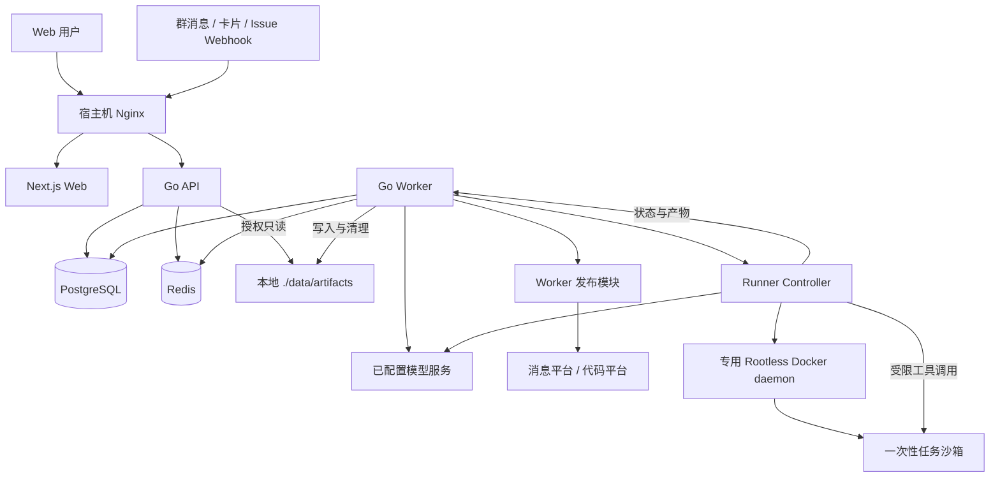
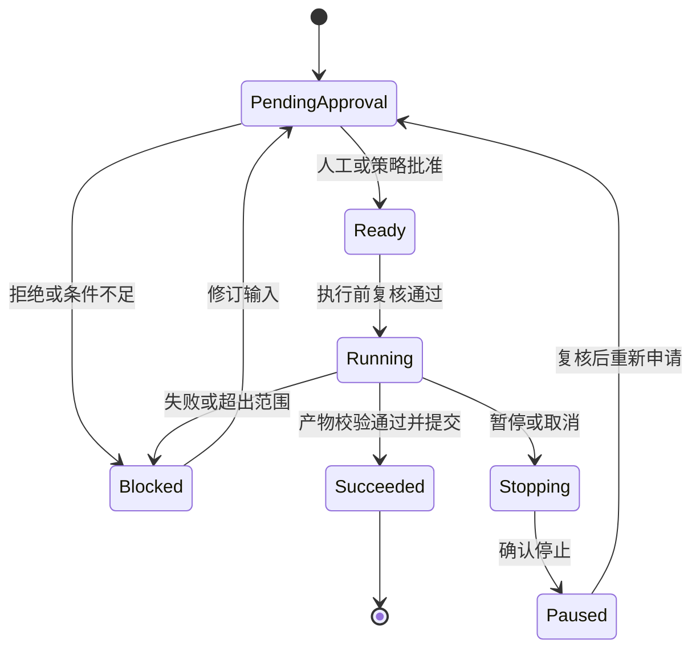
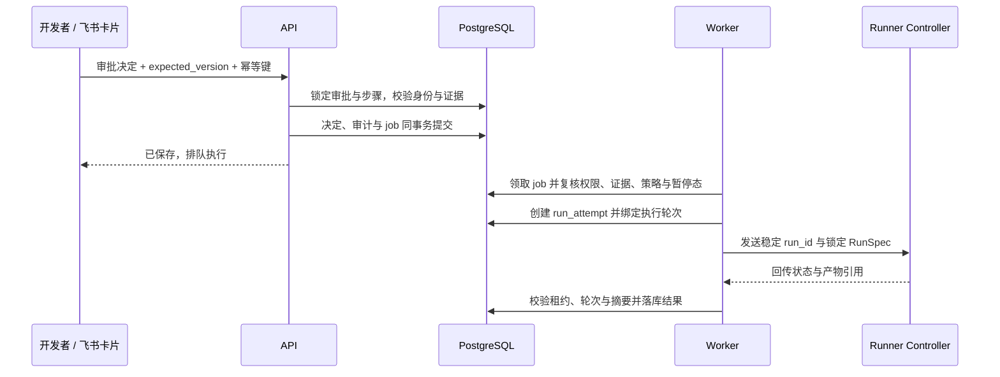

# AgentOwl 技术方案

版本：v0.1 · 架构基线  
日期：2026-10-27  
需求基线：[需求文档 v0.1](./requirements.md)  
范围：面向单个研发团队、主代码仓库和独立执行器的支持与开发全流程。

本文定义 AgentOwl 的系统架构、数据模型、审批协议与沙箱隔离方案。代码平台对接 GitHub，模型采用 OpenAI 兼容接口，开发 Agent 由 Runner Controller 内置的 Eino ReAct 驱动。实际部署和日常操作见 [运维手册](./operations.md)，测试边界见 [验证记录](./verification.md)。

## 1. 核心架构选型

系统由 **Next.js Web + Go API + Go Worker + Runner Controller + 一次性任务沙箱** 组成。API 与 Worker 共享同一个 Go Module 和领域服务，按进程职责分开部署；Runner Controller 专注受限执行，完全隔离于业务数据库和外部发布凭据之外。所有执行宿主均需在控制面登记为运行机器（Runtime Machine），选机结果绑定到每次执行尝试（attempt）。

| 关注点 | 设计方案 |
|---|---|
| 核心状态存储 | PostgreSQL 保存问题、知识版本、审批、任务、执行记录和外部操作结果 |
| 异步任务队列 | PostgreSQL `jobs` 表兼作事务 Outbox，Worker 按租约领取、续租、重试与恢复 |
| Redis | 仅用于缓存、登录限流和可丢失的临时协调，不承载唯一业务状态 |
| 产物与文件 | 问答、知识正文与测试摘要直接入库；代码快照、大日志和报告写入 `./data/artifacts`，数据库登记路径、SHA-256 与权限范围 |
| API 契约 | 以 `backend/api/openapi.yaml`（OpenAPI 3.1）为准，Kiota 生成 TypeScript 客户端 |
| 消息接入 | 应用机器人支持 HTTP 回调、长连接与定时同步；个人账号连接器按需另行评估 |
| 开发执行 | 开发者确认目标后，各阶段依据锁定的输入与证据按人工或策略审批放行 |
| 开发 Agent | Runner Controller 内嵌 Eino v0.9.22（`flow/agent/react`）驱动模型与工具循环，Controller 负责权限与证据校验 |
| 沙箱环境 | Runner Controller 调用专用 Rootless Docker daemon，每次运行创建一次性非 root 容器；控制面支持登记多台运行机器 |
| 模型与执行设置 | 管理员在 Web 端保存版本化配置，PostgreSQL 统一存储、模型密钥加密保存；执行尝试沿用启动时的配置快照 |
| 多机调度 | 运行机器登记执行地址、回调地址、状态、权重与镜像白名单；选机后写入 `run_attempts.runtime_machine_id`，中途不切换 |
| 上下文预算 | 开发上下文拆分为精简事实头和只读引用索引；用离线 `o200k_base` 分词器估算预算，大 diff 与日志分页按需读取 |
| 外部发布 | 发消息、推分支与建 PR 全部由 Worker 内部发布模块执行，开发 Agent 无任何外部写权限 |
| 前端刷新 | SWR 按页面活跃度定时轮询状态，暂不引入独立 WebSocket 推送服务 |
| 部署架构 | 宿主机 Nginx 处理 TLS 与反代，应用服务通过 Docker Compose 运行，持久化数据集中在 `./data` |

首期不引入额外消息中间件、通用工作流引擎、向量数据库、对象存储或动态插件框架，避免过度设计。

## 2. 系统拓扑与信任边界



Worker 内置发布模块负责全部对外写入。Runner Controller 是独立 Go 进程，内置 Eino ReAct 库调用模型并通过受限工具读写沙箱工作区；任何仓库命令都在沙箱容器内运行。多机部署时，Worker 先选定一台运行机器，再向其发起 `Start / Inspect / Stop / Collect / Acknowledge`；运行机器通过回调地址拉取最新配置、上下文引用和运行许可。一旦任务被某台机器接单，后续轮询、收产物和停止指令只发往这台机器。

| 组件 | 允许持有的能力 | 严格禁止的能力 |
|---|---|---|
| 浏览器 | 当前登录会话、业务 API 访问 | 模型密钥、平台 Token、数据库凭据 |
| API | 鉴权、业务事务、Webhook/卡片接收、文件授权下载、运行机器回调 | 执行仓库代码、访问 Docker Socket |
| Worker | 队列调度、知识同步、外部读写与发布、选机调度 | 在本进程执行仓库脚本、访问 Docker Socket |
| Runner Controller | 沙箱执行协议、专用 Rootless Docker 控制、阶段内模型调用 | 访问业务数据库、发群消息、持有仓库写凭据 |
| 任务沙箱 | 当次任务工作区、白名单工具、配置的网络与测试目录权限 | Docker Socket、其他任务目录、任何线上凭据 |

模型输出、群消息、Issue 正文、知识库内容和仓库源码全部按不可信输入处理，均无权授予或扩大任何系统权限。

## 3. 代码结构与模块划分

```text
Frontend/
  app/
    (workspace)/
  components/
  lib/
    api/
      generated/             # Kiota 生成物，禁止手改
      client.ts              # Cookie、CSRF、幂等键与错误封装
    stores/
  public/
backend/
  api/
    openapi.yaml
  cmd/
    api/
    worker/
    runner-controller/
    migrate/
  internal/
    httpapi/
    service/                 # identity、ingest、support、knowledge、workflow 等领域逻辑
    integration/
    runner/
    platform/
  migrations/
deploy/
  compose.yaml
  .env.example
  data/
script/
docs/
```

| 模块 | 职责范围 | 主要写操作 |
|---|---|---|
| `identity` | 登录、会话管理、飞书身份绑定、角色与资源授权 | 成员、身份绑定、会话、角色授权 |
| `ingest` | 入站事件接收、消息标准化、历史补采、能力探测与游标 | 平台账号、渠道、入站事件、来源消息 |
| `support` | 问题分类、Case 生命周期、答复生成、值班路由与时间线 | 问题、关联、回复草稿、值班配置 |
| `knowledge` | 知识来源同步、版本管理、可见范围、检索与发布撤回 | 知识来源、版本、检索切片、授权 |
| `workflow` | 开发确认、步骤流转、审批、策略、预算与外部操作管理 | 开发任务、步骤、审批、策略、发布记录 |
| `integration` | 飞书/Lark、GitHub、模型接口协议适配与加解密 | 纯协议适配，不直接写业务库 |
| `runner` | Runner 服务端与客户端、Eino 适配、沙箱控制、按需上下文读取协议 | 仅写本地运行清单，业务状态经内部 API 上报 |
| `platform` | PostgreSQL、Redis、本地文件读写、配置加载、结构化日志 | 基础设施层，不反向依赖业务模块 |

后端 HTTP 服务基于标准库 `net/http`，数据库使用 `pgx` 编写显式 SQL 与事务，迁移由独立 `migrate` 命令按版本号执行（已上线迁移不可改写）。HTTP Handler 和 Worker 共享同一套 `service` 方法，跨模块变更在单事务内原子完成。

## 4. 身份认证、平台接入与入站流水线

### 4.1 Web 会话与平台身份绑定

Web 端支持团队身份源（OAuth/OIDC）或内部本地密码登录，由 Go API 完成认证并颁发服务端会话。浏览器仅持有 `HttpOnly`、`SameSite=Lax`（HTTPS 下含 `Secure`）的会话 Cookie，不在 LocalStorage 存放令牌；所有写请求均校验 CSRF Token，登出或改权立即作废服务端会话。

对接 OAuth/OIDC 时使用授权码模式 + 绑定交易的 `state` + S256 PKCE，OIDC 额外核验 issuer、audience、签名与 `nonce`（遵循 [RFC 9700](https://www.rfc-editor.org/rfc/rfc9700.html)，不把飞书登录直接当标准 OIDC 处理）。

- **飞书身份绑定**：内部成员与外部账号按 `(provider, app_id, subject_id)` 明确绑定（飞书的 `subject_id` 为应用内 Open ID）。成员在登录状态下发起绑定，服务端交换授权码并读取用户信息；绑定交易绑定浏览器 `state`、S256 PKCE、应用配置版本和发起人当前会话，10 分钟过期且只能消费一次。用户 Token 不落库，也不传给模型或 Runner。
- **权限隔离**：飞书登录仅匹配已绑定且启用的成员，不按姓名或邮箱自动合并账号，也不改变成员角色或资源范围。每次认证都会重检成员、绑定状态和应用的登录开关，解绑立即注销相关会话。消息请求人、任务上下文和审批卡片共用同一套身份解析逻辑，群成员身份或卡片字段均无法绕过后端角色与资源检查。
- **管理员初始化**：首个管理员通过部署变量显式指定稳定身份，不会把第一个登录的人默认升为管理员。外部提问者凭已验证的平台身份和来源关系提交“已解决/未解决/转人工”反馈，无需成为内部成员。
- **细粒度鉴权**：采用“角色 + 资源范围”双层检查——角色控制能做什么操作，资源范围限制能看哪些渠道、模块和仓库，列表、详情、搜索、下载和后台任务口径一致。

### 4.2 平台账号与能力矩阵

每个平台账号记录区域、应用标识、加密凭据、健康状态、检查时间和七项细分能力状态（实时 `@`、普通群消息、历史读取、话题读取、附件读取、发消息、卡片回调）。

适配层按需暴露 `VerifyInbound`、`NormalizeEvent`、`FetchHistory`、`FetchResource`、`Send`、`LookupOperation` 等清晰接口，不做可加载任意代码的插件机制。未通过检查的能力标为 `unverified`，不会被后台调度调用。飞书外部群与历史接口行为均需在目标租户实测确认（参考 [外部群机器人](https://open.feishu.cn/document/develop-robots/add-bot-to-external-group?lang=zh-CN)、[历史消息接口](https://open.feishu.cn/document/uAjLw4CM/ukTMukTMukTM/reference/im-v1/message/list)）。

### 4.3 HTTP 事件入站流程

1. 宿主机 Nginx 限制请求体大小与速率；API 按平台协议验签、解密并校验应用与租户身份（Handshake 与业务事件分开处理）。
2. 校验渠道白名单和采集起始时间，未授权来源直接忽略。
3. 在内存中对敏感凭据做脱敏处理并提取标准化字段；原始报文仅用于验签，默认不落盘。
4. 在单个事务内写入 `ingest_events` 和对应 `jobs`，唯一键冲突直接返回已接收；事务提交后再向平台 ACK，数据库异常返回可重试错误。
5. Worker 先将授权可见消息写入 `source_messages` / `source_message_versions`，再按渠道触发策略创建或更新 Case。未 `@` 机器人且不满足主动识别策略的群消息只进入来源归档，不创建 Case；私聊、GitHub、自动回复渠道和已关联线程继续按策略触发。
6. Worker 异步拉取上下文、按需读取附件、调用模型分类并决定生成草稿或转人工——ACK 路径绝不等待模型或开发任务。

由于平台存在重复推送和响应超时限制，接入以“事件安全落库”作为 ACK 边界（参考 [飞书事件订阅说明](https://open.feishu.cn/document/uAjLw4CM/ukTMukTMukTM/event-subscription-guide/event-subscriptions)）。

标准化事件核心字段包括：`connector_id`、`event_id`、`kind`、`channel_id`、`external_message_id`、`root_id`、`parent_id`、`thread_id`、`actor_ref`、`source_revision`、`occurred_at`、`received_at`、`sanitized_content`、`attachment_refs`。事件去重按平台投递 ID，消息去重按平台消息对象 ID；编辑生成新版本，撤回标记失效；若平台缺乏可靠版本号，则反查对象最新状态，不盲目按到达顺序覆盖。

### 4.4 历史补采、Issue 与附件处理

- **历史补采**：记录采集范围、分页游标、最近成功点和缺失区间；实时推送与历史拉取共享消息唯一键，根消息与话题回复分别补采。
- **Issue 与 PR 同步**：首帖、评论和状态变化均标准化为来源记录，Case 与外部 Issue/PR 通过显式关联维护；除 Webhook 外配合定时增量轮询补漏。
- **附件安全**：一律通过平台连接器按原权限抓取，限制文件类型、体积、解压大小与下载耗时，不直接请求消息里的任意外部链接；远程抓取严格校检目标主机、重定向和解析 IP，阻断内网及云元数据地址（SSRF 防护）。
- **引用与摘录**：附件默认仅存引用、按需授权下载；已用于回答的脱敏摘录和来源版本直接入库保存，避免原附件过期导致历史答复失去依据。
- **卡片回调**：在平台时限内落库业务决策并快速响应，耗时操作交由 Worker 异步执行，超时或丢响应时可在 Web 端查询最终状态（参考 [飞书卡片回调](https://open.feishu.cn/document/event-subscription-guide/callback-subscription/callback-overview)）。

## 5. 数据模型

### 5.1 核心表分组

业务主键统一使用 UUID，时间字段使用 UTC `timestamptz`（前端按用户本地时区渲染）。可变记录维护递增 `version` 实现乐观锁，不可变证据按版本追加。

| 表组 | 职责与核心字段 |
|---|---|
| `principals` / `identity_bindings` / `role_grants` | 团队成员、平台身份绑定、角色与资源范围、撤销状态及权限版本 |
| `sessions` | 会话 ID 摘要、成员、CSRF Token、过期时间与可选的平台绑定 ID（不存上游 Token） |
| `lark_login_transactions` | 一次性 `state` 摘要、PKCE verifier、应用配置版本、发起成员/会话摘要与过期时间 |
| `connectors` / `channels` | 平台账号、凭据引用、能力矩阵、渠道白名单、回复方式、健康状态与同步游标 |
| `ingest_events` | 投递唯一键、消息引用、标准化事件、接收与消费状态 |
| `source_messages` / `source_message_versions` | 外部消息标识、root / parent / 话题关系、发送者、当前版本、脱敏正文、撤回标记、附件引用和内容摘要；AgentOwl 自己发出的回复与通知也会写回该归档 |
| `source_actors` / `source_message_files` / `source_sync_status` | 平台发送者名称缓存、消息附件引用状态、历史补采覆盖度和最近缺口 |
| `cases` / `case_sources` / `case_events` | 分类、优先级、环境、负责人、状态、规范问题 `canonical_case_id`、回复模式 `reply_mode`、来源关联与追加式时间线 |
| `replies` / `answer_evidence` | 回复版本、目标渠道、审核状态、正文摘要、引用的知识/图片依据 |
| `owner_routes` | 模块主备负责人、通知渠道、认领与处理时限 |
| `repositories` | 代码平台、仓库标识、起始分支、允许路径、凭据引用、运行镜像与测试配置 |
| `dev_tasks` / `task_revisions` | 规范问题、确认人、目标仓库、当前阶段、执行轮次（epoch）；不可变的目标与验收条件版本快照 |
| `task_steps` / `run_attempts` | 阶段、输入/输出摘要、状态、运行 ID、选定的运行机器、租约、执行轮次、错误与用量 |
| `approvals` / `approval_decisions` | 锁定的操作参数与证据、审批状态；追加式人工/自动决定与撤销记录 |
| `policies` / `policy_versions` | 生效中的审批策略、启停状态、通知配置与不可变策略版本 |
| `system_settings` | `model`、`execution` 两条全局配置：`data` 存明文参数，`secret` 存加密模型密钥，各自带独立版本与修改审计 |
| `knowledge_sources` / `knowledge_versions` | 来源修订、权限有效期、适用版本/环境、发布状态、受众范围与审核人 |
| `knowledge_chunks` / `knowledge_grants` | 可重建检索切片、来源位置、可见范围与权限版本 |
| `artifacts` | 本地相对路径、SHA-256、字节数、类型、所属任务/问题、可见范围与过期时间 |
| `jobs` | 事务内入队的异步任务、业务幂等键、类型、状态、重试次数与租约 |
| `external_operations` | 回复/通知/推送/PR 的操作记录、审批引用、请求摘要、结果状态与远端 ID |
| `audit_events` | 操作人、动作、资源、前后版本、依据、结果与请求 ID（不记录密钥或完整 Prompt） |

`JSONB` 仅用于存放环境信息、扩展属性与锁定快照；状态、权限、外键与调度字段均采用独立结构化列并建索引。

### 5.2 关键一致性约束

- `ingest_events` 按 `(connector_id, event_id)` 唯一；缺乏稳定事件 ID 的平台由适配层构造确定性去重键。
- `source_messages` 按 `(connector_id, channel_id, external_message_id)` 唯一，消息版本按 `(message_id, source_revision)` 唯一。
- Case 默认以自身为 `canonical_case_id`；归并重复问题时仅支持扁平指向同一主问题，禁止循环引用，且不扩大任何渠道的可见权限。
- 通过部分唯一索引保证同一 `(canonical_case_id, repository_id)` 最多存在一个活跃开发任务；合并问题组时按固定顺序加锁，若双方都已有活跃任务则交人工整合。
- `task_steps` 在同一修订下阶段唯一，`run_attempts` 的运行 ID 唯一，过期 attempt 不能推进当前阶段。
- `jobs` 按 `(对象 ID, 版本, 任务类型)` 唯一，自动重试复用同一记录，人工重跑生成新尝试。
- `external_operations` 按业务动作、目标和内容版本建唯一键，无法通过换随机请求 ID 绕过防重保护。
- 单条审批仅允许一个生效决定，撤销与重提采用追加记录，绝不涂改历史证据。

### 5.3 本地产物与事务一致性

普通问答、知识正文与测试摘要直接存数据库；体积较大的代码快照、diff 和日志由 Worker 先写入 `./data/artifacts` 的临时区，校验 SHA-256 并落盘后同文件系统原子改名，再在事务中登记为 `ready`。只有文件就绪且状态为 `ready` 时才允许下载或作为审批依据。

已绑定审批的产物禁止原地覆盖；清理孤儿文件时会跳过活跃任务仍在引用的产物。单机部署下 Worker 读写挂载 `./data/artifacts`，API 只读挂载，Runner Controller 与任务沙箱均不可见该目录。API 下载接口校验权限后流式输出，严格防范路径穿越与软链接越界。

## 6. 异步任务、并发控制与外部写入

### 6.1 Worker 队列与预算

业务状态变更、审计日志和 `jobs` 在同一个数据库事务内提交。Worker 使用短事务搭配 `FOR UPDATE SKIP LOCKED` 领取到期任务（参考 [PostgreSQL 行锁说明](https://www.postgresql.org/docs/current/sql-select.html#SQL-FOR-UPDATE-SHARE)），分配唯一 `lease_token` 与租约截止时间，提交事务后再调用模型或外部接口。

续租、写回结果和状态推进必须同时校验当前租约、对象版本、任务 `epoch` 和暂停状态，彻底杜绝僵尸 Worker 覆盖新结果。可重试错误按指数退避加抖动重试；鉴权失效、非法参数和能力缺失直接转阻塞。

模型调用和开发执行前按配置原子预占预算，完成后按实结算（结果不明的调用保持预占直到核对完成）。当单次任务 Token 上限设为 `0`（不限）时，启动时预占当日剩余总额度、结束后按实际消耗多退少补，期间其他并发模型调用可能短暂等待；每日总额度限制始终独立生效。Redis 不可用时限流自动转入保守降级。

### 6.2 三层防重与结果核对

| 层级 | 防范场景 | 保障手段 |
|---|---|---|
| 入站层 | 平台重投、实时与历史重叠 | 投递唯一键 + 消息对象唯一键 |
| 业务层 | 连点、并发审批、Worker 重放 | 乐观锁版本、行锁、业务唯一键、租约与 `epoch` |
| 外部写入层 | 重复发消息、重复推分支/建 PR | 持久 `external_operations`、平台幂等参数、`outcome_unknown` 对账 |

外部写入状态按 `pending → dispatching → succeeded / failed / outcome_unknown` 流转。超时、断连或发包后进程崩溃时一律记为 `outcome_unknown`，随后通过远端消息 ID、任务标记、分支或 PR 主动查询核对；无法可靠核实的操作转交人工，绝不盲目重发。

### 6.3 取消与恢复语义

暂停或取消操作先在事务内递增 `epoch`、取消未领取的排队任务并拦截未发出的外部写入，再通知 Runner Controller 终止沙箱。对于已经进入 `dispatching` 的远端请求，无法保证撤回，最终状态以远端核对结果为准。租约过期的任务不会立刻重开第二个容器，Worker 会先查询已有 `run_id` 确认旧容器已退出，再创建新的 attempt。

## 7. 问题分诊、模型调用与知识检索

### 7.1 分诊与答复流水线

```text
标准化消息 → 上下文归集 → 范围识别与环境抽取 → Case 创建/关联
         → 受众与版本过滤 → 知识检索 → 结构化答复草稿
         → 引用与脱敏核查 → 审批或策略放行 → 受控发送
         → 用户反馈 / 人工处理 → 知识草稿候选
```

确定性规则先行过滤机器人自身消息、重复事件和未授权渠道；模型只做语义分类、环境抽取和草稿生成，输出受服务端 JSON Schema 严格校验（字段缺失、枚举非法或引用了不存在的知识 ID 时直接退回重试或转人工）。普通日志只记录模型版本、Prompt 版本、用量与摘要，不打印完整 Prompt 或群聊原文。

### 7.2 检索与版本匹配

首期依托 PostgreSQL 实现确定性过滤 + 文本检索：

1. 先按渠道受众、`published` 状态、来源权限有效期、模块及 CLI 版本/环境条件做硬过滤。
2. 对错误码、命令名和专业术语做精确匹配，正文按章节切片并保留原位置。
3. 英文与命令做词项检索，中文及一般文本补充 `pg_trgm` 相似度匹配（参考 [PostgreSQL pg_trgm](https://www.postgresql.org/docs/current/pgtrgm.html)），短词走受限集合内的精确/包含匹配。
4. 合并排序后取受限数量片段送入模型，且模型回答只能引用这些给定片段的 ID。

版本信息缺失或候选知识相互冲突时，系统会要求补问或转人工，不会猜测版本。

### 7.3 权限隔离、缓存与发前复核

外部群仅允许检索已获公开授权的知识。缓存键包含受众范围、权限版本和知识版本，不做跨受众缓存。来源撤权时同步置为不可检索并递增权限版本，索引与缓存异步清理。

回复正式发出前会再次核对答复版本、引用有效性、渠道可见性、审批策略与 `reply_mode`。处理人点击接管会在事务内切至人工模式并作废尚未发出的自动草稿；原消息编辑或撤回同样会使旧草稿失效。

### 7.4 值班路由与提醒

`owner_routes` 按模块查找主备负责人和通知渠道，认领操作带版本校验防并发覆盖。认领超时和处理超时由延迟 `jobs` 驱动，触发前先核实问题是否已解决或转派，同缺陷爆发时聚合提醒。

## 8. 开发状态机与审批协议

### 8.1 阶段与状态流转

开发者确认修改目标、仓库和验收条件后创建首个任务修订，后续阶段固定为 `plan → edit → test → review → publish_pr → track`。



上图描述单个步骤的生命周期。任务级取消为终态，如需重启须重新创建；任务修订（revision）与每次执行尝试（attempt）分开记录。

### 8.2 锁定的审批证据

每条待审批操作都生成 `ActionSpec`，按确定字段顺序序列化并由服务端计算 SHA-256。开发步骤同时绑定 `model_version`、`execution_version` 以及当次网络、文件系统和配额配置。模型或任务执行设置一旦更新，尚未执行的旧审批会在同一事务中置为 `stale`，关联任务转为 `blocked`，恢复后按新配置重新审批；正在运行的 attempt 则继续沿用启动时的配置快照。

| 操作 | 绑定证据 |
|---|---|
| 确认修改 | Case 版本、目标仓库、预期目标、验收条件、授权开发者 |
| 制定方案 | 任务修订、仓库基线提交、可读范围、模型与预算 |
| 修改代码 | 方案版本、基线、允许路径/操作、工具策略与预算 |
| 运行测试 | 待测代码快照摘要、测试命令参数、镜像 digest、网络与写入选项 |
| 代码审查 | 最终代码快照、diff、测试报告、审查范围与模型配置 |
| 提交 PR | 最终 commit/tree、diff、测试与审查报告、目标分支与 PR 正文 |
| 发回复 / 发知识 | 正文摘要、目标渠道/受众、引用来源版本、发布权限 |

测试阶段默认只读挂载源码、构建输出写独立目录。开启 `test_workspace_writable=true` 时，Runner Controller 在专用 daemon 中创建本次专属匿名 Docker 卷挂载到 `/workspace`，将审批源码复制到 `/workspace/source` 运行测试（原审批快照不挂入容器）。测试结束后，Controller 会先核验容器标识、spec 摘要和卷挂载路径，再只读比对临时卷中所有原审批文件的内容和执行权限——允许新增依赖和构建产物，但只要原文件被修改、删除、改权限或换成软链接，测试立即判定失败。最终归档和 PR 只取原审批快照，匿名卷在任务结束后销毁。

### 8.3 审批执行与二次核验



人工审批和自动策略走同一套状态转换函数。操作者身份只从服务端会话或已验签的平台绑定获取，绝不信任客户端传来的用户 ID。真正启动执行前，Worker 会重新检查审批未撤销/未过期、审批人权限仍在、证据未变、任务未暂停且未被新策略禁止——人工批准也不跳过这项执行前检查。

### 8.4 统一审批策略

创建开发任务（`create_task`）、发送回复、发布知识和五个开发步骤统一存放在 `configs.kind=policies`，共用策略 CRUD、版本控制、权限校验、异步执行和审批通知。

规则仅匹配固定字段（操作类型、渠道、仓库、允许路径、改动文件数/Token/时长上限、有效期、通知开关），不支持动态脚本。优先级固定为：**全局暂停 → 明确禁止（deny）→ 风险事实不足或命中人工（manual）→ 满足全部自动条件（auto）→ 默认人工**。命中多条自动规则时，权限与额度取最严交集。即使开发者手动点击创建开发任务，仍会检查渠道与仓库的禁止策略。

## 9. 沙箱隔离与代码发布

### 9.1 Runner Controller 与专用 Rootless Docker

Linux 宿主机为 Runner 提供独立的低权限系统账号和专用 Rootless Docker daemon。Compose 中只有 `runner-controller` 能访问其受限控制 Socket（`./data/runner/control`），不连接宿主机主 Docker，也不挂载 `/var/run/docker.sock`；API、Worker 和任务容器均无 Docker Socket 权限。

专用 daemon 的 `data-root` 位于 `./data/runner/runtime`，部署脚本记录绝对路径 `RUNNER_HOST_DATA_ROOT`，Controller 始终按任务和 attempt ID 映射宿主机路径与容器路径。执行设置里的 `resource_limits` 仅接受 `required`（默认，要求 cgroup v2 及 CPU/内存/PID 限额）或 `disabled`（仅内部开发环境使用，强制 `max_concurrent=1`，仍保留专用 Rootless daemon、独立容器、非 root 用户和运行许可校验）。参考 [Rootless Docker](https://docs.docker.com/engine/security/rootless/) 与 [资源限制文档](https://docs.docker.com/engine/security/rootless/tips/#limiting-resources)。

Controller 启动时先核验专用 runtime 身份并清理残留中断任务；每次接单前重新通过内部接口拉取模型与执行配置，校验版本号和宿主能力。模型密钥仅在 Controller 进程内存中使用，绝不写入清单、日志、产物或容器环境。

### 9.2 执行协议、工具边界与按需上下文

Controller 仅在内部网络暴露带服务鉴权的 `StartRun`、`InspectRun`、`StopRun`、`CollectArtifacts` 接口。容器名由稳定 `run_id` 派生并打上任务、attempt、轮次与输入摘要标签；遇到超时或重启时先查 runtime 已有容器再决定对账或清理，避免重复起容器。启动和运行期间持续向 API 内部端口校验运行许可，失联或撤权后立即中断工具调用并销毁容器。

开发 Agent 基于 Eino v0.9.22（`flow/agent/react`）运行在 `backend/internal/runner/agent.go`，通过 `ExecuteSequentially: true` 强制工具串行执行，并按阶段收紧权限：

- **`plan` 与 `review`**：只读任务文件与上下文引用，禁止执行仓库命令。
- **`edit`**：仅允许读写批准路径内的文件，默认无通用 Shell；需要跑命令必须走测试控制点。
- **`test`**：由 Controller 直接在容器内执行经审批的固定命令参数、镜像与环境变量，不经过模型循环，如实记录退出码和日志。

Controller 在每次模型调用和文件读写前均核验运行许可和正数配额（填 `0` 不限单次）。在 `network_mode=bridge` 且根文件系统只读时，文件工具通过 `os.OpenRoot` 安全访问本次工作区并校验路径与软链接，其余组合通过 Docker archive 接口读写；仓库测试命令始终在容器内运行。

#### 按需上下文

开发上下文在步骤准备事务中锁定到执行输入并纳入审批 `input_hash`。Manifest v2 的事实头包含请求人、任务授权人、机器人、来源会话、任务修订和授权摘要；资料索引指向问题详情、采用的信息、参考信息、来源消息上下文、已完成阶段的报告以及 diff / 日志。来源消息原文只从已经采用或明确标为参考的信息读取，手动创建问题的描述也可作为资料读取。

`read_context_manifest` 返回完整资料索引；`read_context_ref` 按引用 ID 和 cursor 分页读取原文，每页最多 1536 个 Unicode 字符，返回内容 SHA-256、位置、总字符数和续读游标。采用的信息索引包含 `read_task_input` 所需的 ID，其送达和入模回执继续按输入摘要记录。上下文读取每次都校验运行许可、机器归属和来源版本，无法凭任意 artifact ID 越权读取其他资料。上下文预算使用离线 `o200k_base` 分词器估算，而非按字节粗估。

来源消息上下文由 `source_messages` 构建，按需提供当前消息、引用链、话题窗口、同线索 recent window、上一轮问答、常驻上下文、相关知识候选和覆盖状态。群消息不会无差别注入 Prompt；Manifest 只提供引用与摘要，正文分页读取。`standing_context` 和 `related_knowledge` 只返回当前渠道可见且已发布的知识版本，其中相关知识作为候选提供，不自动视为既定事实。

任务、审批和产物的可见范围覆盖所有已关联输入的来源权限，一旦授权人失去来源访问权，运行许可立即失效。会话覆盖度如实标明本系统已收到的消息和可见的历史补采状态，并非飞书全量历史。支持问答继续使用有长度上限的输入与已筛选知识，同时携带一致的请求人与会话事实。

运行机器通过声明 `context_manifest_version: 2` 表明支持该协议，准备了 v2 上下文的任务只会调度到兼容的机器。

### 9.3 沙箱生命周期

1. Worker 通过只读连接拉取固定基线构建源码清单，子模块或外部依赖必须显式配置。
2. Controller 核验输入摘要后解包至 `./data/runner/tasks/<task>/<attempt>`，拒绝路径穿越、越界软链接、危险文件类型和超限归档。
3. 启动一次性容器：非 root 用户、丢弃全部 Linux capabilities、`no-new-privileges`、受限 seccomp、不挂载 Docker Socket；按配置决定根文件系统是否只读、网络为 `none` 或 `bridge`、以及是否使用临时可写测试卷。
4. 若 `timeout_seconds` 为 `1–3600` 则按时限超时终止，填 `0` 不设超时计时器（暂停、审批失效或撤权仍立即终止整个容器）。
5. 宿主机工作区和 runtime 文件系统本身具备容量与 inode 边界。五项用量上限默认 `0`（不限单次），填正值时 `workspace_mb` / `max_files` 同时约束容器 `/tmp` 与 `/output` 的 tmpfs 配额；可写测试卷中的新增依赖不计入快照大小和文件数，受 runtime 盘总容量约束。
6. 执行完毕后 Worker 通过 `CollectArtifacts` 拉取并核验 diff、日志与测试报告，摘要入库、大产物原子落盘，随后销毁沙箱。

### 9.4 Git 提交与 PR 发布

Worker 发布模块在独立临时目录接收已批准的改动清单，关闭 Git hook 和外部 filter，核对基线、路径白名单和最终 tree 后构造 commit 与 PR 正文，且绝不在持有写凭据的环境执行测试或安装依赖。

推送前再次校验最终审批绑定，仅允许向任务专属分支做非强制推送（附带预期远端引用值防覆盖人工提交），再按任务关联标记创建或更新 PR。推送分支和创建 PR 拆为两条关联的 `external_operations`：若推送成功而建 PR 超时，对账阶段只查询补建 PR，绝不重复建分支。`track` 阶段只同步 CI、Review 和合并状态，不自动合并。

## 10. API 契约

### 10.1 通用规范

- 业务接口统一挂载 `/api/v1`，以 `backend/api/openapi.yaml`（OpenAPI 3.1）为唯一定义，所有接口有稳定 `operationId`，列表采用游标分页（`items`、`next_cursor`），时间格式为 RFC 3339。
- 修改请求携带 `expected_version`，产生外部动作或审批决定的写请求携带 `Idempotency-Key`。状态码语义明确：版本冲突 `409`、参数错误 `422`、未登录 `401`、无权限 `403`；对无权访问的资源隐藏存在性。
- 错误体采用 `application/problem+json`，附带稳定 `code` 和 `request_id`，不泄露堆栈、SQL、密钥或原始上游报文。异步操作返回 `202` 与可查询任务引用。
- 前端全部走 Kiota 生成客户端，CI 校验生成漂移，手写封装仅处理 Cookie、CSRF、幂等键与错误转换（参考 [Kiota TypeScript](https://learn.microsoft.com/en-us/openapi/kiota/quickstarts/typescript)）。

### 10.2 主要接口分组

| 路径 | 用途 |
|---|---|
| `GET /auth/login`、`GET /auth/callback`、`POST /auth/logout` | Web 登录与登出流程 |
| `GET /api/v1/me`、`PATCH /api/v1/me` | 当前用户信息、权限范围、CSRF 初始化与资料更新 |
| `/api/v1/cases`、`/{id}`、`/{id}/actions`、`/{id}/feedback`、`/{id}/relations`、`/{id}/events` | 问题管理、状态操作、用户反馈、重复关联与时间线 |
| `POST /api/v1/cases/{id}/reply-drafts`、`POST /api/v1/replies/{id}/submit` | 生成/保存回复草稿与提交发送审批 |
| `POST /api/v1/cases/{id}/development-confirmations` | 开发者确认修改并创建开发任务 |
| `/api/v1/development-tasks`、`/{id}`、`/{id}/revisions`、`/{id}/actions`、`/api/v1/run-attempts/{id}/events` | 开发任务查询、修订、控制操作与增量运行日志 |
| `/api/v1/approvals`、`/{id}`、`/{id}/decisions` | 审批待办、证据查看与批准/拒绝/撤销 |
| `/api/v1/knowledge`、`/{id}`、`/{id}/versions`、`/{id}/submit`、`/{id}/withdraw`、`/api/v1/knowledge-sources` | 知识库全生命周期与外部来源同步 |
| `GET /api/v1/artifacts/{id}/content` | 经资源授权校验的产物下载 |
| `/api/v1/connectors`、`/channels`、`/owner-routes`、`/policies`、`/principals`、`/identity-bindings`、`/repositories`、`/runtime-machines` | 接入、团队、路由、审批策略、仓库与运行机器配置 |
| `GET/PUT /api/v1/settings/model`、`GET/PUT /api/v1/settings/execution` | 模型接口与任务执行设置（带版本校验） |
| `/api/v1/audit-events`、`/api/v1/external-operations/{id}`、`/api/v1/jobs` | 操作审计、外部操作核对与后台任务管理 |
| `POST /hooks/{provider}/{connector_id}/events`、`/actions` | 平台事件与交互卡片入口（走平台验签，不走 Web Cookie） |

Runner 内部接口（运行许可校验/续期、配置读取、上下文引用读取）监听独立内部端口并使用机器令牌认证，不经公网 Nginx 暴露，也不提供直接改写审批状态的能力。

## 11. 前端架构

前端采用 React + Next.js App Router + TypeScript，UI 基于 Tailwind CSS 4、shadcn-ui、Radix UI、Lucide 与 Geist；Sonner 负责提示，cmdk 提供命令面板和搜索下拉，Zod 负责前端边界校验。

| 路由 | 页面职责 |
|---|---|
| `/` | 概览指标、异常提醒、最近问题、开发进展与动态 |
| `/cases`、`/cases/[id]` | 问题收件箱、来源消息、附件下载、回复草稿、反馈、时间线与开发确认 |
| `/approvals`、`/approvals/[id]` | 审批列表与锁定证据详情（方案、改动路径、测试报告、执行配置） |
| `/development`、`/development/[id]` | 开发任务列表、分阶段进度、补充信息、产物下载、增量日志与控制操作 |
| `/knowledge`、`/knowledge/[id]` | 知识检索、版本维护、可见范围与审批/撤回 |
| `/settings/[section]` | 平台账号、消息渠道、代码仓库、运行机器、知识来源、模型接口、任务执行、团队成员、身份绑定、值班安排与审批策略 |
| `/audit`、`/jobs`、`/profile` | 操作记录与平台操作核对、失败后台任务处理、个人资料与飞书账号绑定 |

- **数据同步**：SWR 管理服务端数据（活跃任务详情约 5 秒轮询，列表 10–15 秒，后台标签自动暂停），Zustand 仅存抽屉/命令面板等本地 UI 状态。
- **并发与安全展示**：操作提交后刷新真实状态，不做激进乐观更新；遇 `409` 提示刷新并保留未提交表单供核对。Markdown 禁用原始 HTML，日志和外部链接均按不可信文本渲染。
- **配置表单细节**：密钥只写不读，换模型地址须重填或显式清除；运行机器状态每 10 秒刷新，宿主机不支持 cgroup 限制时禁用 `required` 选项，`disabled` 时自动锁定并发为 1；五项用量上限接受 `0`（显示为“不限”）或任意安全正整数。

## 12. 部署、目录布局与备份迁移

### 12.1 服务暴露与网络隔离

| 服务 | 网络暴露 | 数据与挂载 |
|---|---|---|
| `web` | 仅宿主机回环端口（经 Nginx 反代） | 无不可恢复状态 |
| `api` | 公网仅经 Nginx；内部端口连 Runner 网络 | 最小数据库账号与入站凭据；只读挂载 `./data/artifacts` |
| `worker` | 不开放端口 | 数据库、模型、连接器与发布凭据；读写挂载 `./data/artifacts` |
| `runner-controller` | 仅 Worker 与 API 内部可达 | 挂载 `./data/runner`；无数据库和发布凭据 |
| `postgres` / `redis` | 仅业务内部网络 | `./data/postgres`、`./data/redis` |
| 任务沙箱 | 专用 daemon 管理，默认断网 | 仅挂当次任务工作区或临时测试匿名卷 |

宿主机 Nginx 将 `/` 转发到 Web，将 `/api/v1`、`/auth`、`/hooks` 转发到 API，并拦截 `/internal/`。应用业务网络与 Runner 控制网络互相隔离，数据库迁移由一次性任务完成，避免多容器并发抢跑。

### 12.2 `./data` 目录布局

```text
deploy/data/
  postgres/
  redis/
  artifacts/                 # Worker 写入的持久化执行产物
  runner/
    control/                 # 临时控制 Socket（启动重建）
    runtime/                 # 专用 Rootless daemon 数据与临时测试卷
    tasks/                   # 按任务和 attempt 隔离的临时工作区
    manifests/               # Controller 运行清单
  secrets/                   # 密钥文件（严禁提交 Git，绝不进模型上下文）
  backups/                   # 一致性冷备归档与 SHA-256 校验清单
```

所有持久化挂载统一相对 `deploy/compose.yaml` 指向 `./data/...`，不使用散落的命名卷。应用级加密主密钥从受限 secret 文件挂载，支持密钥版本与轮换。

### 12.3 迁移与恢复流程

1. 进入维护窗口：停止接收外部新任务，暂停调度与发布，核对在途外部操作。
2. 终止活跃沙箱并收集需保留产物（不靠拷贝运行中容器来迁移任务）。
3. 停机后执行冷备脚本打包数据库、产物、配置与恢复密钥，生成 SHA-256 校验文件。
4. 目标主机准备好兼容系统环境、UID/GID、subuid/subgid 映射与磁盘挂载，恢复归档后重新执行 Runner 初始化和预检。
5. 启动后先暂停外部发布，核查迁移版本、产物校验和审批状态，完成远端对账后再逐项放开接入。

## 13. 可观测性与测试策略

### 13.1 日志与健康检查

结构化日志串联 `request_id`、`case_id`、`job_id`、`run_id` 和 `external_operation_id`，屏蔽原文、Prompt、密钥和带鉴权的 URL。健康检查分别覆盖存活探测、数据库就绪、模型状态和运行机器隔离预检；模型或 Runner 异常时，已授权消息依然正常落库，仅暂停依赖它们的功能。

### 13.2 验证映射

| 测试类别 | 核心覆盖点 | 对应验收项 |
|---|---|---|
| 接入契约与租户实测 | 验签、重投、历史/话题补采、缺权处理与外部群实测 | AC-01、AC-02 |
| 分诊与答疑评测 | 标注集准确率、版本匹配、缺证据转人工与覆盖率 | AC-03、AC-04 |
| 多端关联 | 跨群反馈、Issue 评论、重复归并、编辑/撤回重评 | AC-05 |
| 事务与审批 | 并发审批、旧卡片、撤权、策略变更、改代码失效旧批 | AC-06～AC-09 |
| 沙箱隔离 | 路径穿越、工具越权、断网/联网边界、资源耗尽与强制停止 | AC-10、AC-11 |
| 知识管理 | 内外可见性隔离、过期、撤权、发布与撤回 | AC-11、AC-12 |
| 发布与跟踪 | 推送成功建 PR 超时、CI 失败、关闭未合并、版本跟踪 | AC-07、AC-13 |
| 恢复演练 | ACK 后崩溃、租约过期、沙箱失联、未知结果对账与冷备恢复 | AC-14 |

数据库并发测试必须跑在真实 PostgreSQL 上，沙箱隔离必须在目标 Linux 宿主机实测；Mock 测试、测试租户和生产验收结论分开汇报。CI 覆盖 Go 静态检查与 race 测试、前端 lint/typecheck/单测/构建、OpenAPI 与 Kiota 漂移校验以及 Compose 检查。

## 14. 上线前需落实的环境前置项

未完成实际核验的外部能力默认保持关闭：

| 接入项 | 待确认内容 | 放行前提 |
|---|---|---|
| 群聊接入 | 飞书/Lark 区域、应用归属、首批群清单 | 逐项能力检查与失效场景测试通过 |
| 代码仓库 | 仓库白名单、允许路径、分支规则与测试命令 | 读写同步、幂等核对与 Draft PR 实测通过 |
| 身份源 | OIDC 配置、成员映射与初始管理员 Subject | 登录、登出、撤权与卡片身份映射通过 |
| 模型服务 | 数据合规范围、结构化 JSON 与工具调用兼容度、预算 | Schema 校验、用量统计与问答/改码质量达标 |
| 运行机器 | Linux 宿主机、Rootless Docker、资源限制模式与磁盘边界 | 初始化、预检、启停、对账与工具链镜像实测通过 |
| 值班与知识 | 初始文档来源、公开范围、维护者与值班路由 | 知识可追溯、转人工确有值班人接收 |
| 工具链版本 | Go、Node.js、Next.js 与 Kiota 固定版本 | 契约生成无漂移、CI 全绿 |
| 容量与留存 | 日消息量、并发数、模型预算与归档保留期 | 质量指标与冷备恢复演练达标 |
